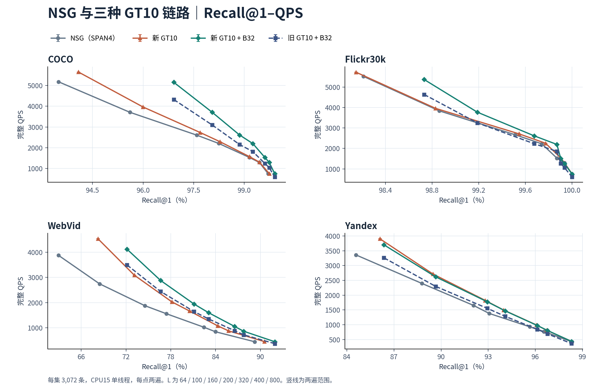
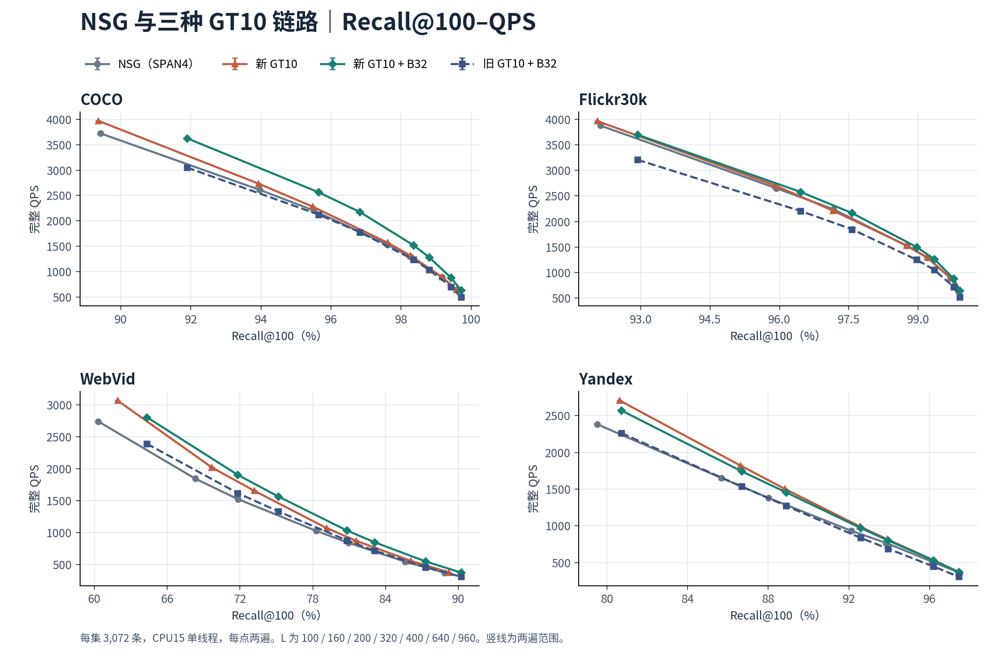

# E212 四集同期对比

对比 NSG（固定单入口、SPAN4）、新 GT10、新 GT10+B32、旧 GT10+B32。新 GT10 使用 E211 发布内核，GT10 画像沿原配置，WebVid 用 soft-t1，其他三集用 hard。补点版共用原 B32 表。全部四集使用既有 NSG 图和原始内积。每集 3,072 条公开查询，真实 K1/K100 各7档 L，224点448批，CPU15 单线程，完整 QPS 取两遍均值。

- 新、旧 GT10+B32 的 56 组同 K/L 返回逐字节相同。新版本完整 QPS 变化 **+13.43% 至 +27.54%**，均值更快 56/56，慢遍快于旧版快遍 56/56。
- 同用 SPAN4 时，新 GT10 相比固定单入口在 35/56 个同 L 点增加平均 Recall。完整 QPS 包含路由成本，各集各 K 见下表。
- 在新 GT10 上启用 B32 有 52/56 个同 L 点增加平均 Recall，有 56/56 个同 L 点的完整 QPS 降低。能否换来更快的达标配置取决于数据集、K 和 Recall 要求。

## Recall–QPS 曲线

## 相同 K 和 L 的差异

每行给出 7 个实测 L 的最小到最大变化。召回差以百分点计。

| 数据集 | K | 新 GT10 比 NSG 召回 | 新 GT10 比 NSG QPS | 补点比纯新 GT10 召回 | 补点比纯新 GT10 QPS | 同表新比旧 QPS |
| --- | --- | --- | --- | --- | --- | --- |
| COCO | 1 | +0.00 pp 至 +0.59 pp | +1.00% 至 +9.17% | +0.16 pp 至 +2.83 pp | -8.83% 至 -1.27% | +19.23% 至 +26.80% |
| COCO | 100 | -0.07 pp 至 +0.00 pp | +0.73% 至 +6.72% | +0.13 pp 至 +2.54 pp | -8.66% 至 -1.58% | +18.91% 至 +27.54% |
| Flickr30k | 1 | -0.07 pp 至 +0.03 pp | -0.70% 至 +3.77% | +0.00 pp 至 +0.59 pp | -6.28% 至 -0.61% | +15.77% 至 +23.33% |
| Flickr30k | 100 | -0.07 pp 至 +0.00 pp | -1.15% 至 +2.33% | +0.03 pp 至 +0.88 pp | -6.80% 至 -0.92% | +15.24% 至 +24.37% |
| WebVid | 1 | +1.30 pp 至 +5.27 pp | +1.43% 至 +17.09% | +1.40 pp 至 +3.91 pp | -9.21% 至 -1.46% | +17.92% 至 +20.43% |
| WebVid | 100 | +0.33 pp 至 +1.59 pp | +1.80% 至 +11.99% | +1.02 pp 至 +2.42 pp | -8.56% 至 -1.38% | +17.45% 至 +21.28% |
| Yandex first10M | 1 | -0.03 pp 至 +1.53 pp | +3.67% 至 +16.18% | +0.00 pp 至 +0.26 pp | -5.26% 至 -0.53% | +13.43% 至 +19.86% |
| Yandex first10M | 100 | -0.07 pp 至 +1.12 pp | +3.43% 至 +13.58% | +0.01 pp 至 +0.10 pp | -5.08% 至 -0.94% | +13.51% 至 +20.79% |

以下是 L200 的实际 Recall / QPS。

| 数据集 | K | NSG（SPAN4） | 新 GT10 | 新 GT10+B32 | 旧 GT10+B32 |
| --- | --- | --- | --- | --- | --- |
| COCO | 1 | 98.242% / 2204.1 | 98.275% / 2291.5 | 99.251% / 2200.2 | 99.251% / 1813.3 |
| COCO | 100 | 95.493% / 2208.7 | 95.469% / 2282.5 | 96.821% / 2174.9 | 96.821% / 1777.4 |
| Flickr30k | 1 | 99.740% / 2225.6 | 99.772% / 2253.3 | 99.870% / 2194.1 | 99.870% / 1856.6 |
| Flickr30k | 100 | 97.165% / 2241.8 | 97.152% / 2215.9 | 97.572% / 2164.9 | 97.572% / 1847.8 |
| WebVid | 1 | 77.409% / 1558.0 | 80.501% / 1667.8 | 83.073% / 1596.8 | 83.073% / 1349.1 |
| WebVid | 100 | 71.829% / 1523.1 | 73.164% / 1655.7 | 75.148% / 1566.3 | 75.148% / 1332.0 |
| Yandex first10M | 1 | 93.066% / 1382.6 | 93.978% / 1499.4 | 94.076% / 1470.2 | 94.076% / 1286.9 |
| Yandex first10M | 100 | 88.006% / 1379.9 | 88.818% / 1503.4 | 88.880% / 1456.3 | 88.880% / 1272.1 |

## 达到召回目标后能跑多快

以达到门槛的最快实测 L 比较，单元格是 L / 实际 Recall / QPS。粗体为该门槛下四种链路中最快的点。破折号表示当前网格没有达标点。

- COCO，在双方均能达到的门槛里，新 GT10+B32 快 4 项、慢 2 项。 以 K1/99% 为例，纯新 GT10 在 L320 得到 99.154% / 1567.4，B32 在 L200 得到 99.251% / 2200.2，QPS 变化 +40.37%。
- Flickr30k，在双方均能达到的门槛里，新 GT10+B32 快 1 项、慢 5 项。 以 K1/99% 为例，纯新 GT10 在 L160 得到 99.544% / 2712.6，B32 在 L100 得到 99.186% / 3772.4，QPS 变化 +39.07%。
- WebVid，在双方均能达到的门槛里，新 GT10+B32 快 2 项、慢 2 项。 以 K100/80% 为例，纯新 GT10 在 L400 得到 81.576% / 870.3，B32 在 L320 得到 80.801% / 1032.5，QPS 变化 +18.63%。 仅补点版达到 K100/90%。
- Yandex first10M，在双方均能达到的门槛里，新 GT10+B32 快 0 项、慢 4 项。

| 数据集 | K | 门槛 | NSG（SPAN4） | 新 GT10 | 新 GT10+B32 | 旧 GT10+B32 |
| --- | --- | --- | --- | --- | --- | --- |
| COCO | 1 | 90% | L64 / 93.490% / 5179.1 | **L64 / 94.076% / 5653.9** | L64 / 96.908% / 5154.6 | L64 / 96.908% / 4323.3 |
| COCO | 1 | 95% | L100 / 95.605% / 3708.1 | L100 / 95.996% / 3963.6 | **L64 / 96.908% / 5154.6** | L64 / 96.908% / 4323.3 |
| COCO | 1 | 99% | L320 / 99.154% / 1527.6 | L320 / 99.154% / 1567.4 | **L200 / 99.251% / 2200.2** | L200 / 99.251% / 1813.3 |
| COCO | 100 | 90% | L160 / 93.960% / 2611.2 | L160 / 93.925% / 2734.5 | **L100 / 91.887% / 3626.5** | L100 / 91.887% / 3049.7 |
| COCO | 100 | 95% | L200 / 95.493% / 2208.7 | L200 / 95.469% / 2282.5 | **L160 / 95.641% / 2564.0** | L160 / 95.641% / 2125.3 |
| COCO | 100 | 99% | L640 / 99.168% / 889.3 | **L640 / 99.166% / 896.9** | L640 / 99.424% / 882.8 | L640 / 99.424% / 704.0 |
| Flickr30k | 1 | 90% | L64 / 98.210% / 5519.2 | **L64 / 98.145% / 5727.1** | L64 / 98.730% / 5367.2 | L64 / 98.730% / 4636.1 |
| Flickr30k | 1 | 95% | L64 / 98.210% / 5519.2 | **L64 / 98.145% / 5727.1** | L64 / 98.730% / 5367.2 | L64 / 98.730% / 4636.1 |
| Flickr30k | 1 | 99% | L160 / 99.512% / 2666.8 | L160 / 99.544% / 2712.6 | **L100 / 99.186% / 3772.4** | L100 / 99.186% / 3249.0 |
| Flickr30k | 100 | 90% | L100 / 92.129% / 3875.7 | **L100 / 92.055% / 3966.2** | L100 / 92.931% / 3696.6 | L100 / 92.931% / 3207.8 |
| Flickr30k | 100 | 95% | L160 / 95.938% / 2649.2 | **L160 / 95.913% / 2703.1** | L160 / 96.459% / 2579.2 | L160 / 96.459% / 2205.5 |
| Flickr30k | 100 | 99% | L400 / 99.201% / 1290.8 | **L400 / 99.201% / 1296.4** | L400 / 99.353% / 1264.9 | L400 / 99.353% / 1052.5 |
| WebVid | 1 | 90% | — | **L800 / 90.527% / 453.3** | L800 / 91.927% / 446.6 | L800 / 91.927% / 370.9 |
| WebVid | 1 | 95% | — | — | — | — |
| WebVid | 1 | 99% | — | — | — | — |
| WebVid | 100 | 70% | L200 / 71.829% / 1523.1 | L200 / 73.164% / 1655.7 | **L160 / 71.815% / 1903.8** | L160 / 71.815% / 1617.6 |
| WebVid | 100 | 80% | L400 / 80.961% / 836.5 | L400 / 81.576% / 870.3 | **L320 / 80.801% / 1032.5** | L320 / 80.801% / 877.9 |
| WebVid | 100 | 85% | L640 / 85.595% / 543.5 | **L640 / 86.072% / 555.5** | L640 / 87.304% / 546.5 | L640 / 87.304% / 456.9 |
| WebVid | 100 | 90% | — | — | **L960 / 90.221% / 370.9** | L960 / 90.221% / 305.8 |
| WebVid | 100 | 95% | — | — | — | — |
| WebVid | 100 | 99% | — | — | — | — |
| Yandex first10M | 1 | 90% | L160 / 92.057% / 1656.0 | **L160 / 92.806% / 1824.0** | L160 / 92.936% / 1777.6 | L160 / 92.936% / 1556.9 |
| Yandex first10M | 1 | 95% | L320 / 95.638% / 932.8 | **L320 / 96.061% / 996.2** | L320 / 96.126% / 975.3 | L320 / 96.126% / 847.3 |
| Yandex first10M | 1 | 99% | — | — | — | — |
| Yandex first10M | 100 | 90% | L320 / 92.128% / 931.2 | **L320 / 92.528% / 992.9** | L320 / 92.572% / 971.1 | L320 / 92.572% / 837.6 |
| Yandex first10M | 100 | 95% | L640 / 96.113% / 513.5 | **L640 / 96.174% / 536.2** | L640 / 96.195% / 530.7 | L640 / 96.195% / 447.1 |
| Yandex first10M | 100 | 99% | — | — | — | — |

同一数据集和 K 的 28 个实测点中，若另一点的 Recall 和 QPS 都至少相同且有一项更高，该点被支配。下表统计未被支配的实测点数。

| 数据集 | K | NSG（SPAN4） | 新 GT10 | 新 GT10+B32 | 旧 GT10+B32 |
| --- | --- | --- | --- | --- | --- |
| COCO | 1 | 0 | 1 | 7 | 0 |
| COCO | 100 | 4 | 5 | 7 | 0 |
| Flickr30k | 1 | 3 | 6 | 4 | 0 |
| Flickr30k | 100 | 6 | 5 | 7 | 0 |
| WebVid | 1 | 0 | 5 | 7 | 0 |
| WebVid | 100 | 0 | 7 | 7 | 0 |
| Yandex first10M | 1 | 1 | 7 | 6 | 0 |
| Yandex first10M | 100 | 1 | 7 | 7 | 0 |

## K100 低召回

每集 3,072 条。L200 下若一个查询命中 0–9 个 GT 成员，计为低召回。脱离和新增配对使用同一查询。

| 数据集 | NSG | 新 GT10 | 新 GT10+B32 | 换入口脱离 / 新增 | 补点脱离 / 新增 |
| --- | --- | --- | --- | --- | --- |
| COCO | 0 | 0 | 0 | 0 / 0 | 0 / 0 |
| Flickr30k | 0 | 0 | 0 | 0 / 0 | 0 / 0 |
| WebVid | 42 | 12 | 9 | 34 / 4 | 3 / 0 |
| Yandex first10M | 67 | 33 | 33 | 48 / 14 | 0 / 0 |

## 复核

168 个 GT10 / B32 实际返回包与 E211 对应结果一致。52 个 NSG 实际返回包与 E200 对应配置输出的前3,072条一致。NSG 标量与 SPAN4 做了每个配置256条资格比对，共14,336次配对。172,032 条 B32 合并由独立线性 oracle 核对。正式两轮包对齐。分析从实际 ID 和测试 GT 算 Recall，再用标准库实现复算全部 224 点、448 wall、同预算净变化、低召回转移及离散门槛。

[协议](protocol.md) · [完整测点](analysis/points.csv) · [同 L 对比](analysis/same_l.csv) · [门槛表](analysis/recall_thresholds.csv) · [前沿](analysis/frontier.csv) · [独立核验](reviews/independent_audit.json) · [来源和产物封存](seal.json)
