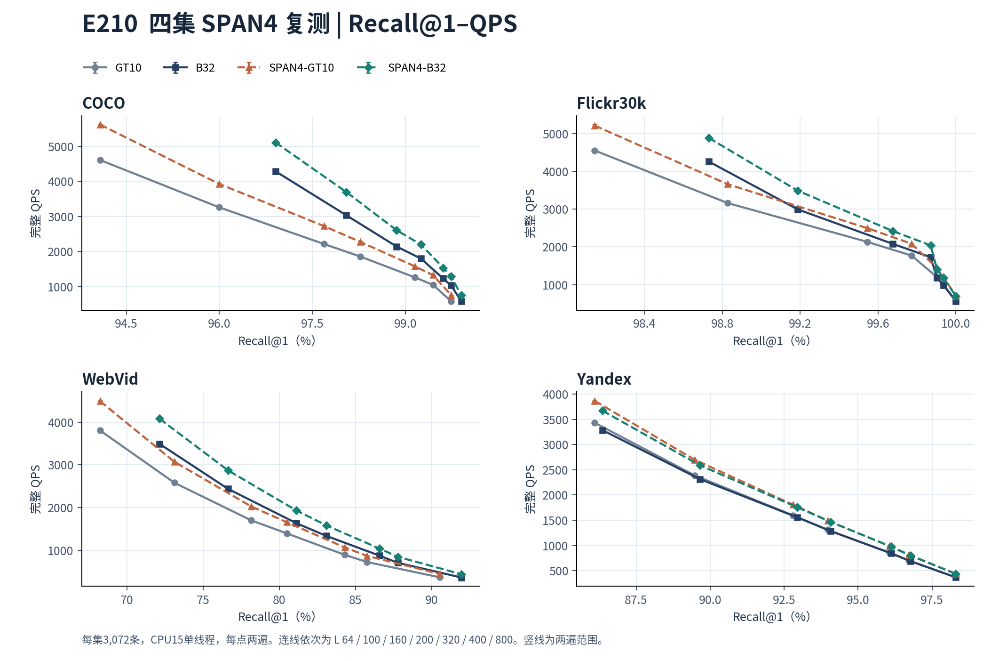
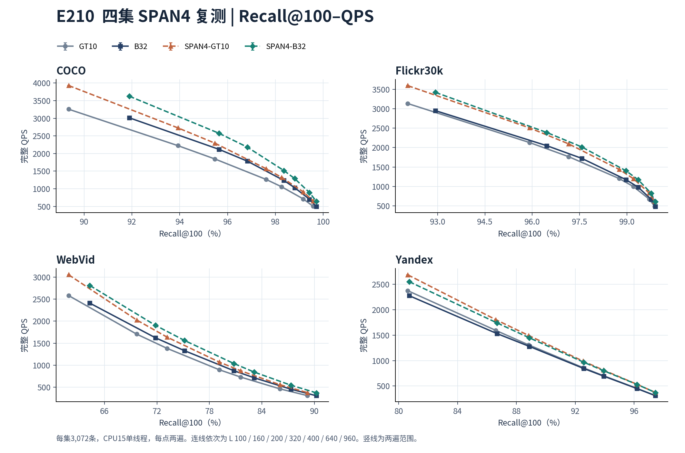
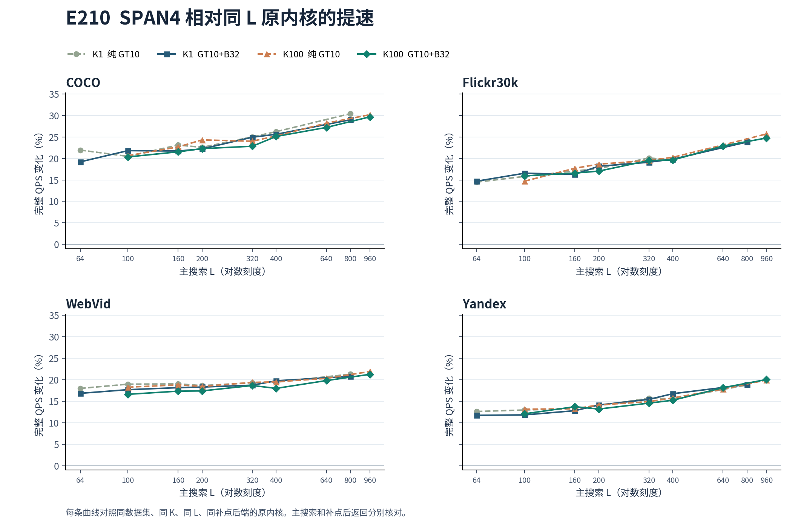

# E210 四真实数据集 SPAN4 端到端复测

COCO、Flickr30k、WebVid、Yandex first10M 四集各3,072条真实公开查询。真实K1/K100，各7个L，224点、448个完整CPU15单线程批次、1,376,256次正式查询，每点两遍。112个优化点返回与各自对照逐字节一致。纯GT10 QPS变化+12.64%至+30.40%，56/56点过预设筛选。接完整B32变化+11.75%至+29.65%，56/56点过筛选。四集全部已测同L预算支持内核替换候选。生产发布合同仍为E99 GT10。

## 实验设计和核验

E210 扩展 E209 的同 L 内核试验。COCO、Flickr30k、Yandex 使用原 hard GT10，WebVid 用原 soft-t1。每组固定原图、向量、查询顺序、raw-IP 及完整16K B32表。原标量内核和 SPAN4 分别用于纯 GT10 和接原 B32；B32 查表、评分和合并沿原实现。跨度边界及预取和四路距离算法沿 E102 在 E209 使用的搜索体。

每集先对真实两 K 的14个预算各做256条资格。两遍正式计时逐方法串行，前置预热256，反向轮转，原计时包含正常输出生命周期。各点的实际 QPS 以其两遍算术均值计，历史 QPS 保留各自身份。公开查询历史已曝光，固定最前3,072条；全部计时结束后读取 GT。

224个资格包和224个正式首轮输出已复核。112个 SPAN4 正式包分别与原 GT10 或原 B32 位级相同，48个原控制点与 E208 原窗一致，28个 WebVid 适用点与 E209 公共窗前缀一致。独立标量原距离对原 B32 重归并172,032次查询配置。首256条独立计数走过实际四路距离接口，14,336条配置查询的主搜索距离计算次数一致。

每节点一个 span 字节，构建计时另列。四路比例为在资格计数中由真实 batch4 接口做的距离项所占比例。它是工作量诊断，完整 QPS 同时包含该内核其他实现动作。

| 数据集 | span 字节 | MiB | 一次构建秒 | batch4评分项占比 |
| --- | --- | --- | --- | --- |
| COCO | 118,272 | 0.113 | 0.0048 | 81.35%–89.39% |
| Flickr30k | 31,782 | 0.030 | 0.0013 | 86.47%–93.05% |
| WebVid | 2,505,000 | 2.389 | 0.1023 | 85.37%–87.92% |
| Yandex | 10,000,000 | 9.537 | 0.3986 | 90.27%–93.22% |

## 实测曲线与同预算速度

同 K 同 L 的 SPAN4 与标量对照召回完全相同，速度变化直接复用同期原始批次。预锁通过口径要求平均提升至少1%且优化慢轮快于对照快轮；两遍范围描述波动。下表按每集每类的7个离散预算汇总。

| 数据集 | K | 版本 | 完整 QPS 变化范围 | 中位增幅 | 通过 |
| --- | --- | --- | --- | --- | --- |
| COCO | 1 | SPAN4-GT10 | +20.47% 至 +30.40% | +23.11% | 7/7 |
| COCO | 1 | SPAN4-B32 | +19.19% 至 +28.98% | +22.21% | 7/7 |
| COCO | 100 | SPAN4-GT10 | +20.63% 至 +30.15% | +24.30% | 7/7 |
| COCO | 100 | SPAN4-B32 | +20.34% 至 +29.65% | +22.82% | 7/7 |
| Flickr30k | 1 | SPAN4-GT10 | +14.48% 至 +24.06% | +17.64% | 7/7 |
| Flickr30k | 1 | SPAN4-B32 | +14.70% 至 +23.79% | +18.17% | 7/7 |
| Flickr30k | 100 | SPAN4-GT10 | +14.70% 至 +25.69% | +19.51% | 7/7 |
| Flickr30k | 100 | SPAN4-B32 | +15.93% 至 +24.74% | +19.50% | 7/7 |
| WebVid | 1 | SPAN4-GT10 | +18.00% 至 +21.31% | +19.05% | 7/7 |
| WebVid | 1 | SPAN4-B32 | +16.85% 至 +20.80% | +18.31% | 7/7 |
| WebVid | 100 | SPAN4-GT10 | +18.29% 至 +21.92% | +19.40% | 7/7 |
| WebVid | 100 | SPAN4-B32 | +16.63% 至 +21.27% | +18.01% | 7/7 |
| Yandex | 1 | SPAN4-GT10 | +12.64% 至 +18.79% | +13.98% | 7/7 |
| Yandex | 1 | SPAN4-B32 | +11.75% 至 +18.90% | +14.14% | 7/7 |
| Yandex | 100 | SPAN4-GT10 | +13.16% 至 +19.96% | +14.93% | 7/7 |
| Yandex | 100 | SPAN4-B32 | +12.10% 至 +20.06% | +14.58% | 7/7 |

L200 的具体值如下，同一行内两种实现的实际 Recall 相同。

| 数据集 | K | 链路 | 共同Recall% | 旧QPS | 新QPS | QPS变化 |
| --- | --- | --- | --- | --- | --- | --- |
| COCO | 1 | GT10 | 98.2747 | 1854.39 | 2272.83 | +22.57% |
| COCO | 1 | B32 | 99.2513 | 1797.71 | 2196.93 | +22.21% |
| COCO | 100 | GT10 | 95.4691 | 1846.52 | 2295.16 | +24.30% |
| COCO | 100 | B32 | 96.8213 | 1786.08 | 2183.74 | +22.26% |
| Flickr30k | 1 | GT10 | 99.7721 | 1771.25 | 2083.67 | +17.64% |
| Flickr30k | 1 | B32 | 99.8698 | 1727.44 | 2041.31 | +18.17% |
| Flickr30k | 100 | GT10 | 97.1520 | 1766.98 | 2096.60 | +18.65% |
| Flickr30k | 100 | B32 | 97.5723 | 1721.85 | 2015.19 | +17.04% |
| WebVid | 1 | GT10 | 80.5013 | 1397.68 | 1658.38 | +18.65% |
| WebVid | 1 | B32 | 83.0729 | 1341.78 | 1587.47 | +18.31% |
| WebVid | 100 | GT10 | 73.1644 | 1381.76 | 1636.76 | +18.45% |
| WebVid | 100 | B32 | 75.1481 | 1329.95 | 1561.61 | +17.42% |
| Yandex | 1 | GT10 | 93.9779 | 1309.77 | 1492.81 | +13.98% |
| Yandex | 1 | B32 | 94.0755 | 1283.63 | 1465.16 | +14.14% |
| Yandex | 100 | GT10 | 88.8177 | 1310.13 | 1495.52 | +14.15% |
| Yandex | 100 | B32 | 88.8799 | 1278.77 | 1447.63 | +13.20% |

## 同在 SPAN4 上比较是否使用 B32

下表使用各自测点中达到指定召回门槛的最快配置，单元格依次为实测 L、Recall%、QPS。两种方法可能超过门槛不同程度，比较只用本轮离散点。破折号表示已测网格中未达标。内核加速和 B32 提升召回分别对应两类作用。

| 数据集 | K | 召回门槛% | SPAN4纯GT10 | SPAN4+原B32 | 补点版QPS变化 |
| --- | --- | --- | --- | --- | --- |
| COCO | 1 | 90 | L64 / 94.0755 / 5616.56 | L64 / 96.9076 / 5105.49 | -9.10% |
| COCO | 1 | 95 | L100 / 95.9961 / 3926.01 | L64 / 96.9076 / 5105.49 | +30.04% |
| COCO | 1 | 99 | L320 / 99.1536 / 1576.26 | L200 / 99.2513 / 2196.93 | +39.38% |
| COCO | 100 | 90 | L160 / 93.9248 / 2728.17 | L100 / 91.8874 / 3628.62 | +33.01% |
| COCO | 100 | 95 | L200 / 95.4691 / 2295.16 | L160 / 95.6406 / 2575.88 | +12.23% |
| COCO | 100 | 99 | L640 / 99.1660 / 912.60 | L640 / 99.4235 / 893.43 | -2.10% |
| Flickr30k | 1 | 90 | L64 / 98.1445 / 5214.33 | L64 / 98.7305 / 4889.32 | -6.23% |
| Flickr30k | 1 | 95 | L64 / 98.1445 / 5214.33 | L64 / 98.7305 / 4889.32 | -6.23% |
| Flickr30k | 1 | 99 | L160 / 99.5443 / 2498.51 | L100 / 99.1862 / 3493.68 | +39.83% |
| Flickr30k | 100 | 90 | L100 / 92.0550 / 3595.30 | L100 / 92.9310 / 3421.44 | -4.84% |
| Flickr30k | 100 | 95 | L160 / 95.9131 / 2508.01 | L160 / 96.4587 / 2389.65 | -4.72% |
| Flickr30k | 100 | 99 | L400 / 99.2008 / 1201.53 | L400 / 99.3532 / 1173.44 | -2.34% |
| WebVid | 1 | 90 | L800 / 90.5273 / 452.39 | L800 / 91.9271 / 447.23 | -1.14% |
| WebVid | 100 | 90 | — | L960 / 90.2210 / 374.04 | — |
| Yandex | 1 | 90 | L160 / 92.8060 / 1806.82 | L160 / 92.9362 / 1759.80 | -2.60% |
| Yandex | 1 | 95 | L320 / 96.0612 / 988.26 | L320 / 96.1263 / 973.79 | -1.46% |
| Yandex | 100 | 90 | L320 / 92.5280 / 988.82 | L320 / 92.5719 / 967.56 | -2.15% |
| Yandex | 100 | 95 | L640 / 96.1745 / 534.78 | L640 / 96.1953 / 529.99 | -0.90% |

SPAN4可进入切换前的工程验证，优先验证实际并发入口、内存生命周期、非raw-IP兼容性和回退，并用本轮同K/L的等价监督检查作为回归对照。

[冻结协议](protocol.md) · [全部测点](analysis/points.csv) · [两遍原始时间](analysis/rounds.csv) · [完整速度配对](analysis/matched_deltas.csv) · [召回门槛](analysis/recall_thresholds.csv) · [资格评分量](analysis/ndc.csv) · [独立输出审计](reviews/output_audit.json)
