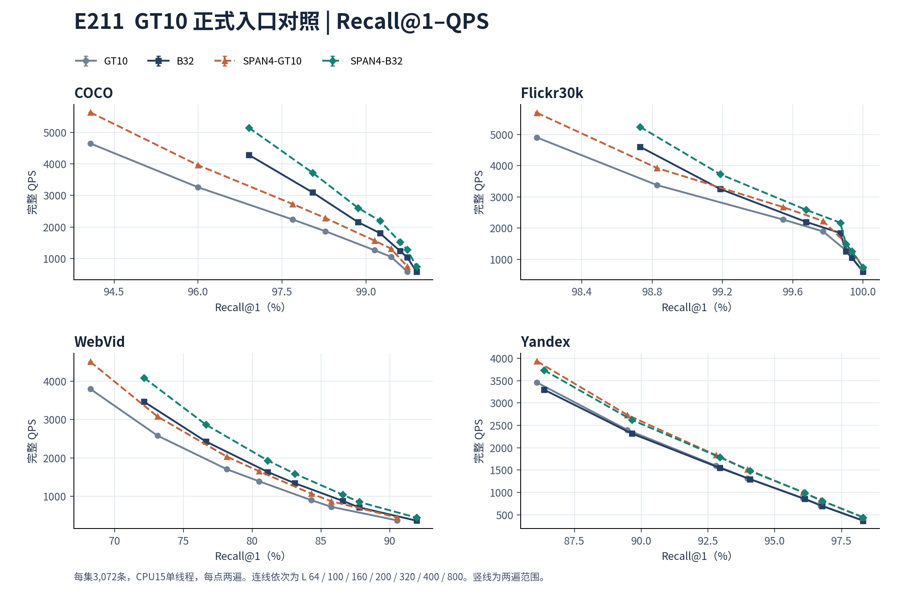
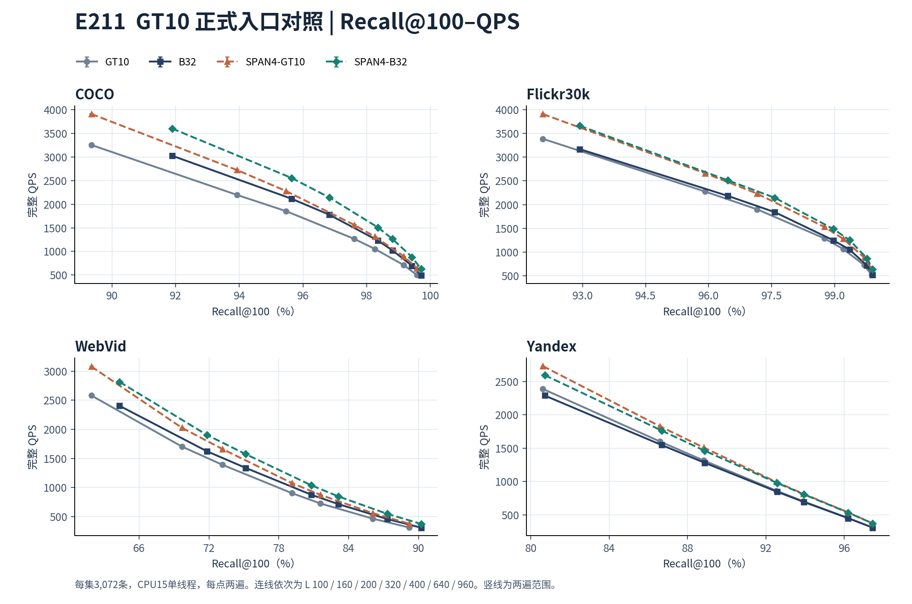
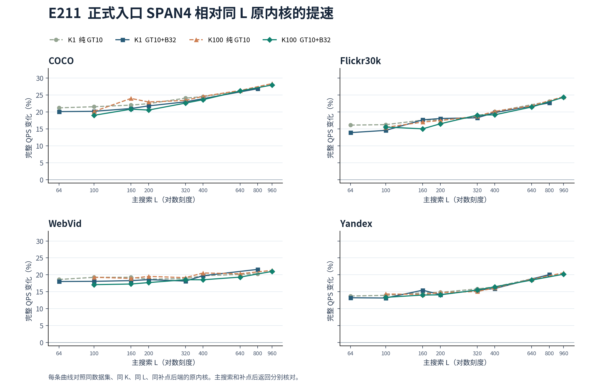

# E211 GT10 正式入口测试和默认切换

**正式验收通过。** 已在源码和重新构建的版本中启用平铺 raw-IP、mode 2 的 SPAN4 默认分流。112个新旧配对返回逐字节相同，112/112个配对通过逐点速度筛选。纯GT10完整QPS变化+13.74%至+28.35%，GT10+B32变化+13.16%至+27.94%。

## 四个真实数据集

每集使用 3,072 条固定公共查询，真实 K1/K100 各七个 L。总计 224 个点、448 个完整批次和 1,376,256 次计时查询。新旧共用同一构建的 `ACSG::search_new`、图、GT10 画像和原 B32 表。CPU15 实际单线程。完整 wall 含路由、主搜、补点（相应方法）以及输出批生命周期，QPS 取两遍均值。测试 GT 在全部计时完成后用于评分。

| 数据集 | 纯 GT10 完整 QPS 变化 | GT10+B32 完整 QPS 变化 | 速度筛选 |
| --- | ---: | ---: | ---: |
| COCO | +20.14% 至 +28.35% | +18.99% 至 +27.94% | 28/28 |
| Flickr30k | +15.43% 至 +24.51% | +13.88% 至 +24.33% | 28/28 |
| WebVid | +18.63% 至 +21.32% | +17.10% 至 +21.61% | 28/28 |
| Yandex first10M | +13.74% 至 +20.60% | +13.16% 至 +20.19% | 28/28 |

全部配对通过两遍速度筛选。

L200 的同配置对照如下。

| 数据集 | K | 链路 | Recall | 标量 QPS | SPAN4 QPS |
| --- | ---: | --- | ---: | ---: | ---: |
| COCO | 1 | GT10 | 98.2747% | 1863.51 | 2281.65 |
| COCO | 1 | B32 | 99.2513% | 1801.61 | 2193.92 |
| COCO | 100 | GT10 | 95.4691% | 1852.61 | 2277.48 |
| COCO | 100 | B32 | 96.8213% | 1778.78 | 2144.18 |
| Flickr30k | 1 | GT10 | 99.7721% | 1891.10 | 2223.97 |
| Flickr30k | 1 | B32 | 99.8698% | 1840.04 | 2172.12 |
| Flickr30k | 100 | GT10 | 97.1520% | 1900.63 | 2232.12 |
| Flickr30k | 100 | B32 | 97.5723% | 1840.88 | 2144.29 |
| WebVid | 1 | GT10 | 80.5013% | 1390.96 | 1651.42 |
| WebVid | 1 | B32 | 83.0729% | 1343.14 | 1592.77 |
| WebVid | 100 | GT10 | 73.1644% | 1389.91 | 1661.46 |
| WebVid | 100 | B32 | 75.1481% | 1337.88 | 1574.82 |
| Yandex first10M | 1 | GT10 | 93.9779% | 1317.59 | 1512.93 |
| Yandex first10M | 1 | B32 | 94.0755% | 1297.07 | 1480.59 |
| Yandex first10M | 100 | GT10 | 88.8177% | 1315.79 | 1509.97 |
| Yandex first10M | 100 | B32 | 88.8799% | 1279.53 | 1459.88 |

## 工程验证

- E211 的 224 个正式输出包均和 E210 对应真实输出逐字节一致。3,584 次额外配对核对整个候选池的 ID、距离位元和扩展标记及 visited 表。原 B32 做了 172,032 次逐查询独立重归并。
- 邻接行在线确定有效末端，按邻接顺序收集和插入，距离以原 Faiss 四路 raw-IP 计算。四路不足时逐项评分。旧索引通过原读盘入口加载，索引另存的 span 数组为零字节。
- 默认构建在四个 raw-IP 数据集的 K1/K100、L200、GT10/B32 组合上实测原生 batch4 入口被调用。显式标量回退的返回逐条一致。Deep10M、SIFT10M 和 GIST1M 使用相同发布产物验证默认标量分流及返回一致，每种组合 256 条。这三个 L2 数据集的检查属于兼容性测试。
- 合成图覆盖批尾、重复入口、预访问、空入口、并列分数、边编辑、visited 轮换、mode0/1、显式 trace 和外部距离函数。四个线程共享同索引并使用独立 scratch 的 1,200 次查询通过。当前 Faiss 构建下对 d=1 至2048 的 131,072 个生成点积做了位级对照。
- 粒度为索引的回退接口是 `acsg.set_flat_ip_batch4_enabled(false)`。在线程启动前配置。正常 CMake 目标 `benches/test` 也已用发布库重新链接，并通过命令行启动检查。

[协议](protocol.md) · [验收判定](analysis/decision.json) · [完整配对](analysis/matched_deltas.csv) · [正式原始批次](data/) · [发布路径核验](reviews/release_dispatch.json) · [发布构建命令](release/build.json) · [产物哈希](seal.json)
