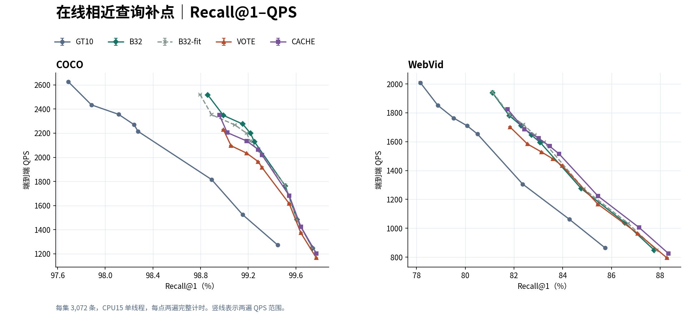
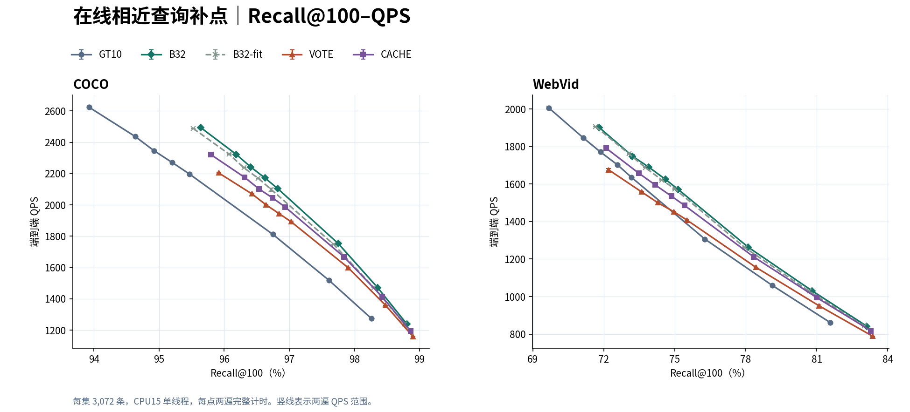

# E216 COCO 和 WebVid 在线相近查询补点

复用原 raw-IP、GT10 和 E211 SPAN4。VOTE 在线取 32 个低维邻居后重排取 16 个，对实际遗漏投票。CACHE 在线低维取 4 个后重排取 1 个，再读取离线汇总的候选表。每查询最多替换原 fit-only B32 的 16 个尾部候选，同 L 实际精算预算相同。五臂包含纯 GT10、完整 16K B32、fit-only B32 和两条在线候选。

资格回放中，VOTE 和 CACHE 均在两个数据集、两种 K 的 dev/cal 提高了同 L 净命中。正式每集 3,072 条公共查询，真实 K1/K100，8 档 L，160 点、320 批，CPU15 实际单线程，两遍 N/wall 平均。在线近邻投影、HNSW、重排、候选查找与投票和精算合并全部记入完整 wall。

主网格同 L 下，两条新方法相对完整 B32 的 64 个点均提高召回且降低 QPS。对代表点同期加密控制后，WebVid K1 的 CACHE L192 为 83.4635% / 1,571.0 QPS，最快达标的 B32-fit L208 为 83.4961% / 1,545.3 QPS，CACHE 快 1.67%。COCO K100 CACHE L200 则比达标的完整 B32 L208 慢 2.65%。以下曲线与表格使用主网格；局部加密另记 59 点、118 批。[加密对照结果](confirmation_result.md)。

## L184 与 L192 的实际对照

每格为 Recall / QPS。新方法都在 L184，两个 B32 对照都在 L192。

| 数据集 | K | 完整 B32 L192 | B32-fit L192 | VOTE L184 | CACHE L184 |
| --- | ---: | ---: | ---: | ---: | ---: |
| COCO | 1 | 99.2188% / 2,199.3 | 99.1862% / 2,199.7 | 99.1862% / 2,034.8 | 99.1862% / 2,135.8 |
| COCO | 100 | 96.6247% / 2,172.6 | 96.5215% / 2,170.5 | 96.6426% / 2,000.7 | 96.5355% / 2,101.5 |
| WebVid | 1 | 82.7148% / 1,646.1 | 82.8451% / 1,647.3 | 83.1380% / 1,527.8 | 83.0078% / 1,624.4 |
| WebVid | 100 | 74.5983% / 1,625.9 | 74.4512% / 1,622.1 | 74.2826% / 1,500.7 | 74.1748% / 1,595.3 |

## 以完整 B32 L192 为召回目标

每格为最快实际达标 L / Recall / QPS，破折号表示当前网格无达标配置。

| 数据集 | K | GT10 | 完整 B32 | B32-fit | VOTE | CACHE |
| --- | ---: | ---: | ---: | ---: | ---: | ---: |
| COCO | 1 | L400 / 99.4466% / 1,273.9 | L192 / 99.2188% / 2,199.3 | L200 / 99.2188% / 2,133.9 | L192 / 99.2839% / 1,964.4 | L192 / 99.2839% / 2,065.0 |
| COCO | 100 | L256 / 96.7461% / 1,812.2 | L192 / 96.6247% / 2,172.6 | L200 / 96.7243% / 2,097.5 | L184 / 96.6426% / 2,000.7 | L192 / 96.7432% / 2,044.7 |
| WebVid | 1 | L320 / 84.2773% / 1,061.7 | L192 / 82.7148% / 1,646.1 | L192 / 82.8451% / 1,647.3 | L184 / 83.1380% / 1,527.8 | L184 / 83.0078% / 1,624.4 |
| WebVid | 100 | L256 / 76.2712% / 1,306.6 | L192 / 74.5983% / 1,625.9 | L200 / 75.0042% / 1,574.3 | L192 / 74.9674% / 1,452.0 | L192 / 74.8620% / 1,535.3 |

## 逐点离散前沿

用纯 GT10、完整 B32 和 fit-only B32 的全部同期实际点共同作对照。下表每臂分母为 8，召回与 QPS 都达到且一项更高计为覆盖。慢遍领先是指新方法慢遍快于所有已达其召回的对照快遍。

| 数据集 | K | 方法 | 被覆盖 | 慢遍领先 | 高于所有对照召回 |
| --- | ---: | --- | ---: | ---: | ---: |
| COCO | 1 | VOTE | 3/8 | 4/8 | 1/8 |
| COCO | 1 | CACHE | 2/8 | 4/8 | 1/8 |
| COCO | 100 | VOTE | 3/8 | 4/8 | 1/8 |
| COCO | 100 | CACHE | 4/8 | 3/8 | 1/8 |
| WebVid | 1 | VOTE | 3/8 | 4/8 | 1/8 |
| WebVid | 1 | CACHE | 0/8 | 7/8 | 1/8 |
| WebVid | 100 | VOTE | 4/8 | 3/8 | 1/8 |
| WebVid | 100 | CACHE | 3/8 | 4/8 | 1/8 |

## 补点重放和模型开销

重放不走主图，额外时间为相对同条件 B32-fit 的微秒/查询。文件字节量按各臂所需投影、单位查询、HNSW 和各自的遗漏或预编表计算；运行器同时加载两套表，字节量不作实际峰值 RSS。

| 数据集 | K | VOTE 额外 μs | CACHE 额外 μs | VOTE 模型 MiB | CACHE 模型 MiB |
| --- | ---: | ---: | ---: | ---: | ---: |
| COCO | 1 | 32.77 | 15.83 | 28.63 | 30.60 |
| COCO | 100 | 33.73 | 17.07 | 28.63 | 30.60 |
| WebVid | 1 | 38.43 | 15.87 | 29.58 | 32.67 |
| WebVid | 100 | 42.59 | 18.09 | 29.58 | 32.67 |

正式结果来自实际返回，32 个纯 GT10 或完整 B32 包与 E214 对齐。固定样本核对四路与独立标量排序及实际候选数。两次计时范围用于描述运行波动。公共测试窗口已用于历史研究，跨 L 门槛由离散实测点判断。

[协议](protocol.md) · [资格](analysis/heldout_quality.csv) · [全部实际点](analysis/points.csv) · [同 L 差](analysis/same_l.csv) · [L184 对 L192](analysis/cross_l.csv) · [门槛](analysis/recall_thresholds.csv) · [前沿](analysis/control_frontier.csv) · [独立复算](reviews/independent_audit.json) · [封存](seal.json)
