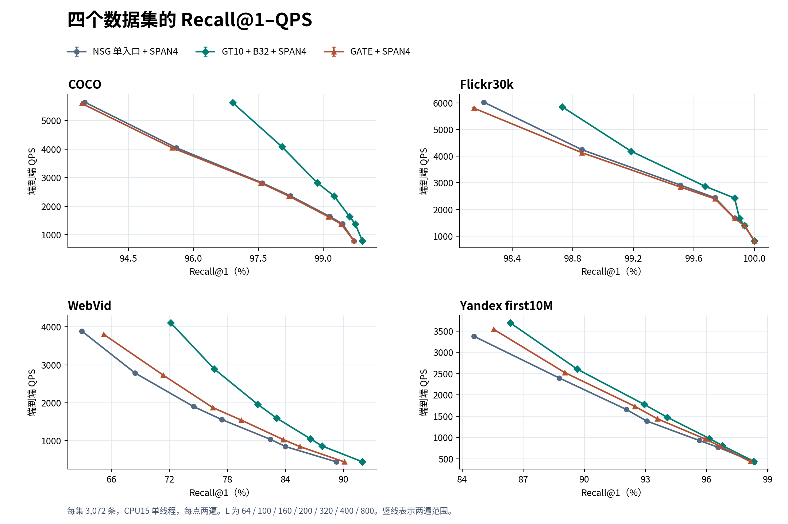
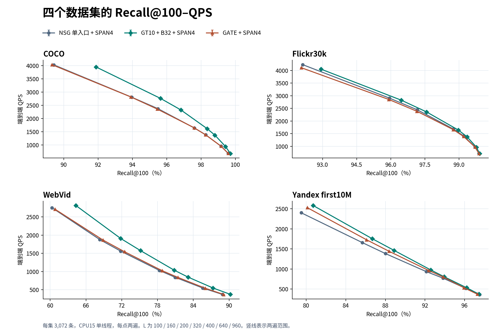

# E213 四集 GT10+B32、NSG 与 GATE 同期实测

COCO、Flickr30k、WebVid、Yandex first10M 各使用 3,072 条公开查询。真实 K1/K100 各 7 档 L，CPU15 实际单线程，每点两遍完整计时。三条 SPAN4 链路共 168 点、336 批。GATE 标量对照另有 56 点、112 批。QPS 为两遍 N/wall 的算术平均。

E200 的 GATE 运行单位 query 的小 HNSW 路由，取三个真实入口后用原 raw query 搜索同一张 NSG 图。独立探针在四集、两种 K 的 L200 再现 GATE 主搜索调用 Faiss batch4，标量臂的调用为零。正式二进制未链接探针。GATE 两个后端的 56 组返回逐字节一致。

## 同 L 结果

| 对照 | Recall 更高 | QPS 更高 | 两项同时提高 | Recall 变化（百分点） | QPS 变化 |
| --- | ---: | ---: | ---: | ---: | ---: |
| GT10 + B32 + SPAN4 相对 NSG 单入口 + SPAN4 | 52/56 | 30/56 | 28/56 | -0.06 至 +9.18 | -4.18% 至 +9.29% |
| GT10 + B32 + SPAN4 相对 GATE + SPAN4 | 54/56 | 41/56 | 39/56 | +0.00 至 +6.93 | -2.16% 至 +7.91% |
| GATE + SPAN4 相对 GATE 标量 | 0/56 | 56/56 | 0/56 | +0.00 至 +0.00 | +11.97% 至 +27.96% |

以下为 L200 的实际召回与端到端 QPS。

| 数据集 | K | NSG 单入口 | GT10 + B32 | GATE |
| --- | ---: | ---: | ---: | ---: |
| COCO | 1 | 98.242% / 2,362.1 | 99.251% / 2,355.8 | 98.210% / 2,350.8 |
| COCO | 100 | 95.493% / 2,371.4 | 96.821% / 2,325.8 | 95.450% / 2,356.2 |
| Flickr30k | 1 | 99.740% / 2,441.1 | 99.870% / 2,426.8 | 99.740% / 2,398.8 |
| Flickr30k | 100 | 97.165% / 2,444.2 | 97.572% / 2,360.2 | 97.148% / 2,386.2 |
| WebVid | 1 | 77.409% / 1,559.8 | 83.073% / 1,598.8 | 79.427% / 1,545.4 |
| WebVid | 100 | 71.829% / 1,562.0 | 75.148% / 1,576.2 | 72.475% / 1,544.6 |
| Yandex first10M | 1 | 93.066% / 1,385.3 | 94.076% / 1,472.6 | 93.587% / 1,437.0 |
| Yandex first10M | 100 | 88.006% / 1,384.4 | 88.880% / 1,463.7 | 88.371% / 1,441.5 |

## 最快的实测达标配置

每格为 L / 实际 Recall / QPS。粗体为三条 SPAN4 链路中最快的达标点，破折号表示本次网格无达标点。

| 数据集 | K | 目标 Recall | NSG 单入口 | GT10 + B32 | GATE |
| --- | ---: | ---: | ---: | ---: | ---: |
| COCO | 1 | 90% | **L64 / 93.490% / 5,644.9** | L64 / 96.908% / 5,624.4 | L64 / 93.424% / 5,595.3 |
| COCO | 1 | 95% | L100 / 95.605% / 4,046.3 | **L64 / 96.908% / 5,624.4** | L100 / 95.508% / 4,047.2 |
| COCO | 1 | 99% | L320 / 99.154% / 1,637.6 | **L200 / 99.251% / 2,355.8** | L320 / 99.121% / 1,631.9 |
| COCO | 100 | 90% | L160 / 93.960% / 2,804.9 | **L100 / 91.887% / 3,945.0** | L160 / 93.912% / 2,814.0 |
| COCO | 100 | 95% | L200 / 95.493% / 2,371.4 | **L160 / 95.641% / 2,759.2** | L200 / 95.450% / 2,356.2 |
| COCO | 100 | 99% | L640 / 99.168% / 953.8 | L640 / 99.424% / 944.0 | **L640 / 99.162% / 955.3** |
| Flickr30k | 1 | 90% | **L64 / 98.210% / 6,027.6** | L64 / 98.730% / 5,845.1 | L64 / 98.145% / 5,802.0 |
| Flickr30k | 1 | 95% | **L64 / 98.210% / 6,027.6** | L64 / 98.730% / 5,845.1 | L64 / 98.145% / 5,802.0 |
| Flickr30k | 1 | 99% | L160 / 99.512% / 2,914.5 | **L100 / 99.186% / 4,181.7** | L160 / 99.512% / 2,841.4 |
| Flickr30k | 100 | 90% | **L100 / 92.129% / 4,226.6** | L100 / 92.931% / 4,049.8 | L100 / 92.061% / 4,108.3 |
| Flickr30k | 100 | 95% | **L160 / 95.938% / 2,907.1** | L160 / 96.459% / 2,825.2 | L160 / 95.910% / 2,852.6 |
| Flickr30k | 100 | 99% | **L400 / 99.201% / 1,411.1** | L400 / 99.353% / 1,378.8 | L400 / 99.200% / 1,390.5 |
| WebVid | 1 | 90% | — | **L800 / 91.927% / 449.2** | L800 / 90.072% / 445.9 |
| WebVid | 1 | 95% | — | — | — |
| WebVid | 1 | 99% | — | — | — |
| WebVid | 100 | 70% | L200 / 71.829% / 1,562.0 | **L160 / 71.815% / 1,910.5** | L200 / 72.475% / 1,544.6 |
| WebVid | 100 | 80% | L400 / 80.961% / 843.2 | **L320 / 80.801% / 1,038.6** | L400 / 81.429% / 839.6 |
| WebVid | 100 | 85% | L640 / 85.595% / 548.6 | **L640 / 87.304% / 549.8** | L640 / 86.008% / 542.7 |
| WebVid | 100 | 90% | — | **L960 / 90.221% / 374.6** | — |
| WebVid | 100 | 95% | — | — | — |
| WebVid | 100 | 99% | — | — | — |
| Yandex first10M | 1 | 90% | L160 / 92.057% / 1,658.5 | **L160 / 92.936% / 1,776.7** | L160 / 92.480% / 1,730.4 |
| Yandex first10M | 1 | 95% | L320 / 95.638% / 928.7 | **L320 / 96.126% / 977.6** | L320 / 95.931% / 962.7 |
| Yandex first10M | 1 | 99% | — | — | — |
| Yandex first10M | 100 | 90% | L320 / 92.128% / 935.1 | **L320 / 92.572% / 977.8** | L320 / 92.359% / 964.4 |
| Yandex first10M | 100 | 95% | L640 / 96.113% / 517.2 | **L640 / 96.195% / 533.3** | L640 / 95.934% / 532.4 |
| Yandex first10M | 100 | 99% | — | — | — |

三条链路各有 56 个点。在同数据集、同 K 的实测网格中，以下统计被其他链路同时达到或超过 Recall 与 QPS、且至少一项更高的点。

| 链路 | 被其他链路覆盖 | 在实测前沿 |
| --- | ---: | ---: |
| NSG 单入口 + SPAN4 | 35/56 | 21/56 |
| GT10 + B32 + SPAN4 | 2/56 | 54/56 |
| GATE + SPAN4 | 51/56 | 5/56 |

## GATE 的后端差异

| 数据集 | 同 K/L 的 GATE SPAN4 相对标量 QPS 变化 |
| --- | ---: |
| COCO | +19.39% 至 +27.96% |
| Flickr30k | +11.97% 至 +21.64% |
| WebVid | +16.30% 至 +21.65% |
| Yandex first10M | +12.64% 至 +20.88% |

56 个同配置对照中，56 个的 SPAN4 慢遍仍比标量快遍更快。两遍范围只描述此次计时波动。

## K100 低召回

L200 下每集 3,072 条。命中 0–9 个 GT 的查询计入下表。

| 数据集 | NSG 单入口 | GT10 + B32 | GATE |
| --- | ---: | ---: | ---: |
| COCO | 0 | 0 | 0 |
| Flickr30k | 0 | 0 | 0 |
| WebVid | 42 | 9 | 32 |
| Yandex first10M | 67 | 33 | 51 |

## 核验与计量

计时包含完整查询链路、六数组复制和正常销毁。载入、预热、GT 评分、核验、写盘在 wall 外。沿用冻结的画像和表，训练监督规模和离线成本沿 E200/E212 的合同。公共查询早已用于项目性能评测，门槛和前沿的结论限于本次实测窗口与预算点。

NSG 与 GT10+B32 的 112 个实际包和 E212 逐字节一致，GATE 的 52 个可对齐实际包和 E200 的对应前缀一致。两套实现从正式的实际 ID 与 GT 重算全部 224 个召回点，核对 448 个正式 wall、同 L 比较、离散达标点和三条主链的有限前沿。

[协议](protocol.md) · [逐点 CSV](analysis/points.csv) · [原始批次 CSV](analysis/rounds.csv) · [同 L 比较](analysis/same_l.csv) · [门槛](analysis/recall_thresholds.csv) · [前沿](analysis/frontier.csv) · [独立复算](reviews/independent_audit.json) · [封存](seal.json)
