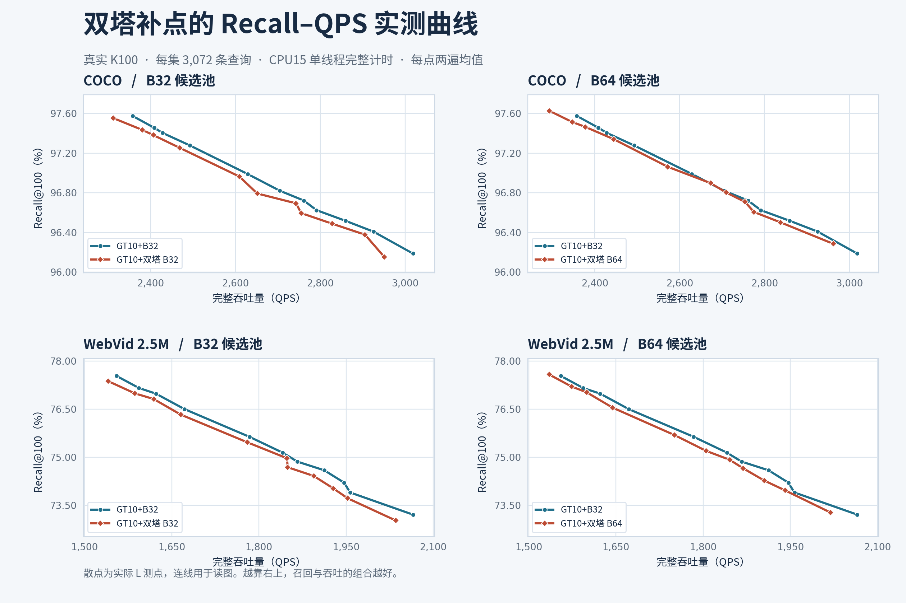

# E226 COCO / WebVid 双塔直接补点

在相同 GT10 主搜索后合并原生 raw-IP 精算结果。B32 保留原版，B64 按原联合未覆盖贪心扩展，并保留每行的有序 B32 前缀。两池各训练独立查询塔和候选塔。塔为无偏置 512→32 线性映射，按真实池内遗漏成员和同池原内积教师分布训练。正式精算上限固定为 48 个去重后的候选。

这轮保留原版 B32 为默认补点对照。全精算 B64 在两集出现值得单独复验的 Recall–QPS 结果。两种双塔都比同池同预算 PCA 回收更多真值成员，固定 48 的版本尚未稳定改善原版 B32 的完整曲线。

## 正式完整计时

COCO hard、WebVid soft-t1 各 3,072 条真实查询，真 K100。11 档 L、每集 66 点，合计 132 点、264 批、811,008 次计时查询。CPU15 每次单线程，测两遍，完整路由、主搜、投影、候选选择、精算、Top-K 合并及返回包生命周期。加载、预热、GT 评分、写盘和额外审计在计时外。

L184 延续前一轮重点预算。工作量取 256 条正式前缀资格见证，质量和吞吐取各 3,072 条完整批次。

| 数据集 | 方法 | Recall@100 | 完整 QPS | 候选池均值 | 精算均值 | 对 B32 全链路 μs/query 差 |
|---|---|---:|---:|---:|---:|---:|
| COCO | B32 | 96.4082% | 2,925.4 | 87.9 | 87.9 | +0.00 |
| COCO | PCA-B32 | 96.3509% | 2,842.2 | 87.9 | 48.0 | +10.14 |
| COCO | TT-B32 | 96.3773% | 2,905.5 | 87.9 | 48.0 | +2.34 |
| COCO | B64 | 96.6624% | 2,820.4 | 158.9 | 158.9 | +12.72 |
| COCO | PCA-B64 | 96.4320% | 2,843.7 | 158.9 | 48.0 | +9.83 |
| COCO | TT-B64 | 96.5013% | 2,837.9 | 158.9 | 48.0 | +10.53 |
| WebVid | B32 | 73.9062% | 1,957.0 | 93.5 | 93.5 | +0.00 |
| WebVid | PCA-B32 | 73.5866% | 1,963.3 | 93.5 | 48.0 | -1.66 |
| WebVid | TT-B32 | 73.7249% | 1,952.8 | 93.5 | 48.0 | +1.14 |
| WebVid | B64 | 74.6237% | 1,907.3 | 187.4 | 187.4 | +13.34 |
| WebVid | PCA-B64 | 73.6895% | 1,935.8 | 187.4 | 48.0 | +5.60 |
| WebVid | TT-B64 | 73.9704% | 1,941.1 | 187.4 | 48.0 | +4.22 |

### 同期 B32 前沿

离散对照对每个新方法点取至少同召回的最快原版 B32。慢遍比较使用新方法慢遍对 B32 快遍。折线按实际测点做召回重叠区间内插值，仅用于描述曲线。

| 数据集 | 方法 | 离散达标对照存在 | 均值更快 | 慢遍仍更快 | 在 B32 折线右侧 |
|---|---|---:|---:|---:|---:|
| COCO | TT-B32 | 11/11 | 0 | 0 | 0/10 |
| COCO | TT-B64 | 10/11 | 6 | 5 | 1/10 |
| COCO | B64 | 8/11 | 8 | 8 | 8/8 |
| WebVid | TT-B32 | 11/11 | 1 | 0 | 0/10 |
| WebVid | TT-B64 | 10/11 | 8 | 5 | 0/10 |
| WebVid | B64 | 8/11 | 8 | 8 | 7/8 |

全精算 B64 在 16 个召回重叠点中有 15 个位于 B32 折线右侧。按已测离散目标比较，L200 相对最快达标 B32 的完整 QPS 在 COCO 高 5.34%、WebVid 高 6.73%，达标对照均为 L224。两点相对折线分别高 0.91% 与 1.47%。该条件证据优先用于独立密集复测。

### 同池同精算的学习贡献

| 数据集 | 宽度 | 双塔优于 PCA 的 L 档 | Recall 差范围（百分点） | L184 救回 / 损伤 |
|---|---|---:|---:|---:|
| COCO | B32 | 11/11 | +0.0195 至 +0.0267 | 137 / 56 |
| COCO | B64 | 11/11 | +0.0609 至 +0.0697 | 432 / 219 |
| WebVid | B32 | 11/11 | +0.1178 至 +0.1396 | 637 / 212 |
| WebVid | B64 | 11/11 | +0.2507 至 +0.2855 | 1443 / 580 |

## 候选供给与校准回放

冻结主返回评估 L176/184/200/224。每集 56 点，COCO 1,024 条、WebVid 1,020 条校准查询，合计 114,464 次选点与原生合并。逐查询检查 B64 为 B32 的超集，并检查进入精算的候选属于对应全池，原版 B32 结果与 E222 位级一致。下表为 L184。

| 数据集 | B32 / B64 候选中的真实漏点数 | B64 全精算相对 B32 净增 | 双塔 B32 / B64 精算 48 相对 B32 净增 |
|---|---:|---:|---:|
| COCO | 1603 / 1894 | +291 | -43 / +119 |
| WebVid | 2205 / 3004 | +799 | -204 / +52 |

## 覆盖、成本与复核

正式输出两遍逐字节一致，独立 Python 集合和 NumPy 评分核实 132 点，256 条前缀逐查询用独立原生标量全排序比对。COCO 同窗的原版 B32 与封存 E225 有 11/11 组四个载荷逐字节一致。WebVid 的训练和校准与公开正式窗做了精确向量字节隔离。WebVid 有四条旧窗重复记录被排除，正式窗保留原始 3,072 条及其一对重复向量。两集正式窗在历史实验使用过，实验范围为 K100 的两集同分布留出。

以下增量大小按实际结构计算。每臂需一份码本、查询权重和全基库大小的 int32 ID 到码槽映射，B64 另需扩展表。正式对照进程一次加载三个码本用于串行测量。构建和拟合为独立离线墙钟。

| 数据集 | 唯一编码 ID | 单臂 B32 / B64 增量 MiB | 扩 B64 表 | 两池拟合及准备 |
|---|---:|---:|---:|---:|
| COCO | 24,146 | 3.46 / 3.66 | 0.12 s | 7.62 s |
| WebVid | 38,701 | 14.34 / 14.54 | 0.94 s | 33.32 s |

[协议](protocol.md) · [完整点](analysis/points.csv) · [两遍原始时间](analysis/rounds.csv) · [同期达标配对](analysis/matched.csv) · [正式救损](analysis/same_L.csv) · [全部校准回放](analysis/replay.csv) · [封存](seal.json)
