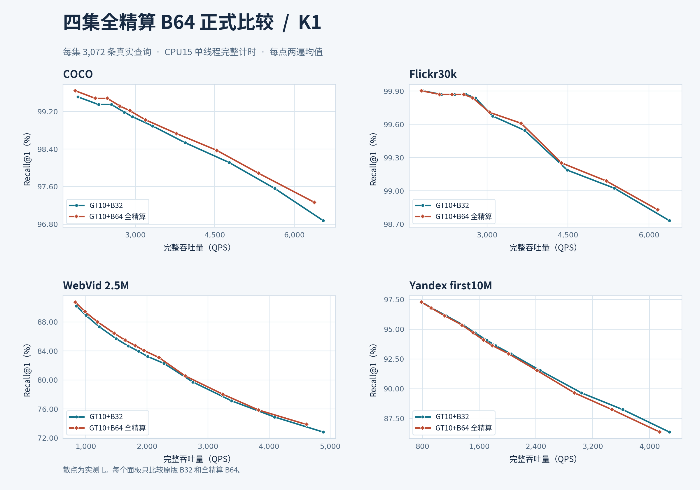
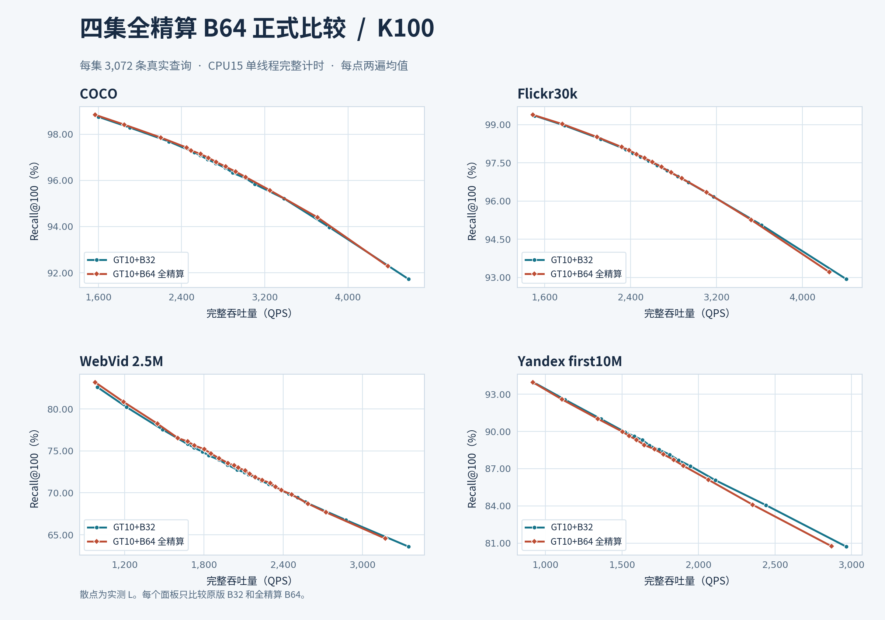

# E229 四集 B32 与全精算 B64 正式测量

COCO、Flickr30k、WebVid 2.5M、Yandex first10M 各 3,072 条官方公开查询。真 K1 和 K100 均独立执行，四集共 218 点、436 批、1,339,392 个计时查询。CPU15 实际单线程，每点两遍完整端到端，QPS 取两遍算术平均。两臂冻结同一 GT10 路由及 SPAN4 主搜索。B64 每路保留原 B32 前缀，三路取并集、去重并排除主返回，随后全部做原 raw-IP 精算。

COCO 和 WebVid 延用 E228 隔离窗，Flickr30k 和 Yandex 延用 E213 前窗。查询与相应训练角色复核无重叠，COCO/Flickr30k 以源组核验，WebVid/Yandex 核精确向量字节。各窗为历史公共查询。两种 K 共享在原 K100/L200 训练 token 上扩出的 B64 表，所有召回均从各自真实返回与正式 GT 独立评分。

按双边都达到的固定目标，B64 平均 QPS 更快为 K1 8/24、K100 15/35 个，慢遍仍快为 8/24、12/35。WebVid 两种 K 的收益较一致，COCO K1 和 Flickr30k K100 有条件收益。COCO K100 本轮只在 2/7 个目标的均值更高，慢遍均未超过原版快遍。Yandex 的 K1 同 L 召回全部相等，K100 同 L 增加 0.0146–0.0374 个百分点，两种 K 的达标目标均由 B32 更快。保留原版 B32 为通用对照，按数据集、K 与目标召回选择全精算 B64。

WebVid K100 的 72% 目标，B64 L160 对 B32 L168 提高 0.46% 平均 QPS，两遍区间重叠。75.5% 目标 B64 L208 对 B32 L224 提高 2.97%，慢遍对快遍仍高 2.72%。本轮 COCO B64 的 K100 网格不含 E228 的 L204 配置，E228 密集窗回报的 +1.40% 与本轮 97% 目标的 +0.20% 使用不同实测网格。

## 达标速度和同 L 结果

双边达标使用固定目标下的两臂最快实测点。慢遍对快遍用于观察波动。折线统计仅在实测召回重叠区间内描述位置。

| 数据集 | K | 双边达标目标 | B64 用小 L | B64 更快 | 慢遍仍更快 | 折线右侧 | 同 L 召回差（百分点） | 同 L QPS 差中位数 |
|---|---:|---:|---:|---:|---:|---:|---:|---:|
| COCO | 1 | 5/5 | 3/5 | 3/5 | 3/5 | 9/9 | +0.1302 至 +0.3906 | -2.96% |
| COCO | 100 | 7/8 | 4/7 | 2/7 | 0/7 | 12/13 | +0.0876 至 +0.5596 | -2.95% |
| Flickr30k | 1 | 5/5 | 1/5 | 1/5 | 1/5 | 5/10 | +0.0000 至 +0.0977 | -1.75% |
| Flickr30k | 100 | 7/7 | 4/7 | 4/7 | 4/7 | 11/13 | +0.0339 至 +0.2764 | -1.74% |
| WebVid 2.5M | 1 | 7/7 | 4/7 | 4/7 | 4/7 | 11/11 | +0.5208 至 +1.0417 | -2.80% |
| WebVid 2.5M | 100 | 13/13 | 10/13 | 9/13 | 8/13 | 19/22 | +0.5570 至 +0.9648 | -3.57% |
| Yandex first10M | 1 | 7/7 | 0/7 | 0/7 | 0/7 | 0/12 | +0.0000 至 +0.0000 | -1.74% |
| Yandex first10M | 100 | 8/9 | 0/8 | 0/8 | 0/8 | 0/13 | +0.0146 至 +0.0374 | -2.05% |

每个目标的 L、实际召回和完整 QPS 见下表。

| 数据集 | K | 召回目标 | GT10+B32 | GT10+B64 | QPS 差 | 慢遍对快遍 |
|---|---:|---:|---:|---:|---:|---:|
| COCO | 1 | 97% | L80 / 97.5586% / 5,635.1 | L64 / 97.2656% / 6,379.8 | +13.21% | +12.22% |
| COCO | 1 | 98% | L100 / 98.1120% / 4,774.4 | L100 / 98.3724% / 4,538.4 | -4.94% | -5.45% |
| COCO | 1 | 98.5% | L128 / 98.5352% / 3,941.0 | L128 / 98.7305% / 3,777.6 | -4.14% | -5.40% |
| COCO | 1 | 99% | L184 / 99.0885% / 2,947.3 | L160 / 99.0234% / 3,191.9 | +8.30% | +7.54% |
| COCO | 1 | 99.25% | L224 / 99.3490% / 2,549.4 | L200 / 99.3164% / 2,710.6 | +6.32% | +5.30% |
| COCO | 100 | 93% | L128 / 93.9714% / 3,820.2 | L128 / 94.3997% / 3,705.9 | -2.99% | -4.22% |
| COCO | 100 | 95% | L152 / 95.2207% / 3,381.8 | L152 / 95.5719% / 3,248.8 | -3.93% | -4.44% |
| COCO | 100 | 96% | L176 / 96.0879% / 3,016.8 | L168 / 96.1465% / 3,015.7 | -0.04% | -0.28% |
| COCO | 100 | 96.4% | L192 / 96.5446% / 2,819.8 | L184 / 96.5986% / 2,822.3 | +0.09% | -1.21% |
| COCO | 100 | 97% | L216 / 97.0778% / 2,578.4 | L208 / 97.1416% / 2,583.7 | +0.20% | -0.60% |
| COCO | 100 | 97.2% | L224 / 97.2129% / 2,522.7 | L216 / 97.2972% / 2,490.5 | -1.28% | -1.74% |
| COCO | 100 | 98% | L320 / 98.2913% / 1,901.8 | L320 / 98.4150% / 1,850.6 | -2.69% | -3.09% |
| COCO | 100 | 99% | — | — | — | — |
| Flickr30k | 1 | 98.5% | L64 / 98.7305% / 6,381.4 | L64 / 98.8281% / 6,166.7 | -3.36% | -3.50% |
| Flickr30k | 1 | 99% | L80 / 99.0234% / 5,358.8 | L80 / 99.0885% / 5,211.2 | -2.75% | -2.95% |
| Flickr30k | 1 | 99.25% | L128 / 99.5443% / 3,701.1 | L100 / 99.2513% / 4,381.9 | +18.39% | +17.87% |
| Flickr30k | 1 | 99.5% | L128 / 99.5443% / 3,701.1 | L128 / 99.6094% / 3,631.8 | -1.87% | -2.18% |
| Flickr30k | 1 | 99.75% | L184 / 99.8372% / 2,784.6 | L184 / 99.8372% / 2,737.1 | -1.71% | -2.08% |
| Flickr30k | 100 | 93% | L128 / 95.0583% / 3,618.7 | L100 / 93.2074% / 4,249.9 | +17.44% | +16.68% |
| Flickr30k | 100 | 95% | L128 / 95.0583% / 3,618.7 | L128 / 95.2650% / 3,521.3 | -2.69% | -3.02% |
| Flickr30k | 100 | 96% | L152 / 96.1732% / 3,170.1 | L152 / 96.3431% / 3,105.3 | -2.04% | -2.24% |
| Flickr30k | 100 | 97% | L184 / 97.2048% / 2,737.6 | L176 / 97.1214% / 2,775.7 | +1.39% | +1.02% |
| Flickr30k | 100 | 97.5% | L200 / 97.5723% / 2,566.0 | L192 / 97.5326% / 2,601.4 | +1.38% | +1.34% |
| Flickr30k | 100 | 98% | L224 / 98.0234% / 2,355.9 | L224 / 98.1253% / 2,315.6 | -1.71% | -1.86% |
| Flickr30k | 100 | 99% | L400 / 99.3532% / 1,507.6 | L320 / 99.0241% / 1,765.0 | +17.08% | +16.90% |
| WebVid 2.5M | 1 | 73% | L80 / 74.9023% / 4,087.1 | L64 / 73.8607% / 4,612.4 | +12.85% | +11.74% |
| WebVid 2.5M | 1 | 76% | L100 / 77.1159% / 3,388.5 | L100 / 78.0273% / 3,244.6 | -4.25% | -4.96% |
| WebVid 2.5M | 1 | 80% | L160 / 82.2917% / 2,278.5 | L128 / 80.5664% / 2,625.2 | +15.22% | +14.61% |
| WebVid 2.5M | 1 | 83% | L184 / 83.2357% / 2,011.5 | L160 / 83.1055% / 2,196.8 | +9.21% | +8.69% |
| WebVid 2.5M | 1 | 85% | L256 / 85.7096% / 1,494.5 | L224 / 85.4818% / 1,645.4 | +10.09% | +9.79% |
| WebVid 2.5M | 1 | 88% | L400 / 88.8997% / 1,003.0 | L400 / 89.4206% / 984.7 | -1.83% | -2.54% |
| WebVid 2.5M | 1 | 90% | L480 / 90.2018% / 844.4 | L480 / 90.7227% / 830.5 | -1.65% | -1.72% |
| WebVid 2.5M | 100 | 68% | L136 / 68.8994% / 2,565.7 | L128 / 68.7145% / 2,586.4 | +0.81% | +0.39% |
| WebVid 2.5M | 100 | 70% | L148 / 70.2848% / 2,387.4 | L140 / 70.3141% / 2,386.1 | -0.05% | -1.10% |
| WebVid 2.5M | 100 | 71% | L156 / 71.0404% / 2,290.9 | L148 / 71.1439% / 2,302.9 | +0.52% | +0.33% |
| WebVid 2.5M | 100 | 72% | L168 / 72.1784% / 2,136.3 | L160 / 72.2471% / 2,146.2 | +0.46% | -0.56% |
| WebVid 2.5M | 100 | 73% | L184 / 73.3372% / 1,979.2 | L172 / 73.2542% / 2,028.9 | +2.51% | +2.15% |
| WebVid 2.5M | 100 | 74% | L200 / 74.4482% / 1,836.9 | L184 / 74.1214% / 1,913.0 | +4.14% | +2.47% |
| WebVid 2.5M | 100 | 74.5% | L208 / 74.9118% / 1,788.7 | L192 / 74.7025% / 1,851.6 | +3.52% | +3.18% |
| WebVid 2.5M | 100 | 75.5% | L224 / 75.8092% / 1,676.0 | L208 / 75.6576% / 1,725.8 | +2.97% | +2.72% |
| WebVid 2.5M | 100 | 76% | L256 / 77.5488% / 1,486.5 | L216 / 76.1156% / 1,677.9 | +12.87% | +12.26% |
| WebVid 2.5M | 100 | 77% | L256 / 77.5488% / 1,486.5 | L256 / 78.2321% / 1,448.9 | -2.53% | -3.16% |
| WebVid 2.5M | 100 | 78% | L320 / 80.2311% / 1,213.4 | L256 / 78.2321% / 1,448.9 | +19.41% | +18.85% |
| WebVid 2.5M | 100 | 80% | L320 / 80.2311% / 1,213.4 | L320 / 80.8493% / 1,191.3 | -1.82% | -2.14% |
| WebVid 2.5M | 100 | 82% | L400 / 82.6165% / 992.7 | L400 / 83.1735% / 978.0 | -1.48% | -1.58% |
| Yandex first10M | 1 | 85% | L64 / 86.3607% / 4,279.3 | L64 / 86.3607% / 4,143.4 | -3.18% | -4.45% |
| Yandex first10M | 1 | 88% | L80 / 88.2487% / 3,622.5 | L80 / 88.2487% / 3,469.6 | -4.22% | -4.90% |
| Yandex first10M | 1 | 90% | L128 / 91.5365% / 2,458.0 | L128 / 91.5365% / 2,414.6 | -1.77% | -2.98% |
| Yandex first10M | 1 | 92% | L160 / 92.9362% / 2,047.5 | L160 / 92.9362% / 2,014.8 | -1.60% | -2.13% |
| Yandex first10M | 1 | 94% | L200 / 94.0755% / 1,709.0 | L200 / 94.0755% / 1,662.6 | -2.71% | -2.82% |
| Yandex first10M | 1 | 95% | L256 / 95.3451% / 1,377.5 | L256 / 95.3451% / 1,360.8 | -1.21% | -1.89% |
| Yandex first10M | 1 | 96% | L320 / 96.1263% / 1,135.8 | L320 / 96.1263% / 1,116.4 | -1.72% | -2.63% |
| Yandex first10M | 100 | 82% | L128 / 84.0632% / 2,440.7 | L128 / 84.0960% / 2,354.2 | -3.54% | -3.81% |
| Yandex first10M | 100 | 85% | L152 / 86.0739% / 2,109.9 | L152 / 86.1038% / 2,065.8 | -2.09% | -2.51% |
| Yandex first10M | 100 | 87.5% | L176 / 87.6875% / 1,869.5 | L176 / 87.7155% / 1,837.8 | -1.69% | -2.44% |
| Yandex first10M | 100 | 88% | L184 / 88.1273% / 1,812.7 | L184 / 88.1549% / 1,771.3 | -2.28% | -2.74% |
| Yandex first10M | 100 | 89% | L208 / 89.3044% / 1,633.5 | L208 / 89.3294% / 1,594.7 | -2.37% | -3.23% |
| Yandex first10M | 100 | 90% | L256 / 91.0016% / 1,363.0 | L256 / 91.0231% / 1,341.7 | -1.57% | -2.02% |
| Yandex first10M | 100 | 92% | L320 / 92.5719% / 1,125.9 | L320 / 92.5889% / 1,107.0 | -1.67% | -2.43% |
| Yandex first10M | 100 | 93% | L400 / 93.9414% / 925.0 | L400 / 93.9561% / 918.4 | -0.72% | -1.15% |
| Yandex first10M | 100 | 94% | — | — | — | — |

## L200 同档与扩表资源

| 数据集 | K | 原版召回 / QPS | 全精算召回 / QPS | 多精算 | 真值救回 / 损伤 | 命中 0–9 变化 |
|---|---:|---:|---:|---:|---:|---:|
| COCO | 1 | 99.1862% / 2,791.8 | 99.3164% / 2,710.6 | 75.6 | 4 / 0 | — |
| COCO | 100 | 96.7380% / 2,729.6 | 96.9808% / 2,658.5 | 73.6 | 746 / 0 | 0 → 0 |
| Flickr30k | 1 | 99.8698% / 2,611.0 | 99.8698% / 2,568.0 | 68.8 | 0 / 0 | — |
| Flickr30k | 100 | 97.5723% / 2,566.0 | 97.6914% / 2,529.3 | 67.3 | 366 / 0 | 0 → 0 |
| WebVid 2.5M | 1 | 83.9518% / 1,863.6 | 84.7331% / 1,811.8 | 94.6 | 24 / 0 | — |
| WebVid 2.5M | 100 | 74.4482% / 1,836.9 | 75.2018% / 1,802.1 | 93.5 | 2315 / 0 | 11 → 9 |
| Yandex first10M | 1 | 94.0755% / 1,709.0 | 94.0755% / 1,662.6 | 95.7 | 0 / 0 | — |
| Yandex first10M | 100 | 88.8799% / 1,680.0 | 88.9059% / 1,646.3 | 95.6 | 80 / 0 | 33 → 32 |

精算量为前 256 条原生核验见证的算术平均。峰值 RSS 包含完整索引和两臂共用进程。扩表数组体积单列。

| 数据集 | B64 原始数组 KiB | 原 B32 编译训练覆盖 → B64 | 完整进程峰值 RSS GiB |
|---|---:|---:|---:|
| COCO | 204.55 | 47,965 → 66,169 | 0.29 |
| Flickr30k | 204.55 | 28,831 → 40,413 | 0.10 |
| WebVid 2.5M | 204.55 | 73,142 → 113,793 | 5.41 |
| Yandex first10M | 206.05 | 29,363 → 55,553 | 9.92 |

## 复核

两遍实际返回逐字节相同。55,808 条额外原生标量 Top-K 核验及候选池超集检查。旧实验与本轮共有配置，53/53 组对照的四份载荷均相同。四集计时结束后评分，使用封存 GT 文件的完整 SHA-256 和物理查询行对齐，两路评分逐查询核对。

[协议](protocol.md) · [逐点](analysis/points.csv) · [固定召回目标](analysis/targets.csv) · [同 L 救损](analysis/same_L.csv) · [同召回匹配](analysis/matched.csv) · [逐遍计时](analysis/rounds.csv) · [封存](seal.json)
