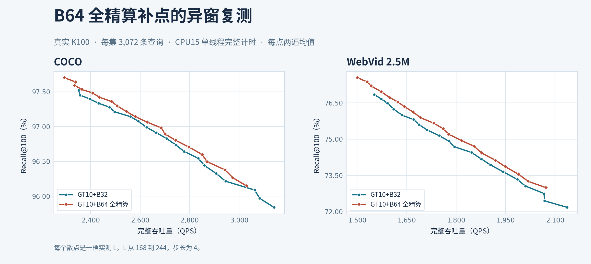

# E228 B64 全精算复测

冻结 E226 的 B32/B64 两套表和 SPAN4。三路候选合并去重并排除主返回，按原生 raw-IP 对所有候选精算。两集各 3,072 条真实 K100 查询，20 档 L、80 点、160 批 CPU15 单线程完整计时。每点两遍，使用算术平均 QPS。

窗口从物理行号 6144 开始。COCO 取至 9215。WebVid 跳过 2 条与前 6,144 条向量字节重复的记录，顺延至 9217。两集与 E226 正式窗和拟合/校准窗隔离，COCO 核源组身份，WebVid 核精确向量及官方训练来源，另比对全部 20,000 条归档画像拟合向量。此窗口来自历史公共查询。

B64 在两集的全部同 L 测点提高召回，完整吞吐同 L 中位数分别下降 2.77% 和 2.90%。两集把 L 调低到同一召回目标后，COCO 7/7、WebVid 5/6 个双边达标目标的 B64 均值更快，慢遍仍快分别 6/7 和 4/6。B64 在每集 16 个同召回重叠点都位于 B32 折线右侧，折线 QPS 差中位数 +1.64% 和 +2.27%。这支持将 B64 作为已测两集 K100 的条件配置。

## 实测达标点

每臂独立取同一固定 Recall@100 目标的最快完整 QPS。表内列出实际召回和完整 QPS。慢遍列比较 B64 的慢遍与 B32 的快遍。

| 数据集 | Recall@100 目标 | GT10+B32（L / 实际召回 / QPS） | GT10+B64（L / 实际召回 / QPS） | QPS 差 | 慢遍对快遍 |
|---|---:|---:|---:|---:|---:|
| COCO | 96.2% | L180 · 96.2148% · 2,944.9 | L172 · 96.2653% · 2,974.3 | +1.00% | +0.23% |
| COCO | 96.4% | L188 · 96.4424% · 2,858.9 | L180 · 96.4958% · 2,870.3 | +0.40% | -0.46% |
| COCO | 96.6% | L196 · 96.6426% · 2,777.6 | L188 · 96.7064% · 2,796.8 | +0.69% | +0.35% |
| COCO | 96.8% | L204 · 96.8281% · 2,707.0 | L192 · 96.8031% · 2,743.3 | +1.34% | +0.83% |
| COCO | 97.0% | L216 · 97.0778% · 2,592.5 | L204 · 97.0641% · 2,628.8 | +1.40% | +0.58% |
| COCO | 97.2% | L224 · 97.2129% · 2,496.2 | L212 · 97.2139% · 2,545.8 | +1.99% | +1.21% |
| COCO | 97.4% | L240 · 97.4521% · 2,357.4 | L224 · 97.4215% · 2,435.6 | +3.32% | +3.03% |
| COCO | 97.6% | — | L240 · 97.6410% · 2,339.8 | — | — |
| WebVid | 72.0% | L168 · 72.1784% · 2,135.8 | L168 · 72.9919% · 2,072.3 | -2.97% | -3.18% |
| WebVid | 73.0% | L180 · 73.0615% · 2,009.6 | L172 · 73.2542% · 2,018.3 | +0.43% | -0.74% |
| WebVid | 74.0% | L196 · 74.1751% · 1,876.8 | L184 · 74.1214% · 1,919.6 | +2.28% | +1.93% |
| WebVid | 75.0% | L212 · 75.1426% · 1,748.7 | L200 · 75.2018% · 1,777.8 | +1.66% | +1.06% |
| WebVid | 75.5% | L220 · 75.6055% · 1,687.1 | L208 · 75.6576% · 1,732.6 | +2.70% | +1.82% |
| WebVid | 76.0% | L232 · 76.2419% · 1,610.5 | L216 · 76.1156% · 1,670.4 | +3.72% | +3.24% |
| WebVid | 77.0% | — | L236 · 77.1973% · 1,542.6 | — | — |
| WebVid | 78.0% | — | — | — | — |

WebVid 72.0% 目标两臂均落在本轮下限 L168，B64 的完整 QPS 差为 −2.97%。这个目标的更小 L 留待另测。

## 全网格比较

| 数据集 | 实测目标两边均达标 | B64 用更小 L | B64 均值更快 | B64 慢遍仍更快 | B64 在 B32 折线右侧 |
|---|---:|---:|---:|---:|---:|
| COCO | 7/8 | 7/7 | 7/7 | 6/7 | 16/16 |
| WebVid | 6/8 | 5/6 | 5/6 | 4/6 | 16/16 |

折线结论限 B32 和 B64 召回重叠范围内的描述性插值。两遍速度差用于检查方向和波动。

## 同 L 候选和费用

| 数据集 | 锚点 | B32 / B64 平均精算数 | B64 召回差 | 正确成员救回 / 损伤 | B64 全链路耗时增量 |
|---|---:|---:|---:|---:|---:|
| COCO | L184 | 87.8 / 161.4 | +0.2715 个百分点 | 834 / 0 | +6.79 μs/query |
| COCO | L200 | 87.7 / 161.2 | +0.2428 个百分点 | 746 / 0 | +7.95 μs/query |
| WebVid | L184 | 93.3 / 186.8 | +0.7842 个百分点 | 2409 / 0 | +17.21 μs/query |
| WebVid | L200 | 93.2 / 186.7 | +0.7536 个百分点 | 2315 / 0 | +20.93 μs/query |

精算数来自每个正式点的前 256 条独立资格回放。两集扩表 ID 和计数实际各占 204.55 / 204.55 KiB，沿用 E226 表文件。扩表保留原 B32 前缀。

## 复核

两遍正式返回逐字节相同。正式资格独立标量全排序检查 20,480 条，核 B64 去重候选逐查询覆盖 B32。以 E226 原查询窗的 12 组两臂前 256 条返回核载荷一致。两集全部计时后按物理行绑定官方 GT100，Recall 使用 Python 集合和 NumPy 各自核验。

COCO 对 E227 的公共物理查询行，11/11 个可比 L 的四份 B32 返回载荷全相同。
WebVid 对 E227 的公共物理查询行，11/11 个可比 L 的四份 B32 返回载荷全相同。

[协议](protocol.md) · [逐点](analysis/points.csv) · [固定目标](analysis/targets.csv) · [按点匹配](analysis/matched.csv) · [原始两遍](analysis/rounds.csv) · [同 L 救损](analysis/same_L.csv) · [封存](seal.json)
