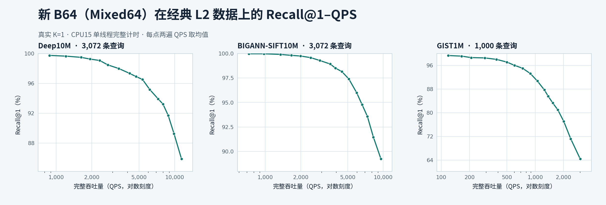
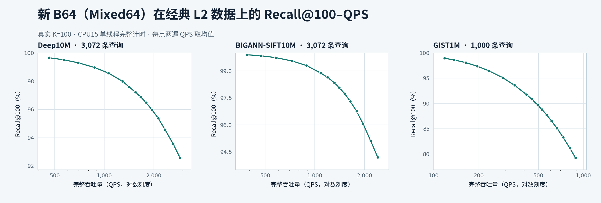

# E252 新 B64 在三套经典平方 L2 数据上的复测

Deep10M、BIGANN-SIFT10M 和 GIST1M 沿用冻结底库、图和 GT10。Mixed64 将
原 B32 的有序前缀续填到每行至多 64 项。每集使用 24,192 条训练查询和 L176/192/208
三档真 K100 主搜索漏点。Deep/SIFT 使用 soft 画像，GIST 用 hard 画像。

真 K1/K100 共 192 点、384 个完整 CPU15 单线程批次，正式墙钟合计 856.00 秒。每点两遍取算术平均。两遍结果包逐字节一致，另核验首 256 条共 49,152 条配置级查询的候选以及原距离合并排序。

## 同 L 质量和成本

| 数据集 | K | 查询 | 召回升 / 平 / 降 | 召回变化（百分点） | 额外精算数均值 | QPS 变化中位数 |
| --- | ---: | ---: | ---: | ---: | ---: | ---: |
| Deep10M | 1 | 3,072 | 0 / 16 / 0 | +0.0000 到 +0.0000 | 86.3 | -2.71% |
| Deep10M | 100 | 3,072 | 14 / 1 / 0 | +0.0000 到 +0.0039 | 86.2 | -1.16% |
| BIGANN-SIFT10M | 1 | 3,072 | 6 / 10 / 0 | +0.0000 到 +0.0651 | 90.6 | -3.24% |
| BIGANN-SIFT10M | 100 | 3,072 | 13 / 2 / 0 | +0.0000 到 +0.0046 | 90.5 | -1.24% |
| GIST1M | 1 | 1,000 | 12 / 5 / 0 | +0.0000 到 +0.3000 | 95.5 | -3.98% |
| GIST1M | 100 | 1,000 | 17 / 0 / 0 | +0.0090 到 +0.1220 | 95.1 | -1.92% |

额外精算数按各点首 256 条查询取平均，完整 QPS 使用全窗。低召回查询（真 K100
命中少于 10 个）逐点失败率、救损和脱离失败的计数保存在逐点及同 L 表。

## 固定召回目标达标比较

两臂分别采用最快的同期实测达标点。慢遍胜出以新表慢遍 QPS 对原 B32 快遍 QPS 判断。

| 数据集 | K | 新表均值更快 / 双边达标 | 新表慢遍更快 | QPS 变化范围 |
| --- | ---: | ---: | ---: | ---: |
| Deep10M | 1 | 0/7 | 0 | -4.81% 到 -0.74% |
| Deep10M | 100 | 0/7 | 0 | -1.75% 到 -0.40% |
| BIGANN-SIFT10M | 1 | 0/7 | 0 | -7.06% 到 -1.66% |
| BIGANN-SIFT10M | 100 | 0/7 | 0 | -2.61% 到 -0.74% |
| GIST1M | 1 | 1/8 | 1 | -7.26% 到 +16.94% |
| GIST1M | 100 | 1/8 | 1 | -3.44% 到 +6.03% |

| 数据集 | K | 召回目标 | B32 的 L、召回与 QPS | Mixed64 的 L、召回与 QPS | QPS 变化 |
| --- | ---: | ---: | --- | --- | ---: |
| Deep10M | 1 | 90% | L24 / 91.699% / 9,287.6 | L24 / 91.699% / 8,841.3 | -4.81% |
| Deep10M | 1 | 94% | L40 / 95.182% / 6,381.0 | L40 / 95.182% / 6,164.7 | -3.39% |
| Deep10M | 1 | 96% | L48 / 96.517% / 5,516.4 | L48 / 96.517% / 5,366.3 | -2.72% |
| Deep10M | 1 | 97% | L64 / 97.331% / 4,246.4 | L64 / 97.331% / 4,175.0 | -1.68% |
| Deep10M | 1 | 98% | L100 / 98.470% / 2,853.4 | L100 / 98.470% / 2,730.6 | -4.31% |
| Deep10M | 1 | 99% | L128 / 99.056% / 2,353.6 | L128 / 99.056% / 2,336.1 | -0.74% |
| Deep10M | 1 | 99.5% | L280 / 99.642% / 1,216.2 | L280 / 99.642% / 1,207.1 | -0.74% |
| Deep10M | 100 | 94% | L128 / 94.562% / 2,383.8 | L128 / 94.565% / 2,344.7 | -1.64% |
| Deep10M | 100 | 95% | L144 / 95.373% / 2,168.0 | L144 / 95.375% / 2,131.7 | -1.67% |
| Deep10M | 100 | 96% | L176 / 96.484% / 1,825.2 | L176 / 96.485% / 1,797.5 | -1.51% |
| Deep10M | 100 | 97% | L208 / 97.224% / 1,572.7 | L208 / 97.224% / 1,545.2 | -1.75% |
| Deep10M | 100 | 98% | L320 / 98.576% / 1,065.7 | L320 / 98.577% / 1,059.6 | -0.57% |
| Deep10M | 100 | 99% | L512 / 99.302% / 698.0 | L512 / 99.303% / 695.2 | -0.40% |
| Deep10M | 100 | 99.5% | L640 / 99.515% / 569.6 | L640 / 99.516% / 566.7 | -0.50% |
| BIGANN-SIFT10M | 1 | 90% | L20 / 91.406% / 8,874.4 | L20 / 91.471% / 8,247.7 | -7.06% |
| BIGANN-SIFT10M | 1 | 95% | L32 / 95.931% / 6,344.7 | L32 / 95.996% / 5,955.5 | -6.13% |
| BIGANN-SIFT10M | 1 | 97% | L40 / 97.331% / 5,341.1 | L40 / 97.396% / 5,114.4 | -4.25% |
| BIGANN-SIFT10M | 1 | 98% | L48 / 98.145% / 4,619.1 | L48 / 98.145% / 4,468.0 | -3.27% |
| BIGANN-SIFT10M | 1 | 99% | L80 / 99.284% / 3,030.0 | L80 / 99.284% / 2,900.0 | -4.29% |
| BIGANN-SIFT10M | 1 | 99.5% | L100 / 99.577% / 2,494.8 | L100 / 99.577% / 2,422.9 | -2.88% |
| BIGANN-SIFT10M | 1 | 99.8% | L160 / 99.805% / 1,693.2 | L160 / 99.805% / 1,665.1 | -1.66% |
| BIGANN-SIFT10M | 100 | 95% | L112 / 95.118% / 2,232.7 | L112 / 95.122% / 2,181.1 | -2.31% |
| BIGANN-SIFT10M | 100 | 96% | L128 / 96.063% / 2,013.8 | L128 / 96.066% / 1,961.4 | -2.61% |
| BIGANN-SIFT10M | 100 | 97% | L160 / 97.307% / 1,670.3 | L160 / 97.309% / 1,642.1 | -1.69% |
| BIGANN-SIFT10M | 100 | 98% | L192 / 98.073% / 1,428.0 | L192 / 98.074% / 1,407.4 | -1.44% |
| BIGANN-SIFT10M | 100 | 99% | L320 / 99.302% / 897.1 | L320 / 99.303% / 889.4 | -0.86% |
| BIGANN-SIFT10M | 100 | 99.5% | L400 / 99.554% / 732.5 | L400 / 99.555% / 727.0 | -0.75% |
| BIGANN-SIFT10M | 100 | 99.8% | L640 / 99.842% / 476.0 | L640 / 99.842% / 472.5 | -0.74% |
| GIST1M | 1 | 75% | L32 / 76.800% / 2,167.5 | L32 / 77.100% / 2,010.2 | -7.26% |
| GIST1M | 1 | 80% | L40 / 80.700% / 1,855.2 | L40 / 81.000% / 1,738.2 | -6.31% |
| GIST1M | 1 | 85% | L56 / 85.400% / 1,450.0 | L56 / 85.600% / 1,373.0 | -5.31% |
| GIST1M | 1 | 90% | L80 / 90.600% / 1,097.9 | L80 / 90.700% / 1,054.3 | -3.98% |
| GIST1M | 1 | 94% | L128 / 94.900% / 754.3 | L128 / 95.000% / 734.7 | -2.59% |
| GIST1M | 1 | 96% | L200 / 97.000% / 513.8 | L160 / 96.000% / 600.8 | +16.94% |
| GIST1M | 1 | 98% | L280 / 98.000% / 392.4 | L280 / 98.000% / 387.5 | -1.24% |
| GIST1M | 1 | 99% | L800 / 99.100% / 165.9 | L800 / 99.100% / 164.8 | -0.68% |
| GIST1M | 100 | 80% | L112 / 81.034% / 840.2 | L112 / 81.151% / 811.3 | -3.44% |
| GIST1M | 100 | 85% | L160 / 86.441% / 627.6 | L144 / 85.100% / 665.4 | +6.03% |
| GIST1M | 100 | 90% | L232 / 90.780% / 461.0 | L232 / 90.841% / 452.2 | -1.92% |
| GIST1M | 100 | 92% | L320 / 93.550% / 353.4 | L320 / 93.590% / 346.7 | -1.91% |
| GIST1M | 100 | 94% | L400 / 95.075% / 292.7 | L400 / 95.108% / 288.7 | -1.35% |
| GIST1M | 100 | 96% | L512 / 96.429% / 237.9 | L512 / 96.457% / 234.0 | -1.63% |
| GIST1M | 100 | 97% | L640 / 97.349% / 196.4 | L640 / 97.371% / 195.2 | -0.62% |
| GIST1M | 100 | 98% | L800 / 98.071% / 164.9 | L800 / 98.084% / 163.8 | -0.62% |

## 表与离线成本

| 数据集 | 训练阶段墙钟（秒） | 编译秒数 | 追加 ID 数 | 训练漏点 B32 / Mixed64 覆盖 | 在线新表 KiB | 峰值 RSS GiB |
| --- | ---: | ---: | ---: | ---: | ---: | ---: |
| Deep10M | 53.50 | 0.208 | 22,259 | 70,254 / 131,560（共 163,339） | 200.8 | 6.04 |
| BIGANN-SIFT10M | 61.93 | 0.180 | 23,632 | 69,145 / 128,373（共 136,569） | 200.8 | 7.24 |
| GIST1M | 134.22 | 1.339 | 24,671 | 100,289 / 201,289（共 840,724） | 200.8 | 3.84 |

训练阶段墙钟包括读取、实际三档主搜索、遗漏事件构造和新表编译，另有冻结输入验签。额外样本来自合法 fit 尾段和 QGT learn 角色，均与整套公开查询按向量字节互斥。实验在已公开的查询集、固定图和固定档位上完成。

[协议](protocol.md) · [实测点](analysis/points.csv) · [两遍原始耗时](analysis/rounds.csv) · [同 L 救损](analysis/same_L.csv) · [固定目标](analysis/targets.csv) · [封存](seal.json)
