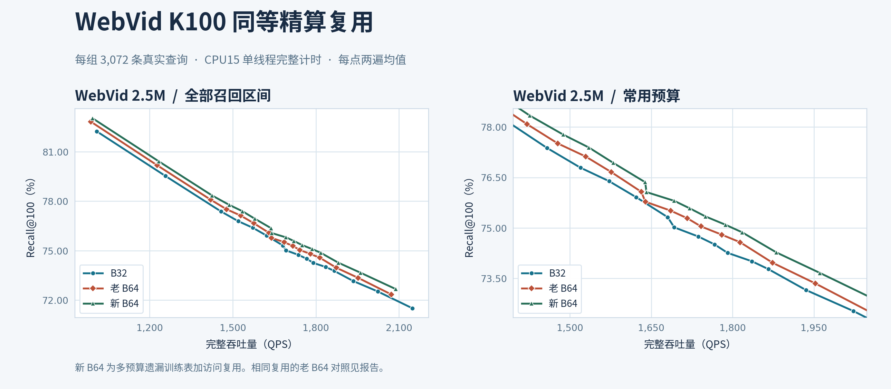

# E244 WebVid B64 同等精算复用的异源验证

在老 B64、E238 Budget40、E243 Mixed64 三个动作分别开关相同 visited 实现。保留 B32 基线。真实 K100，次序、底库、主图、GT10 路由、原生精算合并固定。

取 WebVid validation 真实查询 3,072 条，物理行 4096 至 7167，排除 0 条。按精确向量字节避开原拟合、E243 扩训、公共测试及 E237 的验证身份。112 点、224 批 CPU15 单线程两遍完整计时。评分使用相应 exact raw-IP GT。

## L196 打开第三路尾部

| 窗口 | 配置 | 实际 Recall@100 | 完整 QPS | 平均精算数 |
|---|---|---:|---:|---:|
| validation | B32 | 74.5078% | 1,766.9 | 93.14 |
| validation | B64-old | 75.2861% | 1,716.5 | 186.71 |
| validation | Visited64 | 75.2861% | 1,720.3 | 179.98 |
| validation | Budget40 | 75.2142% | 1,731.7 | 161.81 |
| validation | VisitedBudget40 | 75.2142% | 1,737.3 | 155.66 |
| validation | Mixed64 | 75.5811% | 1,719.6 | 185.57 |
| validation | VisitedMixed64 | 75.5811% | 1,721.0 | 178.20 |

## 75.5% 召回目标

各法使用有限网格的最快实测达标点。慢遍对快遍只描述速度波动。

| 窗口 | 配置 | L | 实际召回 | 完整 QPS | 比老 B64 | 慢遍比老 B64 快遍 |
|---|---|---:|---:|---:|---:|---:|
| validation | B32 | 216 | 75.9157% | 1,621.8 | -3.79% | -3.89% |
| validation | B64-old | 200 | 75.5124% | 1,685.7 | — | — |
| validation | Visited64 | 200 | 75.5124% | 1,688.9 | +0.19% | -0.16% |
| validation | Budget40 | 204 | 75.7077% | 1,651.5 | -2.03% | -3.14% |
| validation | VisitedBudget40 | 204 | 75.7077% | 1,641.6 | -2.62% | -4.62% |
| validation | Mixed64 | 196 | 75.5811% | 1,719.6 | +2.01% | +1.78% |
| validation | VisitedMixed64 | 196 | 75.5811% | 1,721.0 | +2.09% | +1.94% |

## 同等访问复用比较

| 召回目标 | 版本 | 较 Visited64 完整 QPS | 慢遍对快遍 |
|---:|---|---:|---:|
| 74.5% | VisitedBudget40 | -1.10% | -1.41% |
| 74.5% | VisitedMixed64 | -0.09% | -0.31% |
| 75.5% | VisitedBudget40 | -2.80% | -5.02% |
| 75.5% | VisitedMixed64 | +1.90% | +1.52% |
| 76.5% | VisitedBudget40 | +0.49% | +0.44% |
| 76.5% | VisitedMixed64 | -0.11% | -0.26% |
| 80% | VisitedBudget40 | +0.49% | -0.03% |
| 80% | VisitedMixed64 | +0.15% | -0.21% |
| 84% | VisitedBudget40 | —% | —% |
| 84% | VisitedMixed64 | —% | —% |

## 验证

28,672 次额外原生标量 Top-K 全排序核对，两遍包位级一致。三个对应访问复用版本各逐个核可跳过 ID，全部逐字节保持原始对应版本返回。各法同档路由和画像分数一致。

[协议](protocol.md) · [逐点结果](analysis/points.csv) · [目标比较](analysis/targets.csv) · [同 L 救损](analysis/same_L.csv) · [原始两遍](analysis/rounds.csv) · [封存](seal.json)
