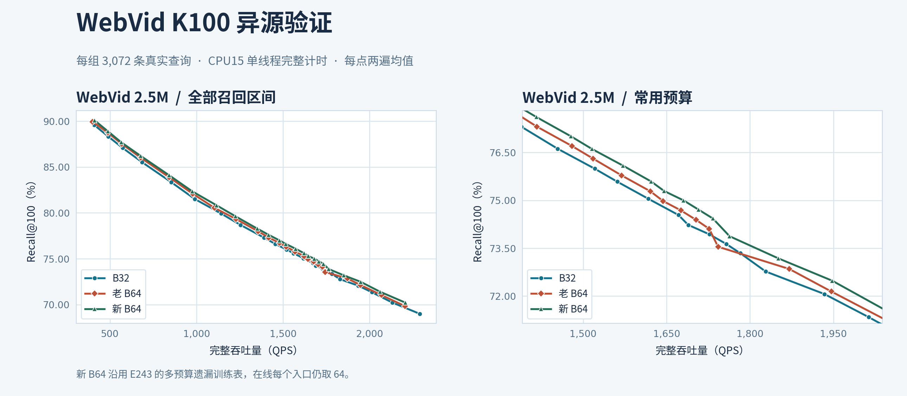

# E237 WebVid B64 异源验证与高召回

冻结 E243 的 More64 与 Mixed64，以及 E234 单分数门。比较新训练监督及按查询分配的异源性能。真实 K100，次序、底库、主图、GT10 路由、原生精算合并固定。

取 WebVid validation 真实查询 3,072 条，物理行 0 至 3071，排除 0 条。与原拟合、E243 扩训及公共测试按向量字节排重。115 点、230 批 CPU15 单线程两遍完整计时。评分使用相应 exact raw-IP GT。

## L196 打开第三路尾部

| 窗口 | 配置 | 实际 Recall@100 | 完整 QPS | 平均精算数 |
|---|---|---:|---:|---:|
| validation | B32 | 73.6296% | 1,757.7 | 93.23 |
| validation | B64-old | 74.3857% | 1,703.3 | 186.78 |
| validation | More64 | 74.6829% | 1,706.5 | 185.57 |
| validation | Mixed64 | 74.7087% | 1,707.4 | 185.44 |
| validation | CutoffGate | 74.3473% | 1,710.4 | 175.79 |

## 75.5% 召回目标

各法使用有限网格的最快实测达标点。慢遍对快遍只描述速度波动。

| 窗口 | 配置 | L | 实际召回 | 完整 QPS | 比老 B64 | 慢遍比老 B64 快遍 |
|---|---|---:|---:|---:|---:|---:|
| validation | B32 | 224 | 75.5830% | 1,561.4 | -0.50% | -0.56% |
| validation | B64-old | 216 | 75.7790% | 1,569.2 | — | — |
| validation | More64 | 208 | 75.5677% | 1,624.6 | +3.53% | +3.49% |
| validation | Mixed64 | 208 | 75.5915% | 1,622.1 | +3.37% | +3.30% |
| validation | CutoffGate | 216 | 75.7419% | 1,576.5 | +0.46% | +0.44% |

## 验证

29,440 次额外原生标量 Top-K 全排序核对，两遍包位级一致。逐条核新版候选包含 B32，单分数门选原 B64 子集。各法同档路由和画像分数一致。

[协议](protocol.md) · [逐点结果](analysis/points.csv) · [目标比较](analysis/targets.csv) · [同 L 救损](analysis/same_L.csv) · [原始两遍](analysis/rounds.csv) · [封存](seal.json)
