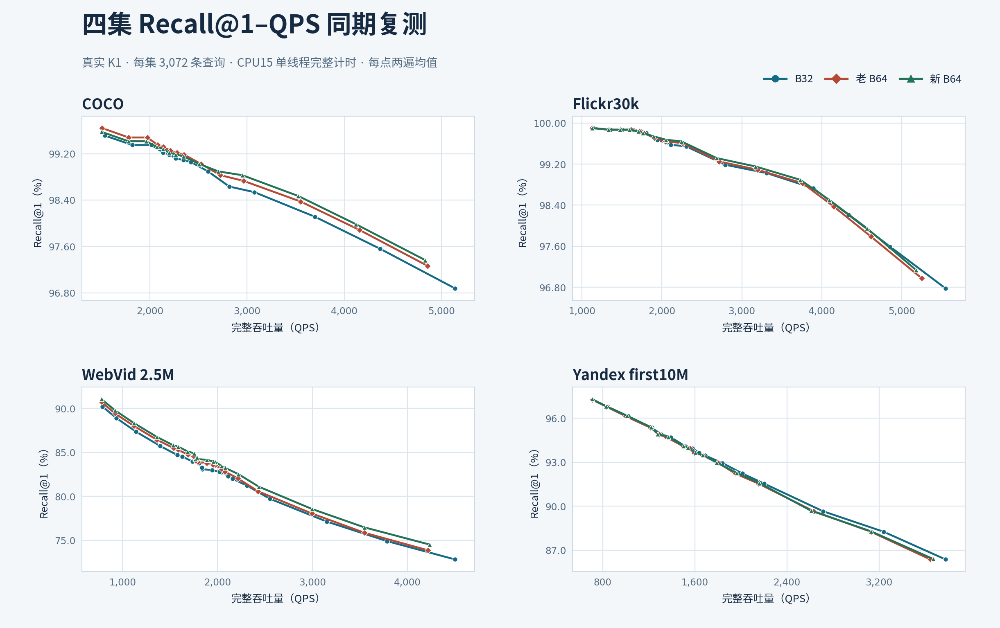
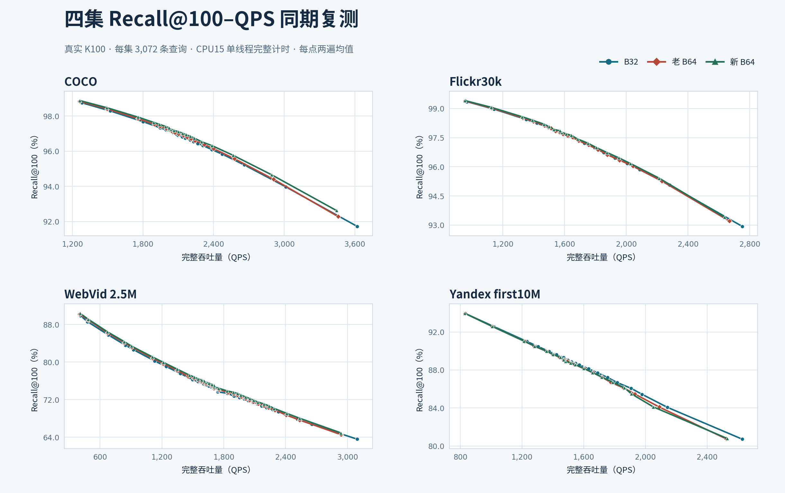

# E251 四集 B32、老 B64 与新 B64 复测

四集各 3,072 条真实公开查询、真 K1 和 K100、465 点、930 个完整 CPU15 单线程批次，每点两遍。
所有正式批次结束后按原 GT100 评分。下表使用各法在同一召回门槛内最快的实测点，QPS 取两遍均值。

## 代表召回门槛

| 数据集 | K | 门槛 | B32 的 L / 召回 / QPS | 老 B64 | 新 B64 | 新对 B32 | 新对老 B64 | 慢遍对老快遍 |
|---|---:|---:|---|---|---|---:|---:|---:|
| COCO | 1 | 99% | L176 / 99.0560% / 2,420.3 | L160 / 99.0234% / 2,524.8 | L160 / 99.0234% / 2,505.7 | +3.53% | -0.76% | -0.91% |
| COCO | 100 | 97% | L216 / 97.0778% / 2,051.5 | L204 / 97.0641% / 2,070.6 | L196 / 97.0254% / 2,136.5 | +4.14% | +3.19% | +2.73% |
| Flickr30k | 1 | 99.5% | L128 / 99.5443% / 2,303.7 | L128 / 99.6094% / 2,257.1 | L128 / 99.6419% / 2,243.6 | -2.61% | -0.60% | -0.84% |
| Flickr30k | 100 | 97.5% | L200 / 97.5723% / 1,623.8 | L192 / 97.5326% / 1,651.4 | L192 / 97.6191% / 1,643.4 | +1.21% | -0.48% | -0.59% |
| WebVid 2.5M | 1 | 84% | L216 / 84.5052% / 1,630.5 | L184 / 84.0495% / 1,771.8 | L176 / 84.1471% / 1,885.8 | +15.65% | +6.43% | +5.75% |
| WebVid 2.5M | 100 | 75.5% | L224 / 75.8092% / 1,550.2 | L208 / 75.6576% / 1,606.7 | L204 / 75.7220% / 1,624.8 | +4.81% | +1.12% | +0.67% |
| Yandex first10M | 1 | 92% | L144 / 92.2201% / 2,013.5 | L144 / 92.2201% / 1,951.7 | L144 / 92.2526% / 1,964.5 | -2.43% | +0.65% | -0.40% |
| Yandex first10M | 100 | 90% | L240 / 90.4782% / 1,303.2 | L240 / 90.5016% / 1,279.6 | L240 / 90.5146% / 1,281.5 | -1.67% | +0.15% | -0.38% |

## 全网格

固定门槛的速度胜点按双方均达标统计。折线描述只覆盖两法实际召回重叠，实测支配使用原始测量点。

| 数据集 | K | 对照 | 新版同 L 召回提高 | 新版同 L 召回差（百分点） | 新版达标均值更快 | 新版慢遍仍更快 | 新版重叠折线更快 | 新版被对照实点支配 |
|---|---:|---|---:|---:|---:|---:|---:|---:|
| COCO | 1 | B32 | 14/14 | +0.0651 到 +0.4883 | 3/5 | 3/5 | 12/13 | 0 |
| COCO | 1 | B64-old | 5/14 | -0.0651 到 +0.0977 | 0/5 | 0/5 | 5/14 | 9 |
| COCO | 100 | B32 | 19/19 | +0.1322 到 +0.9036 | 3/7 | 3/7 | 18/18 | 0 |
| COCO | 100 | B64-old | 19/19 | +0.0446 到 +0.3441 | 3/7 | 2/7 | 18/18 | 0 |
| Flickr30k | 1 | B32 | 9/15 | +0.0000 到 +0.3581 | 2/5 | 2/5 | 8/15 | 6 |
| Flickr30k | 1 | B64-old | 9/15 | +0.0000 到 +0.1628 | 1/5 | 1/5 | 10/15 | 5 |
| Flickr30k | 100 | B32 | 19/19 | +0.0592 到 +0.4775 | 6/7 | 5/7 | 17/18 | 0 |
| Flickr30k | 100 | B64-old | 19/19 | +0.0254 到 +0.2012 | 1/7 | 1/7 | 18/18 | 0 |
| WebVid 2.5M | 1 | B32 | 20/20 | +0.8464 到 +1.6927 | 7/8 | 7/8 | 19/19 | 0 |
| WebVid 2.5M | 1 | B64-old | 20/20 | +0.3255 到 +0.6510 | 7/8 | 7/8 | 19/19 | 0 |
| WebVid 2.5M | 100 | B32 | 33/33 | +0.4945 到 +1.3525 | 14/16 | 12/16 | 32/32 | 0 |
| WebVid 2.5M | 100 | B64-old | 33/33 | +0.1400 到 +0.3877 | 14/17 | 9/17 | 32/32 | 0 |
| Yandex first10M | 1 | B32 | 16/16 | +0.0326 到 +0.0326 | 0/7 | 0/7 | 1/15 | 0 |
| Yandex first10M | 1 | B64-old | 16/16 | +0.0326 到 +0.0326 | 6/7 | 3/7 | 11/15 | 0 |
| Yandex first10M | 100 | B32 | 19/19 | +0.0257 到 +0.0703 | 0/8 | 0/8 | 0/18 | 4 |
| Yandex first10M | 100 | B64-old | 19/19 | +0.0111 到 +0.0329 | 1/8 | 0/8 | 13/18 | 0 |

## 训练与资源

| 数据集 | 新表来源 | 训练查询 / 追加 | 新表在线文件 KiB | 进程峰值 RSS GiB | K1 / K100 的 L 档数 |
|---|---|---:|---:|---:|---:|
| COCO | 20261123_coco_b64_multibudget_training_v1 | 20,096 / 4,096 | 204.5 | 0.29 | 14/19 |
| Flickr30k | E251 | 20,096 / 4,096 | 204.5 | 0.10 | 15/19 |
| WebVid 2.5M | 20261123_b64_multibudget_training_v1 | 24,192 / 8,192 | 204.5 | 5.41 | 20/33 |
| Yandex first10M | E251 | 24,192 / 8,192 | 206.1 | 9.92 | 16/19 |

Flickr30k 从固定 profile 角色取额外真查询并重算精确 raw-IP 标签，Yandex 从原 router_train 中按精确向量排重。
复测的 COCO、Flickr30k、WebVid、Yandex 查询为 E229 历史公开窗。绝对 QPS 按本轮同期对照解读。
全部两遍包按字节相同。核验了 231 组历史同档四字段和 119,040 条额外原生标量排序。

[协议](protocol.md) · [逐点](analysis/points.csv) · [原始两遍](analysis/rounds.csv) · [固定目标](analysis/targets.csv) · [同 L 救损](analysis/same_L.csv) · [逐点匹配](analysis/matched.csv) · [表来源](configs/table_provenance.json) · [封存](seal.json)
