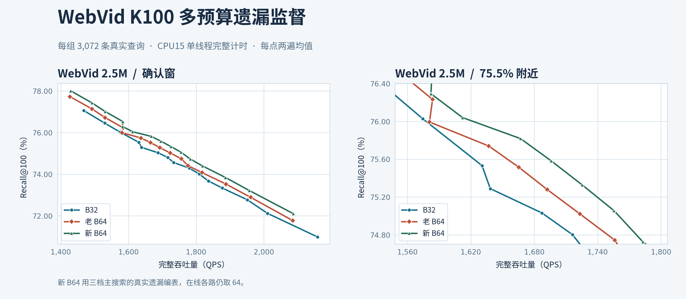

# E243 WebVid B64 多预算遗漏监督

保留原 B32 前缀。固定原 B32 前缀。More64 加入更多独立的真实训练向量，仍按 L200 编表。Mixed64 用同样训练向量的 L176、192、208 遗漏联合编表。真实 K100，次序、底库、主图、GT10 路由、原生精算合并固定。

确认窗 3,072 条，训练与校准另用开发窗。确认物理行从 3073 至 9222 按冻结清单选择，与开发、E229 诊断及原画像拟合窗精确字节隔离。90 点、180 批 CPU15 单线程两遍完整计时。结果均从真实返回评分。

## L196 打开第三路尾部

| 窗口 | 配置 | 实际 Recall@100 | 完整 QPS | 平均精算数 |
|---|---|---:|---:|---:|
| confirmation | B32 | 74.2972% | 1,778.8 | 93.05 |
| confirmation | B64-old | 75.0208% | 1,723.3 | 186.22 |
| confirmation | Far52 | 74.9684% | 1,728.8 | 174.57 |
| confirmation | More64 | 75.3083% | 1,720.4 | 185.12 |
| confirmation | Mixed64 | 75.3271% | 1,725.5 | 184.96 |
| confirmation | Mixed52 | 75.2620% | 1,729.5 | 173.42 |

## 75.5% 召回目标

各法使用有限网格的最快实测达标点。慢遍对快遍只描述速度波动。

| 窗口 | 配置 | L | 实际召回 | 完整 QPS | 比老 B64 | 慢遍比老 B64 快遍 |
|---|---|---:|---:|---:|---:|---:|
| confirmation | B32 | 216 | 75.5319% | 1,630.7 | -2.09% | -2.18% |
| confirmation | B64-old | 204 | 75.5150% | 1,665.4 | — | — |
| confirmation | Far52 | 208 | 75.6885% | 1,639.0 | -1.59% | -1.68% |
| confirmation | More64 | 200 | 75.5641% | 1,686.8 | +1.28% | +0.86% |
| confirmation | Mixed64 | 200 | 75.5824% | 1,696.1 | +1.84% | +1.81% |
| confirmation | Mixed52 | 200 | 75.5176% | 1,692.8 | +1.65% | +1.23% |

## 离线训练

沿用 16,000 条原训练，加入 8,192 条按查询字节排重的独立训练。
- more 编表 663,385 个实际遗漏事件，B32 覆盖 90,390，扩表覆盖 150,552，原生编表 1.9 秒。
- mixed 编表 2,034,261 个实际遗漏事件，B32 覆盖 272,479，扩表覆盖 456,002，原生编表 4.5 秒。

## 验证

23,040 次额外原生标量 Top-K 全排序核对，两遍包位级一致。逐条核新版候选包含 B32 和 Mixed52 嵌套关系。各法同档路由和画像分数一致。

[协议](protocol.md) · [训练身份](models/train/roles.json) · [逐点结果](analysis/points.csv) · [目标比较](analysis/targets.csv) · [同 L 救损](analysis/same_L.csv) · [原始两遍](analysis/rounds.csv) · [封存](seal.json)
