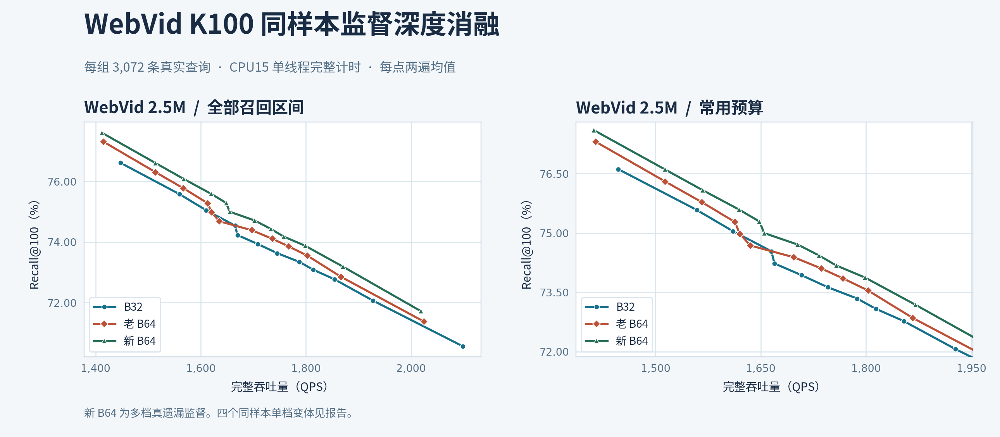

# E247 WebVid B64 同样本监督深度消融

同一批训练样本，用四个单独主搜索 L 以及 E243 多档主搜索真漏点分别编表。真实 K100，次序、底库、主图、GT10 路由、原生精算合并固定。

取 WebVid validation 真实查询 3,072 条，物理行 0 至 3071，排除 0 条。与原拟合、E243 扩训及公共测试按向量字节排重。84 点、168 批 CPU15 单线程两遍完整计时。评分使用相应 exact raw-IP GT。

## L196 打开第三路尾部

| 窗口 | 配置 | 实际 Recall@100 | 完整 QPS | 平均精算数 |
|---|---|---:|---:|---:|
| validation | B32 | 73.6296% | 1,745.4 | 93.23 |
| validation | B64-old | 74.3857% | 1,697.4 | 186.78 |
| validation | Single176 | 74.7087% | 1,700.2 | 185.32 |
| validation | Single192 | 74.6986% | 1,706.9 | 185.43 |
| validation | Single200 | 74.6829% | 1,705.2 | 185.57 |
| validation | Single208 | 74.6813% | 1,697.0 | 185.61 |
| validation | Mixed64 | 74.7087% | 1,702.6 | 185.44 |

## 75.5% 召回目标

各法使用有限网格的最快实测达标点。慢遍对快遍只描述速度波动。

| 窗口 | 配置 | L | 实际召回 | 完整 QPS | 比老 B64 | 慢遍比老 B64 快遍 |
|---|---|---:|---:|---:|---:|---:|
| validation | B32 | 224 | 75.5830% | 1,559.0 | -0.47% | -1.03% |
| validation | B64-old | 216 | 75.7790% | 1,566.4 | — | — |
| validation | Single176 | 208 | 75.5863% | 1,614.0 | +3.04% | +2.45% |
| validation | Single192 | 208 | 75.5801% | 1,613.2 | +2.99% | +2.82% |
| validation | Single200 | 208 | 75.5677% | 1,615.9 | +3.16% | +2.76% |
| validation | Single208 | 208 | 75.5677% | 1,617.4 | +3.26% | +3.09% |
| validation | Mixed64 | 208 | 75.5915% | 1,619.5 | +3.39% | +3.15% |

## 同 L 对最佳单档

| L | 当档召回最佳单档 | 多档新增正确成员 | 多档−单档完整 QPS |
|---:|---|---:|---:|
| 160 | Single176 | -16 | -0.33% |
| 176 | Single176 | -4 | +0.25% |
| 184 | Single176 | -2 | +0.11% |
| 188 | Single176 | -1 | -0.17% |
| 192 | Single176 | -2 | -0.15% |
| 196 | Single176 | +0 | +0.14% |
| 200 | Single176 | +6 | -0.01% |
| 204 | Single176 | +8 | +1.35% |
| 208 | Single176 | +16 | +0.34% |
| 216 | Single176 | +20 | -0.12% |
| 224 | Single176 | +27 | -0.16% |
| 244 | Single176 | +31 | -0.03% |

## 原训练主包核对

重跑 L200 的原 16,000 条训练和 E183 历史主包对照。各字段存在差异的查询数见复核记录。 [字段核对](analysis/original_training_l200_parity.json)

## 验证

21,504 次额外原生标量 Top-K 全排序核对，两遍包位级一致。逐条核新版候选包含 B32 有序前缀。各法同档路由和画像分数一致。

[协议](protocol.md) · [逐点结果](analysis/points.csv) · [目标比较](analysis/targets.csv) · [同 L 救损](analysis/same_L.csv) · [原始两遍](analysis/rounds.csv) · [封存](seal.json)
