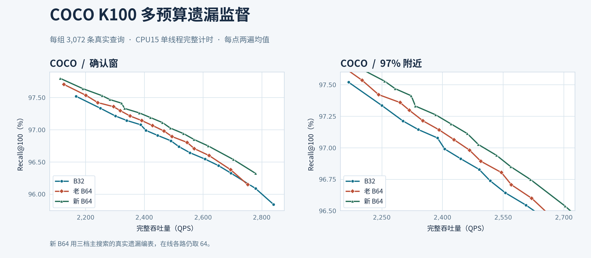

# E245 COCO B64 多预算遗漏监督

保留原 B32 前缀。固定原 B32 前缀。More64 加入更多独立的真实训练向量，仍按 L200 编表。Mixed64 用同样训练向量的 L176、192、208 遗漏联合编表。真实 K100，次序、底库、主图、GT10 路由、原生精算合并固定。

确认使用 E229 的 3,072 个 COCO 源组，额外训练与确认、原拟合按源组和向量字节排重。90 点、180 批 CPU15 单线程两遍完整计时。结果均从真实返回评分。

## L196 打开第三路尾部

| 窗口 | 配置 | 实际 Recall@100 | 完整 QPS | 平均精算数 |
|---|---|---:|---:|---:|
| confirmation | B32 | 96.6426% | 2,555.5 | 87.70 |
| confirmation | B64-old | 96.8929% | 2,494.9 | 161.30 |
| confirmation | Far52 | 96.8721% | 2,500.2 | 153.46 |
| confirmation | More64 | 96.9805% | 2,490.8 | 168.12 |
| confirmation | Mixed64 | 97.0254% | 2,488.9 | 171.82 |
| confirmation | Mixed52 | 97.0013% | 2,488.3 | 161.32 |

## 97% 召回目标

各法使用有限网格的最快实测达标点。慢遍对快遍只描述速度波动。

| 窗口 | 配置 | L | 实际召回 | 完整 QPS | 比老 B64 | 慢遍比老 B64 快遍 |
|---|---|---:|---:|---:|---:|---:|
| confirmation | B32 | 216 | 97.0778% | 2,387.7 | -1.69% | -1.92% |
| confirmation | B64-old | 204 | 97.0641% | 2,428.6 | — | — |
| confirmation | Far52 | 204 | 97.0452% | 2,428.2 | -0.02% | -0.30% |
| confirmation | More64 | 200 | 97.0684% | 2,462.0 | +1.37% | +1.14% |
| confirmation | Mixed64 | 196 | 97.0254% | 2,488.9 | +2.48% | +2.31% |
| confirmation | Mixed52 | 196 | 97.0013% | 2,488.3 | +2.46% | +1.85% |

## 离线训练

沿用 16,000 条原训练，加入 4,096 条按查询字节排重的独立训练。
- more 编表 94,169 个实际遗漏事件，B32 覆盖 53,568，扩表覆盖 77,365，原生编表 0.2 秒。
- mixed 编表 299,835 个实际遗漏事件，B32 覆盖 163,303，扩表覆盖 240,032，原生编表 0.4 秒。

## 验证

23,040 次额外原生标量 Top-K 全排序核对，两遍包位级一致。逐条核新版候选包含 B32 和 Mixed52 嵌套关系。各法同档路由和画像分数一致。

[协议](protocol.md) · [训练身份](models/train/roles.json) · [逐点结果](analysis/points.csv) · [目标比较](analysis/targets.csv) · [同 L 救损](analysis/same_L.csv) · [原始两遍](analysis/rounds.csv) · [封存](seal.json)
