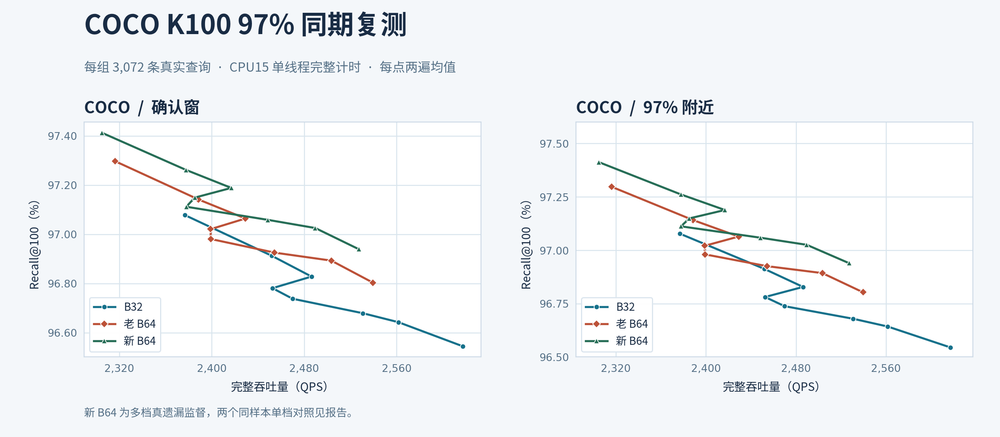

# E250 COCO B64 97% 同期复测

冻结 E248 的 L176、L192 单档与 E245 多档表，直接复测达标附近。真实 K100，次序、底库、主图、GT10 路由、原生精算合并固定。

COCO 确认 3,072 个真实源组，原 E245 训练与留出保持按源组分离。40 点、80 批 CPU15 单线程两遍完整计时。评分使用 exact raw-IP GT。

## L196 打开第三路尾部

| 窗口 | 配置 | 实际 Recall@100 | 完整 QPS | 平均精算数 |
|---|---|---:|---:|---:|
| confirmation | B32 | 96.6426% | 2,561.6 | 87.70 |
| confirmation | B64-old | 96.8929% | 2,503.5 | 161.30 |
| confirmation | Single176 | 97.0283% | 2,488.5 | 170.49 |
| confirmation | Single192 | 97.0029% | 2,487.7 | 169.30 |
| confirmation | Mixed64 | 97.0254% | 2,489.6 | 171.82 |

## 97% 召回目标

各法使用有限网格的最快实测达标点。慢遍对快遍只描述速度波动。

| 窗口 | 配置 | L | 实际召回 | 完整 QPS | 比老 B64 | 慢遍比老 B64 快遍 |
|---|---|---:|---:|---:|---:|---:|
| confirmation | B32 | 216 | 97.0778% | 2,376.8 | -2.15% | -2.57% |
| confirmation | B64-old | 204 | 97.0641% | 2,429.1 | — | — |
| confirmation | Single176 | 196 | 97.0283% | 2,488.5 | +2.44% | +1.88% |
| confirmation | Single192 | 196 | 97.0029% | 2,487.7 | +2.41% | +2.12% |
| confirmation | Mixed64 | 196 | 97.0254% | 2,489.6 | +2.49% | +2.33% |

## 同 L 对最佳单档

| L | 当档召回最佳单档 | 多档新增正确成员 | 多档−单档完整 QPS |
|---:|---|---:|---:|
| 192 | Single176 | -21 | -0.38% |
| 196 | Single176 | -9 | +0.04% |
| 198 | Single176 | -12 | -0.47% |
| 200 | Single176 | -9 | +0.31% |
| 202 | Single176 | -9 | +0.56% |
| 204 | Single176 | -12 | -0.29% |
| 208 | Single176 | -14 | +0.16% |
| 216 | Single176 | -5 | -0.34% |

## 原训练主包核对

重跑 L200 的原 16,000 条训练和 E183 历史主包对照。各字段存在差异的查询数见复核记录。 [字段核对](analysis/original_training_l200_parity.json)

## 验证

10,240 次额外原生标量 Top-K 全排序核对，两遍包位级一致。逐条核新版候选包含 B32 有序前缀。各法同档路由和画像分数一致。

[协议](protocol.md) · [逐点结果](analysis/points.csv) · [目标比较](analysis/targets.csv) · [同 L 救损](analysis/same_L.csv) · [原始两遍](analysis/rounds.csv) · [封存](seal.json)
