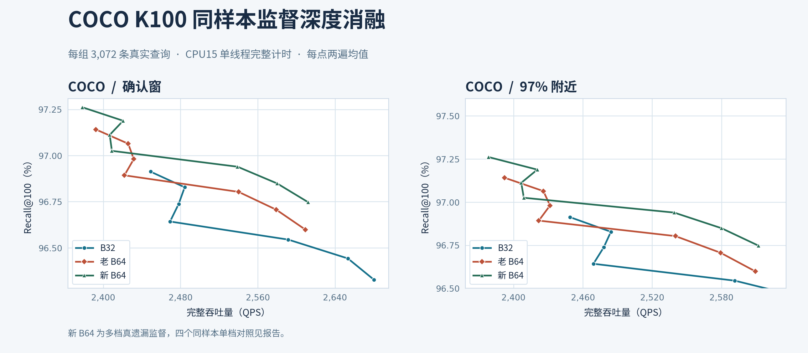

# E248 COCO B64 同样本监督深度消融

同一批训练样本，用四个单独主搜索 L 以及 E243 多档主搜索真漏点分别编表。真实 K100，次序、底库、主图、GT10 路由、原生精算合并固定。

COCO 确认 3,072 个真实源组，原 E245 训练与留出保持按源组分离。49 点、98 批 CPU15 单线程两遍完整计时。评分使用 exact raw-IP GT。

## L196 打开第三路尾部

| 窗口 | 配置 | 实际 Recall@100 | 完整 QPS | 平均精算数 |
|---|---|---:|---:|---:|
| confirmation | B32 | 96.6426% | 2,469.2 | 87.70 |
| confirmation | B64-old | 96.8929% | 2,421.9 | 161.30 |
| confirmation | Single176 | 97.0283% | 2,427.9 | 170.49 |
| confirmation | Single192 | 97.0029% | 2,456.9 | 169.30 |
| confirmation | Single200 | 96.9805% | 2,459.6 | 168.12 |
| confirmation | Single208 | 96.9762% | 2,468.9 | 167.38 |
| confirmation | Mixed64 | 97.0254% | 2,408.9 | 171.82 |

## 97% 召回目标

各法使用有限网格的最快实测达标点。慢遍对快遍只描述速度波动。

| 窗口 | 配置 | L | 实际召回 | 完整 QPS | 比老 B64 | 慢遍比老 B64 快遍 |
|---|---|---:|---:|---:|---:|---:|
| confirmation | B32 | — | —% | — | —% | —% |
| confirmation | B64-old | 204 | 97.0641% | 2,425.8 | — | — |
| confirmation | Single176 | 200 | 97.1149% | 2,441.7 | +0.66% | -0.23% |
| confirmation | Single192 | 196 | 97.0029% | 2,456.9 | +1.28% | -0.44% |
| confirmation | Single200 | 204 | 97.1484% | 2,422.0 | -0.16% | -0.53% |
| confirmation | Single208 | 204 | 97.1436% | 2,422.4 | -0.14% | -0.42% |
| confirmation | Mixed64 | 204 | 97.1885% | 2,420.6 | -0.22% | -0.48% |

## 同 L 对最佳单档

| L | 当档召回最佳单档 | 多档新增正确成员 | 多档−单档完整 QPS |
|---:|---|---:|---:|
| 184 | Single176 | -19 | +0.11% |
| 188 | Single176 | -22 | +0.23% |
| 192 | Single176 | -21 | +0.18% |
| 196 | Single176 | -9 | -0.78% |
| 200 | Single176 | -9 | -1.44% |
| 204 | Single176 | -12 | -0.09% |
| 208 | Single176 | -14 | -0.29% |

## 原训练主包核对

重跑 L200 的原 16,000 条训练和 E183 历史主包对照。各字段存在差异的查询数见复核记录。 [字段核对](analysis/original_training_l200_parity.json)

## 验证

12,544 次额外原生标量 Top-K 全排序核对，两遍包位级一致。逐条核新版候选包含 B32 有序前缀。各法同档路由和画像分数一致。

[协议](protocol.md) · [逐点结果](analysis/points.csv) · [目标比较](analysis/targets.csv) · [同 L 救损](analysis/same_L.csv) · [原始两遍](analysis/rounds.csv) · [封存](seal.json)
