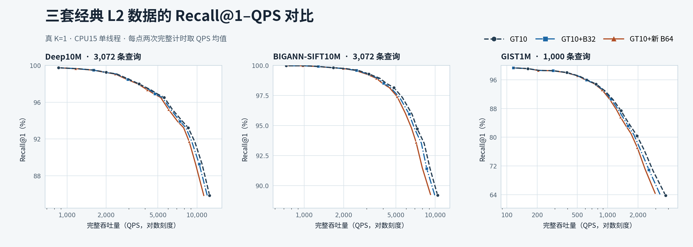
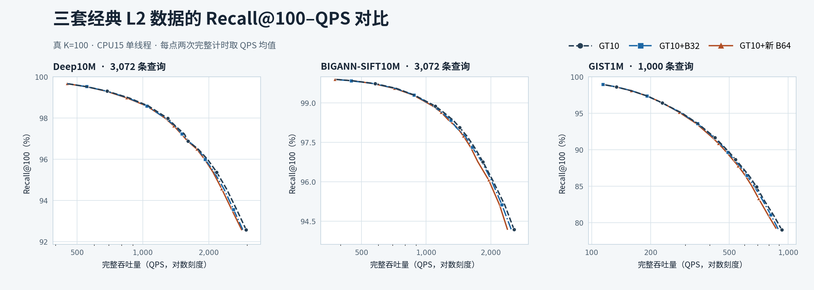

# E253 三套经典 L2 数据的三方法同期比较

纯 GT10、GT10+B32、GT10+Mixed64 冻结 E252 相同底库、主图、GT10 画像、补点表、公开查询窗和 L 网格。纯 GT10 直接返回主搜索结果。

真 K1/K100 共 288 点、576 个完整 CPU15 单线程批次，正式墙钟合计 1302.84 秒。每点两遍取 QPS 算术平均。两遍结果包逐字节相同，原 B32 和 Mixed64 的 192 组返回与 E252 四字段逐字一致。每点另核首 256 条查询，共 73,728 条配置级核验。

## 相同 L 的取舍

| 数据集 | K | 比较 | 召回升 / 平 / 降 | 召回变化（百分点） | 额外精算数 | QPS 变化中位数 |
| --- | ---: | --- | ---: | ---: | ---: | ---: |
| Deep10M | 1 | GT10+B32 对 GT10 | 0 / 16 / 0 | +0.0000 到 +0.0000 | 90.6 | -2.70% |
| Deep10M | 1 | GT10+新 B64 对 GT10 | 0 / 16 / 0 | +0.0000 到 +0.0000 | 176.9 | -5.88% |
| Deep10M | 1 | GT10+新 B64 对 GT10+B32 | 0 / 16 / 0 | +0.0000 到 +0.0000 | 86.3 | -2.31% |
| Deep10M | 100 | GT10+B32 对 GT10 | 15 / 0 / 0 | +0.0003 到 +0.0055 | 90.5 | -1.84% |
| Deep10M | 100 | GT10+新 B64 对 GT10 | 15 / 0 / 0 | +0.0003 到 +0.0094 | 176.7 | -2.56% |
| Deep10M | 100 | GT10+新 B64 对 GT10+B32 | 14 / 1 / 0 | +0.0000 到 +0.0039 | 86.2 | -0.77% |
| BIGANN-SIFT10M | 1 | GT10+B32 对 GT10 | 0 / 16 / 0 | +0.0000 到 +0.0000 | 90.5 | -4.35% |
| BIGANN-SIFT10M | 1 | GT10+新 B64 对 GT10 | 6 / 10 / 0 | +0.0000 到 +0.0651 | 181.1 | -6.32% |
| BIGANN-SIFT10M | 1 | GT10+新 B64 对 GT10+B32 | 6 / 10 / 0 | +0.0000 到 +0.0651 | 90.6 | -2.65% |
| BIGANN-SIFT10M | 100 | GT10+B32 对 GT10 | 15 / 0 / 0 | +0.0007 到 +0.0055 | 90.5 | -1.93% |
| BIGANN-SIFT10M | 100 | GT10+新 B64 对 GT10 | 15 / 0 / 0 | +0.0007 到 +0.0101 | 181.0 | -2.80% |
| BIGANN-SIFT10M | 100 | GT10+新 B64 对 GT10+B32 | 13 / 2 / 0 | +0.0000 到 +0.0046 | 90.5 | -1.13% |
| GIST1M | 1 | GT10+B32 对 GT10 | 10 / 7 / 0 | +0.0000 到 +0.3000 | 95.4 | -3.30% |
| GIST1M | 1 | GT10+新 B64 对 GT10 | 12 / 5 / 0 | +0.0000 到 +0.6000 | 190.9 | -6.43% |
| GIST1M | 1 | GT10+新 B64 对 GT10+B32 | 12 / 5 / 0 | +0.0000 到 +0.3000 | 95.5 | -3.23% |
| GIST1M | 100 | GT10+B32 对 GT10 | 17 / 0 / 0 | +0.0090 到 +0.1230 | 95.0 | -1.75% |
| GIST1M | 100 | GT10+新 B64 对 GT10 | 17 / 0 / 0 | +0.0180 到 +0.2450 | 190.1 | -3.93% |
| GIST1M | 100 | GT10+新 B64 对 GT10+B32 | 17 / 0 / 0 | +0.0090 到 +0.1220 | 95.1 | -2.09% |

额外精算数是每点前 256 条资格查询的均值。逐点和同 L 表记录 K100 的低召回查询（命中 0–9 个）、故障改善和脱离计数。

## 固定召回目标

各方法使用最快的同期实测达标点。比较在共同达标的目标上进行，同一门槛允许三种方法的实际召回不同。慢遍胜出表示较新方法的慢遍仍高于对照快遍。

| 数据集 | K | GT10 / B32 / Mixed64 各自最快次数 | B32 对 GT10 更快 | 新 B64 对 GT10 更快 | 新 B64 对 B32 更快 |
| --- | ---: | ---: | ---: | ---: | ---: |
| Deep10M | 1 | 7 / 0 / 0 | 0/7（慢遍 0） | 0/7（慢遍 0） | 0/7（慢遍 0） |
| Deep10M | 100 | 7 / 0 / 0 | 0/7（慢遍 0） | 0/7（慢遍 0） | 0/7（慢遍 0） |
| BIGANN-SIFT10M | 1 | 7 / 0 / 0 | 0/7（慢遍 0） | 0/7（慢遍 0） | 0/7（慢遍 0） |
| BIGANN-SIFT10M | 100 | 6 / 0 / 1 | 0/7（慢遍 0） | 1/7（慢遍 0） | 2/7（慢遍 1） |
| GIST1M | 1 | 7 / 0 / 1 | 0/8（慢遍 0） | 1/8（慢遍 1） | 1/8（慢遍 1） |
| GIST1M | 100 | 7 / 0 / 1 | 0/8（慢遍 0） | 1/8（慢遍 1） | 2/8（慢遍 1） |

| 数据集 | K | 召回目标 | GT10 的 L、召回和 QPS | GT10+B32 的 L、召回和 QPS | 新 B64 的 L、召回和 QPS |
| --- | ---: | ---: | --- | --- | --- |
| Deep10M | 1 | 90% | L24 / 91.699% / 9,630.7 | L24 / 91.699% / 9,140.1 | L24 / 91.699% / 8,729.2 |
| Deep10M | 1 | 94% | L40 / 95.182% / 6,490.2 | L40 / 95.182% / 6,296.5 | L40 / 95.182% / 6,070.0 |
| Deep10M | 1 | 96% | L48 / 96.517% / 5,599.1 | L48 / 96.517% / 5,406.8 | L48 / 96.517% / 5,254.3 |
| Deep10M | 1 | 97% | L64 / 97.331% / 4,434.2 | L64 / 97.331% / 4,332.4 | L64 / 97.331% / 4,159.0 |
| Deep10M | 1 | 98% | L100 / 98.470% / 3,018.8 | L100 / 98.470% / 2,946.0 | L100 / 98.470% / 2,896.2 |
| Deep10M | 1 | 99% | L128 / 99.056% / 2,422.2 | L128 / 99.056% / 2,393.1 | L128 / 99.056% / 2,350.0 |
| Deep10M | 1 | 99.5% | L280 / 99.642% / 1,202.5 | L280 / 99.642% / 1,184.7 | L280 / 99.642% / 1,169.8 |
| Deep10M | 100 | 94% | L128 / 94.559% / 2,409.6 | L128 / 94.562% / 2,344.2 | L128 / 94.565% / 2,290.8 |
| Deep10M | 100 | 95% | L144 / 95.370% / 2,174.4 | L144 / 95.373% / 2,117.7 | L144 / 95.375% / 2,089.3 |
| Deep10M | 100 | 96% | L176 / 96.481% / 1,792.8 | L176 / 96.484% / 1,786.7 | L176 / 96.485% / 1,765.1 |
| Deep10M | 100 | 97% | L208 / 97.222% / 1,547.3 | L208 / 97.224% / 1,510.0 | L208 / 97.224% / 1,498.4 |
| Deep10M | 100 | 98% | L320 / 98.575% / 1,063.0 | L320 / 98.576% / 1,043.5 | L320 / 98.577% / 1,043.5 |
| Deep10M | 100 | 99% | L512 / 99.301% / 686.0 | L512 / 99.302% / 681.6 | L512 / 99.303% / 677.9 |
| Deep10M | 100 | 99.5% | L640 / 99.515% / 555.6 | L640 / 99.515% / 554.9 | L640 / 99.516% / 551.8 |
| BIGANN-SIFT10M | 1 | 90% | L20 / 91.406% / 9,127.7 | L20 / 91.406% / 8,613.4 | L20 / 91.471% / 7,964.5 |
| BIGANN-SIFT10M | 1 | 95% | L32 / 95.931% / 6,656.1 | L32 / 95.931% / 6,325.7 | L32 / 95.996% / 5,923.5 |
| BIGANN-SIFT10M | 1 | 97% | L40 / 97.331% / 5,610.6 | L40 / 97.331% / 5,355.2 | L40 / 97.396% / 5,123.5 |
| BIGANN-SIFT10M | 1 | 98% | L48 / 98.145% / 4,837.5 | L48 / 98.145% / 4,562.7 | L48 / 98.145% / 4,468.2 |
| BIGANN-SIFT10M | 1 | 99% | L80 / 99.284% / 3,116.8 | L80 / 99.284% / 3,049.6 | L80 / 99.284% / 2,964.1 |
| BIGANN-SIFT10M | 1 | 99.5% | L100 / 99.577% / 2,584.6 | L100 / 99.577% / 2,514.5 | L100 / 99.577% / 2,457.7 |
| BIGANN-SIFT10M | 1 | 99.8% | L160 / 99.805% / 1,669.3 | L160 / 99.805% / 1,661.7 | L160 / 99.805% / 1,636.0 |
| BIGANN-SIFT10M | 100 | 95% | L112 / 95.113% / 2,323.4 | L112 / 95.118% / 2,254.1 | L112 / 95.122% / 2,196.4 |
| BIGANN-SIFT10M | 100 | 96% | L128 / 96.058% / 2,040.4 | L128 / 96.063% / 2,010.5 | L128 / 96.066% / 1,956.0 |
| BIGANN-SIFT10M | 100 | 97% | L160 / 97.303% / 1,681.5 | L160 / 97.307% / 1,641.3 | L160 / 97.309% / 1,612.9 |
| BIGANN-SIFT10M | 100 | 98% | L192 / 98.070% / 1,431.3 | L192 / 98.073% / 1,377.9 | L192 / 98.074% / 1,391.2 |
| BIGANN-SIFT10M | 100 | 99% | L320 / 99.301% / 881.2 | L320 / 99.302% / 880.4 | L320 / 99.303% / 870.5 |
| BIGANN-SIFT10M | 100 | 99.5% | L400 / 99.553% / 728.8 | L400 / 99.554% / 719.2 | L400 / 99.555% / 713.6 |
| BIGANN-SIFT10M | 100 | 99.8% | L640 / 99.841% / 460.8 | L640 / 99.842% / 449.3 | L640 / 99.842% / 462.0 |
| GIST1M | 1 | 75% | L32 / 76.500% / 2,296.0 | L32 / 76.800% / 2,091.5 | L32 / 77.100% / 1,970.7 |
| GIST1M | 1 | 80% | L40 / 80.400% / 1,954.8 | L40 / 80.700% / 1,820.1 | L40 / 81.000% / 1,705.0 |
| GIST1M | 1 | 85% | L56 / 85.200% / 1,510.6 | L56 / 85.400% / 1,427.3 | L56 / 85.600% / 1,340.7 |
| GIST1M | 1 | 90% | L80 / 90.400% / 1,136.2 | L80 / 90.600% / 1,083.0 | L80 / 90.700% / 1,038.4 |
| GIST1M | 1 | 94% | L128 / 94.800% / 766.9 | L128 / 94.900% / 743.6 | L128 / 95.000% / 723.9 |
| GIST1M | 1 | 96% | L200 / 97.000% / 524.2 | L200 / 97.000% / 514.1 | L160 / 96.000% / 599.3 |
| GIST1M | 1 | 98% | L280 / 98.000% / 394.8 | L280 / 98.000% / 387.8 | L280 / 98.000% / 381.6 |
| GIST1M | 1 | 99% | L800 / 99.100% / 161.9 | L800 / 99.100% / 160.9 | L800 / 99.100% / 160.2 |
| GIST1M | 100 | 80% | L112 / 80.920% / 846.3 | L112 / 81.034% / 816.5 | L112 / 81.151% / 785.4 |
| GIST1M | 100 | 85% | L160 / 86.358% / 635.1 | L160 / 86.441% / 618.3 | L144 / 85.100% / 650.1 |
| GIST1M | 100 | 90% | L232 / 90.723% / 458.9 | L232 / 90.780% / 452.6 | L232 / 90.841% / 442.2 |
| GIST1M | 100 | 92% | L320 / 93.509% / 349.5 | L320 / 93.550% / 345.7 | L320 / 93.590% / 340.3 |
| GIST1M | 100 | 94% | L400 / 95.038% / 287.4 | L400 / 95.075% / 284.1 | L400 / 95.108% / 279.3 |
| GIST1M | 100 | 96% | L512 / 96.403% / 229.0 | L512 / 96.429% / 226.9 | L512 / 96.457% / 227.8 |
| GIST1M | 100 | 97% | L640 / 97.326% / 193.5 | L640 / 97.349% / 191.6 | L640 / 97.371% / 190.5 |
| GIST1M | 100 | 98% | L800 / 98.056% / 160.6 | L800 / 98.071% / 160.3 | L800 / 98.084% / 159.0 |

[协议](protocol.md) · [逐点](analysis/points.csv) · [两遍计时](analysis/rounds.csv) · [同 L 救损](analysis/same_L.csv) · [固定目标](analysis/targets.csv) · [原生返回校验](analysis/historical_parity.csv) · [封存](seal.json)
