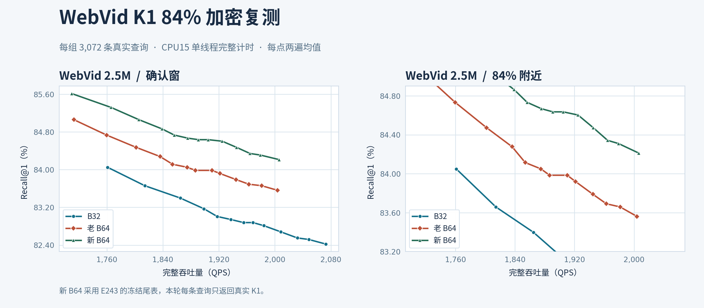

# E249 WebVid B64 84% 加密复测

保留原 B32 前缀。原 B32、老 B64 和 E243 Mixed64 用同一真 K1 确认窗加密。真实 K1，次序、底库、主图、GT10 路由、原生精算合并固定。

确认 3,072 条，查询与原拟合精确字节隔离。确认沿用 E231 物理行 3073 至 9222 的筛选清单。39 点、78 批 CPU15 单线程两遍完整计时。全程真实 K1。

## L200 打开第三路尾部

| 窗口 | 配置 | 实际 Recall@1 | 完整 QPS | 平均精算数 |
|---|---|---:|---:|---:|
| confirmation | B32 | 84.0495% | 1,761.1 | 94.86 |
| confirmation | B64-old | 85.0586% | 1,713.0 | 189.12 |
| confirmation | Mixed64 | 85.6120% | 1,710.0 | 188.30 |

## 84% 召回目标

各法使用有限网格的最快实测达标点。慢遍对快遍只描述速度波动。

| 窗口 | 配置 | L | 实际召回 | 完整 QPS | 比老 B64 | 慢遍比老 B64 快遍 |
|---|---|---:|---:|---:|---:|---:|
| confirmation | B32 | 200 | 84.0495% | 1,761.1 | -6.07% | -6.10% |
| confirmation | B64-old | 180 | 84.0495% | 1,874.9 | — | — |
| confirmation | Mixed64 | 166 | 84.2122% | 2,006.3 | +7.01% | +6.69% |

## 验证

9,984 次额外原生标量 Top-K 全排序核对，两遍包位级一致。逐条核新版候选包含 B32。各法同档路由和画像分数一致。

[协议](protocol.md) · [逐点结果](analysis/points.csv) · [目标比较](analysis/targets.csv) · [同 L 救损](analysis/same_L.csv) · [原始两遍](analysis/rounds.csv) · [封存](seal.json)
