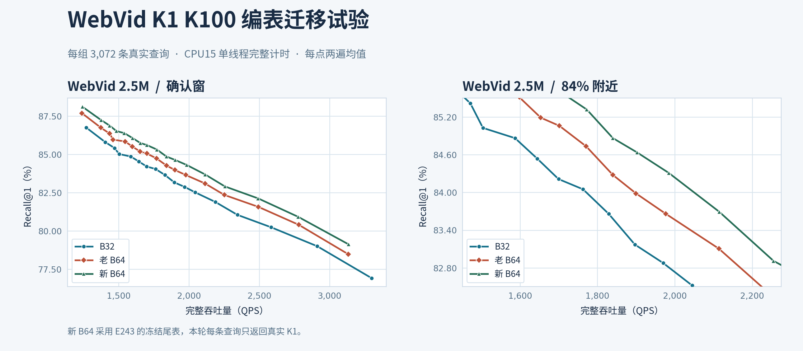

# E246 WebVid B64 K100 编表迁移试验

保留原 B32 前缀。冻结 E243 的 More64 与 Mixed64，保留均匀 B56。真实 K1，次序、底库、主图、GT10 路由、原生精算合并固定。

开发与确认各 3,072 条，查询精确字节隔离。确认沿用 E231 物理行 3073 至 9222 的筛选清单。85 点、170 批 CPU15 单线程两遍完整计时。全程真实 K1。

## L200 打开第三路尾部

| 窗口 | 配置 | 实际 Recall@1 | 完整 QPS | 平均精算数 |
|---|---|---:|---:|---:|
| confirmation | B32 | 84.0495% | 1,762.9 | 94.86 |
| confirmation | B64-old | 85.0586% | 1,701.8 | 189.12 |
| confirmation | More64 | 85.4818% | 1,700.4 | 188.35 |
| confirmation | Mixed64 | 85.6120% | 1,701.2 | 188.30 |
| confirmation | B56-equal | 84.8307% | 1,718.6 | 165.55 |

## 84% 召回目标

各法使用有限网格的最快实测达标点。慢遍对快遍只描述速度波动。

| 窗口 | 配置 | L | 实际召回 | 完整 QPS | 比老 B64 | 慢遍比老 B64 快遍 |
|---|---|---:|---:|---:|---:|---:|
| confirmation | B32 | 200 | 84.0495% | 1,762.9 | -4.20% | -4.41% |
| confirmation | B64-old | 184 | 84.2773% | 1,840.1 | — | — |
| confirmation | More64 | 168 | 84.1797% | 1,983.3 | +7.78% | +7.66% |
| confirmation | Mixed64 | 168 | 84.3099% | 1,984.5 | +7.85% | +7.79% |
| confirmation | B56-equal | 184 | 84.0495% | 1,849.8 | +0.52% | +0.30% |

## 验证

21,760 次额外原生标量 Top-K 全排序核对，两遍包位级一致。逐条核新版候选包含 B32，均匀 B56 是老 B64 子集。各法同档路由和画像分数一致。

[协议](protocol.md) · [逐点结果](analysis/points.csv) · [目标比较](analysis/targets.csv) · [同 L 救损](analysis/same_L.csv) · [原始两遍](analysis/rounds.csv) · [封存](seal.json)
