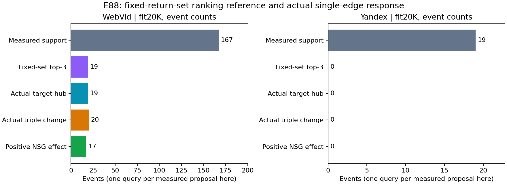

# E88 已测提议目标为何很少改变入口

仅复用冻结fit20K响应，新增ANN/训练/构图/GT/QPS均0。P完整策略更好，并不保证其独有hub在compact画像下排得足够高。

| 数据 | 已测边支持事件 | 固定集插入后目标hub可进前三 | 实际目标hub进前三 | 实际三入口变化 | NSG命中改善 |
|---|---:|---:|---:|---:|---:|
| Web | 167 | 19 | 19 | 20 | 17 |
| Y | 19 | 0 | 0 | 0 | 0 |

Web全1542提议事件中1375未对应被测候选；Y409中390未测，完整表这些实际响应留空。上述167/19恰为不同query，仅代表53/9被测边各自的支持query。Web67个目标本来就在七slot中，实际加边后94个目标返回；Y10个原本就在七slot中，仍全部落在三入口之外。对这组Y支持query，仅增加边不足以弥补目标画像的排序劣势。

排名用float64 query·W，在原七slot与目标的固定并集上排序、按真实hub去重；全部事件按另一lexsort顺序核验，被测支持事件中目标与第三hub分差无近界事件；完整1951事件中另有2个未测事件近界。此参照不模拟HNSW路径；目标未返回不等于没访问，首返回source也不等于关键扩展节点。19和19汇总相等不自行证明逐事件因果等价；不能断言其它候选/打分/入口规则均无效。

Web所有独立边在各自支持query合计净+65命中、其余query净+55；支持外24个query-边收益事件和11个损伤事件。这里是独立干预的事件和，不能当合并图+120；E87实际选择16边后合并仅+94。Y两部分均0。完整40154行集合/mask评分通过。

下一步优先冻结晚间最终候选/矩阵。若另开实质研究，可先只用已暴露fit检查更好hub的画像竞争性，再设计新离线画像/打分目标；必须保留完整入口实际NSG反馈与冻结接受门，不能放宽E87旧support阈值试阳性。

[完整事件](../entry_method_exploration/20260913_until2100_v1/stage29_proposal_rank_diagnosis_v1/results/events.csv) · [完整每边响应](../entry_method_exploration/20260913_until2100_v1/stage29_proposal_rank_diagnosis_v1/results/edges.csv) · [汇总/成本](../entry_method_exploration/20260913_until2100_v1/stage29_proposal_rank_diagnosis_v1/results/summary.json) · [协议](../entry_method_exploration/20260913_until2100_v1/stage29_proposal_rank_diagnosis_v1/protocol.md) · [分析源码](../entry_method_exploration/20260913_until2100_v1/stage29_proposal_rank_diagnosis_v1/src/analyze.py)

fit含历史train/monitor，诊断用于下一方向设计亦属训练反馈；没有读aux响应、E34最终或held-out。首版语法错误发生在执行前，原稿保留；修正版一次成功，无实验重跑。操作wall不作查询性能。

[范围修正版报告](../entry_method_exploration/20260913_until2100_v1/stage29_proposal_rank_diagnosis_v1/report_v2.md)：只修正近界事件范围，原始诊断不变。
