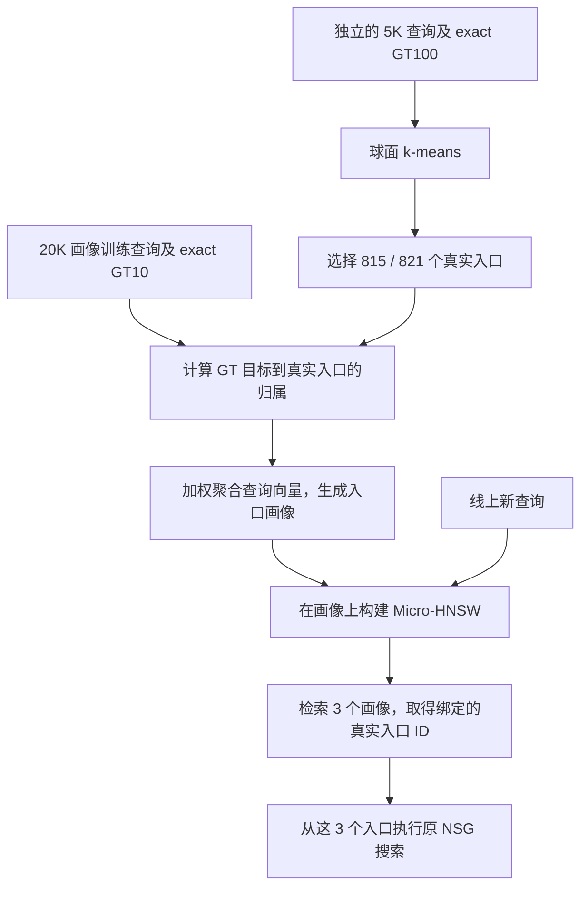

当前保留的最好方法是 **QGT 选真实入口 + GT10 查询画像 + Micro-HNSW 路由**。两套数据使用同一条流程，区别主要在画像的归属方式：

| 配置 | WebVid | Yandex |
|---|---|---|
| 当前方法 | **GT10-soft-t1** | **GT10-hard** |
| 真实入口数量 | 815 | 821 |
| 向量维度 | 512 | 200 |
| 画像训练查询 | 20,000 条 | 20,000 条 |
| 每条查询使用的 GT 目标 | 前 10 个真实近邻 | 前 10 个真实近邻 |
| 目标归属 | 软分配，温度约 0.0162 | 硬分配 |
| 在线选择的真实入口 | 3 个 | 3 个 |

这里的“最好”指当前实验后保留的默认方法；已有结果包含不同搜索预算下的收益和损失，尚不能说它在所有条件下都最优。

它的训练核心是：**先确定哪些真实节点适合作为入口，再根据训练查询的真实近邻，把查询向量聚合成这些入口的画像。** 画像通过闭式计算得到，没有神经网络的反向传播或强化学习更新。



**第一步：准备查询、真实近邻和固定底图。** 训练涉及两组用途不同的查询。

一组是独立的 **5,000 条 QGT 查询**，用于选择真实入口。每条查询已经有对应的 exact GT100，即按照数据集原本的内积指标，在整个 base 中找出的前 100 个真实近邻。

另一组用于构造画像。当前 GT10 使用原 `router_train` 的 `[10000, 30000)`，共 **20,000 条查询**。GT 文件保存了前 100 个近邻，但 GT10 画像只使用其中前 10 个。

另外，`router_train[0,1024)` 用于开发选择，`[1024,2048)` 用于选择后的审计。这两部分不参与当前 GT10 画像的向量聚合。历史 Fast30K 使用过完整 30K 查询，因此它与这里的 GT10-20K需要分别标记。

训练还需要原始 base 向量，以及已经建好的 NSG。当前方法固定 NSG，在它前面增加入口路由层。

**第二步：从 5K 查询中选择真实入口。** 这一步沿用原 Fast 的 QGT-Cover 构造：

1. 将 5K 查询分别归一化为单位向量。
2. 做球面 k-means，簇数设为入口预算：WebVid 815，Yandex 821。
3. 对每个簇，按查询与簇中心的相似度排序，优先查看最接近中心的查询。
4. 按该查询 GT100 的近邻名次，找到第一个尚未被其他簇选中的真实 base 节点，将它作为这个簇的入口。
5. 若该查询无法提供新节点，继续查看簇内下一条查询。实现还保留不足数量时扫描 GT 补齐的逻辑。
6. 最后将选出的真实 ID 升序排列，保存 ID 及其原始 base 向量。

当前入口来自固定 seed `20260828`，球面 k-means 使用 25 轮、一次初始化运行。815/821 是已有配置中的入口预算，GT10 阶段直接继承这组入口。

到这里，得到的是：

\[
H=\{h_1,\ldots,h_m\},\qquad x_{h_j}=\text{入口 }h_j\text{ 的原始向量}
\]

簇中心用于辅助选择真实节点。后续画像训练重新计算归属，不沿用这 5K 查询的聚类分组。具体选择行为已核对[原入口构造代码](/data/netg/ACSG/benches/run/build_fast_entry_variants.py:180)。

**第三步：用每条训练查询的 GT10，计算它对各入口的贡献。** 这是当前方法最关键的一步。

设训练查询为 \(q_i\)，它的第 \(t\) 个真实近邻为 \(g_{it}\)，用 \(\hat v\) 表示向量 \(v\) 的单位方向。先计算：

\[
s_{itj}
=
\hat x_{g_{it}}^\top \hat x_{h_j}
\]

这个分数表示：**查询的第 \(t\) 个真实目标，与第 \(j\) 个真实入口在方向上有多接近。**

这里有三种不同对象：

| 对象 | 在训练中的作用 |
|---|---|
| 查询 \(q_i\) | 最终贡献给画像的向量 |
| 真实近邻 \(x_{g_{it}}\) | 帮助判断查询该贡献给哪些入口 |
| 真实入口 \(x_{h_j}\) | 接收归属，并提供画像的初始先验方向 |

Yandex 使用 **GT10-hard**。每个 GT 目标只归给分数最高的入口：

\[
b_{itj}
=
\mathbf 1\!\left[j=\arg\max_{\ell}s_{it\ell}\right]
\]

同分时优先较小的真实入口 ID。随后，把 10 个 GT 目标的归属等权平均：

\[
a_{ij}=\frac1{10}\sum_{t=1}^{10}b_{itj}
\]

例如，一条查询的 10 个真实近邻中，有 6 个归给入口 A、3 个归给 B、1 个归给 C，那么这条查询对三个画像的贡献权重就是：

\[
a_{iA}=0.6,\qquad a_{iB}=0.3,\qquad a_{iC}=0.1
\]

因此，**“硬”指每个 GT 目标选择一个入口；一条查询仍然可以贡献给多个入口。**

WebVid 使用 **GT10-soft-t1**。每个 GT 目标在全部 815 个入口之间做 softmax：

\[
b_{itj}
=
\frac{\exp(s_{itj}/T)}
{\sum_{\ell=1}^{m}\exp(s_{it\ell}/T)}
\]

再同样对 10 个目标取平均，得到 \(a_{ij}\)。相近的入口可以共同接收权重；温度越低，分配越集中，温度越高，分配越分散。实际代码减去最大分数后再计算指数，以保证数值稳定。

两种方式都满足：

\[
a_{ij}\ge 0,\qquad \sum_j a_{ij}=1
\]

每条训练查询总共贡献一份质量，10 个 GT 目标共同决定这一份质量如何分配。

**第四步：把查询向量聚合成入口画像。** 有了权重之后，每个入口的画像直接计算为：

\[
\boxed{
p_j=
\operatorname{unit}
\left(
\hat x_{h_j}
+
\sum_{i=1}^{20000}a_{ij}\hat q_i
\right)
}
\]

这个公式包含三个操作：

- 用入口的单位原始向量作为先验，权重固定为 1。
- 按 \(a_{ij}\) 累加所有训练查询的单位向量。
- 将累加结果归一化，得到最终画像 \(p_j\)。

比如入口 A 收到了很多某类查询的贡献，其画像就会朝这类查询的共同方向移动。查询支持越充分，固定权重为 1 的原始入口先验影响相对越小；没有查询支持时，画像保持入口原始方向。

**最终聚合进去的是查询向量。GT 目标向量负责产生归属权重。** 所以画像表达的是“哪些查询适合被路由到这个入口”。

实现主要就是矩阵运算：

```text
Q = 每条训练查询的单位向量       # N × d
R = 每个真实入口的单位向量       # H × d
A = 查询到入口的贡献权重         # N × H

S = R + A.T @ Q
P = 按行归一化(S)
```

当前 GT10 的权重与加权累加使用 float64，最终画像导出为 float32。输出分别为 `815×512` 和 `821×200`，每行绑定一个固定真实 ID。[画像计算代码](/data/netg/ACSG/entry_method_exploration/20260910_gt_topk_profiles_v1/src/build_profiles.py:20)

从数学上看，给定归属权重后，这个单位方向使画像与“加权查询总方向加入口先验”的内积最大。它具有直接解，因此画像阶段没有 epoch、学习率或梯度优化过程。

**第五步：确定硬归属还是软归属，以及软归属的温度。** 当前配置来自 E24 的有限候选比较。

温度尺度先只用 fit 的 20K 查询确定：对每条查询的 **GT1 目标**，计算它与所有入口的 cosine，取最高分与次高分之差；然后取这些差值的中位数，最低限制为 \(10^{-4}\)。设这个尺度为 \(\tau\)，预先固定三个候选温度：

\[
T\in\{0.25\tau,\ \tau,\ 4\tau\}
\]

WebVid 的三个值约为：

| 名称 | 温度 |
|---|---:|
| `t0` | 0.0040503 |
| `t1` | **0.0162011** |
| `t2` | 0.0648046 |

所以 **`t1` 是第二档温度的编号，温度数值约为 0.0162**。

当时每个数据集构建了八份候选：GT1-hard、GT10-hard，以及 GT1-soft 和 GT10-soft 各三个温度。所有候选先冻结，再在 cal 的 1,024 条查询上，执行真实的“画像 HNSW top3 → NSG L128”搜索。

选择优先看总 GT10 命中数，再看主图距离计算量，最后使用预先固定的决胜规则。QPS 和精确画像 top3 的诊断结果不参与选温度。最终 WebVid 选出 GT10-soft-t1，Yandex 选出 GT10-hard；审计和后续验证保留结果，不重新选参。[原冻结协议](/data/netg/ACSG/entry_method_exploration/20260910_gt_topk_profiles_v1/protocol.md)

这也明确了监督的边界：**画像构造使用 exact GT 的几何归属；模型选择使用真实搜索结果。画像构造本身没有直接优化三个入口联合执行 NSG 的 Recall。**

**第六步：在画像上构建 Micro-HNSW。** 对选定的画像矩阵 \(P\)，使用普通 HNSW 建图：

| 参数 | 当前值 |
|---|---:|
| 索引向量 | 每个入口的画像 \(p_j\) |
| 节点标签 | 对应真实 base ID |
| 距离函数 | \(1-q^\top p\) |
| `M` | 16 |
| `efConstruction` | 200 |
| 构图 seed | 20260828 |
| 在线 `efSearch` | 10 |
| 返回画像数量 | 3 |

这里的小图索引的是 815/821 个**画像向量**。每个画像携带真实入口 ID，检索到画像后就知道应该从原 NSG 的哪个节点开始搜索。

GT10 的 HNSW 是普通构建算法生成的，没有额外训练边权或在线策略网络。

**第七步：在线查询只执行已冻结的路由和搜索。** 新查询到来后：

1. 将原始查询向量送入 Micro-HNSW。
2. 按查询与画像的内积，近似检索三个画像。
3. 取得三个互异的真实入口 ID，按 ID 升序交给原搜索接口。
4. 从这三个入口执行原 NSG 搜索，返回结果。

在线不需要训练 GT、归属矩阵 \(A\)、softmax 温度计算或画像更新。温度的作用已经固化在画像里。

训练时使用单位方向来计算归属和聚合画像；线上仍保持数据集原始内积搜索合同。特别是 Yandex，主搜索没有新增归一化。

最后，训练成本需要区分阶段。完整入口层构造成本应包括：

\[
T_{\text{入口层}}
=
T_{\text{exact GT}}
+
T_{\text{QGT聚类及选入口}}
+
T_{\text{GT归属及画像聚合}}
+
T_{\text{Micro-HNSW构建}}
\]

从零建立整个检索系统，还要另计底层 NSG 的构建成本。

E24 已有 GT、入口集合和 NSG，恢复 GT1 基线后，其余七份候选的构建阶段分别约为 WebVid **7.94 秒**、Yandex **7.36 秒**，离线配置为 16 线程。这些时间包括该阶段的输入读取、归属计算、画像聚合和产物保存，但没有包含已有 GT 生成、QGT 入口选择及完整系统构建。当前没有完整重测的从零训练总耗时，不能把这几秒称为全部训练成本。[原成本记录](/data/netg/ACSG/entry_method_exploration/20260910_gt_topk_profiles_v1/results/costs.json)