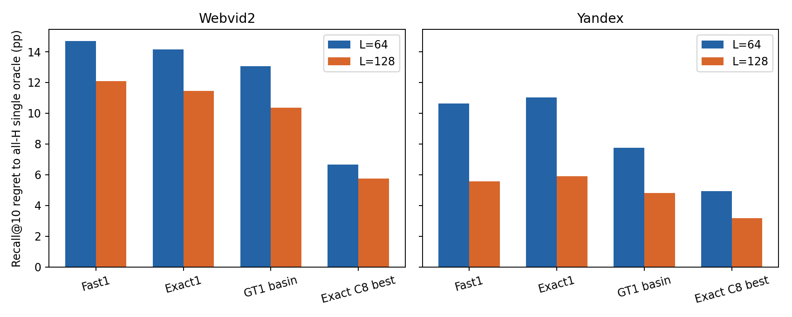
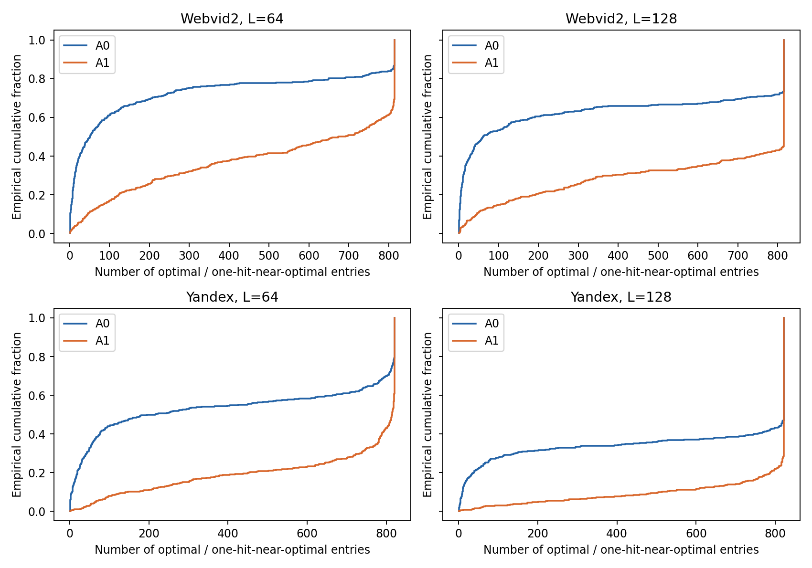
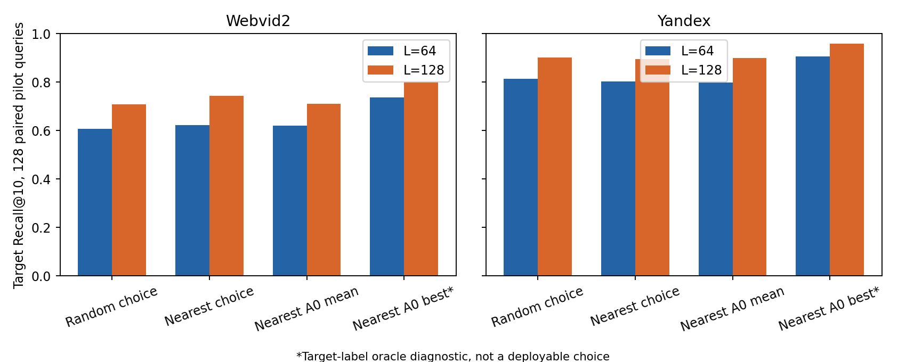
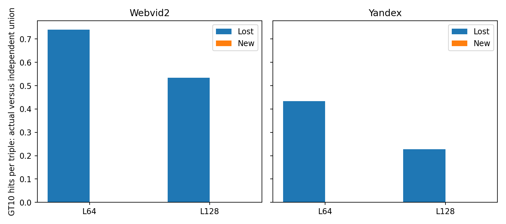

# Fast 入口矩阵分析

此文件为固定协议的离线诊断摘要；不发布 QPS 或部署收益。
最优仅限当前 H、L 和目标；最近邻 A0 的目标最好值使用目标标签，属于 oracle。

32 项主族均为 query 配对 Recall@10 差；普通 95% 与 Bonferroni32 区间来自 10,000 次 bootstrap。

| 数据集 | L | 对比 | ΔRecall (pp) | 95% CI (pp) | 全族 95% CI (pp) |
|---|---:|---|---:|---|---|
| webvid2 | 64 | exact1_minus_fast1 | +0.547 | [-0.137, +1.270] | [-0.570, +1.777] |
| webvid2 | 64 | exact3_minus_fast3 | +0.352 | [-0.234, +0.918] | [-0.590, +1.328] |
| webvid2 | 64 | all_h_single_oracle_minus_exact1 | +14.160 | [+12.715, +15.723] | [+11.891, +16.664] |
| webvid2 | 64 | all_h_single_oracle_minus_exact_c8_single_oracle | +6.660 | [+5.918, +7.402] | [+5.566, +7.910] |
| webvid2 | 64 | gt1_basin_minus_exact1 | +1.094 | [-0.508, +2.695] | [-1.312, +3.871] |
| webvid2 | 64 | c8_unrestricted_triple_oracle_minus_anchor_triple_oracle | +3.105 | [+2.305, +4.024] | [+1.871, +4.633] |
| webvid2 | 64 | c8_triple_oracle_minus_fast3 | +6.699 | [+5.488, +8.027] | [+4.719, +8.965] |
| webvid2 | 64 | nearest_fit_choice_minus_random_fit_choice | +1.562 | [-3.047, +6.250] | [-6.187, +8.672] |
| webvid2 | 128 | exact1_minus_fast1 | +0.625 | [+0.078, +1.289] | [-0.176, +1.801] |
| webvid2 | 128 | exact3_minus_fast3 | +0.625 | [+0.137, +1.250] | [+0.020, +1.687] |
| webvid2 | 128 | all_h_single_oracle_minus_exact1 | +11.465 | [+10.137, +12.852] | [+9.371, +13.754] |
| webvid2 | 128 | all_h_single_oracle_minus_exact_c8_single_oracle | +5.762 | [+5.078, +6.484] | [+4.668, +6.996] |
| webvid2 | 128 | gt1_basin_minus_exact1 | +1.113 | [-0.195, +2.441] | [-1.055, +3.214] |
| webvid2 | 128 | c8_unrestricted_triple_oracle_minus_anchor_triple_oracle | +2.520 | [+1.738, +3.418] | [+1.387, +3.929] |
| webvid2 | 128 | c8_triple_oracle_minus_fast3 | +5.195 | [+4.004, +6.504] | [+3.379, +7.406] |
| webvid2 | 128 | nearest_fit_choice_minus_random_fit_choice | +3.594 | [+0.000, +7.266] | [-1.983, +10.093] |
| yandex | 64 | exact1_minus_fast1 | -0.371 | [-0.898, +0.000] | [-1.316, +0.059] |
| yandex | 64 | exact3_minus_fast3 | -0.449 | [-0.977, -0.039] | [-1.484, +0.000] |
| yandex | 64 | all_h_single_oracle_minus_exact1 | +11.016 | [+9.434, +12.734] | [+8.442, +13.793] |
| yandex | 64 | all_h_single_oracle_minus_exact_c8_single_oracle | +4.941 | [+4.121, +5.879] | [+3.691, +6.602] |
| yandex | 64 | gt1_basin_minus_exact1 | +3.262 | [+1.875, +4.805] | [+1.134, +5.808] |
| yandex | 64 | c8_unrestricted_triple_oracle_minus_anchor_triple_oracle | +2.656 | [+1.836, +3.594] | [+1.426, +4.238] |
| yandex | 64 | c8_triple_oracle_minus_fast3 | +4.512 | [+3.398, +5.742] | [+2.789, +6.628] |
| yandex | 64 | nearest_fit_choice_minus_random_fit_choice | -1.016 | [-4.453, +2.109] | [-6.983, +3.921] |
| yandex | 128 | exact1_minus_fast1 | -0.352 | [-0.859, +0.000] | [-1.348, +0.000] |
| yandex | 128 | exact3_minus_fast3 | -0.312 | [-0.820, +0.039] | [-1.328, +0.078] |
| yandex | 128 | all_h_single_oracle_minus_exact1 | +5.918 | [+4.766, +7.188] | [+4.156, +8.051] |
| yandex | 128 | all_h_single_oracle_minus_exact_c8_single_oracle | +3.164 | [+2.539, +3.867] | [+2.227, +4.421] |
| yandex | 128 | gt1_basin_minus_exact1 | +1.113 | [+0.117, +2.266] | [-0.336, +3.027] |
| yandex | 128 | c8_unrestricted_triple_oracle_minus_anchor_triple_oracle | +0.840 | [+0.508, +1.230] | [+0.352, +1.523] |
| yandex | 128 | c8_triple_oracle_minus_fast3 | +2.363 | [+1.543, +3.301] | [+1.191, +3.933] |
| yandex | 128 | nearest_fit_choice_minus_random_fit_choice | -0.547 | [-3.906, +2.812] | [-6.499, +5.015] |

并列集合、短名单覆盖、GT1 basin 分解、真实组合、跨 L 迁移、Spearman、样本密度及 GT 交集分层见 [analysis.json](analysis.json)。
逐 query 和邻近源映射见 CSV。相关性或当前近邻迁移失败均不证明一般不可学习。

