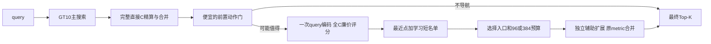

# 当前方法回顾与新残差方案结论

2026-11-02。工作区 `/data/netg/ACSG`，实际 HEAD 为 `96cf05d5410cf51272048cd1f90b4bb194e23c62`；工作区存在后续未提交研究，不能以 HEAD 代替当前实验状态。本次完成原始文档、源码、CSV复核与论文研究，新增14行费用推导、7行教师空间汇总及2组历史正面例子。**没有运行新ANN、训练、GT或性能实验。新方法状态：THEORY_ONLY_UNIMPLEMENTED_UNTESTED。**

结论是：继续保留E99 GT10默认和有条件有效的M5/B32/SQ；后继优先研究**带前置拒绝、廉价入口排序和展开预算选择的条件残差补全**。它必须同时回答“选哪个入口、是否值得展开、展开多少”。只把现有模型换大，或只把现有模型压缩，均缺少足够的收益依据。

新方案目前达到的是机制具体、证据动机成立、可检验；尚未达到完整Recall–QPS有效，更没有达到默认替换。新颖性也未获证明：学习路由、蒸馏、排序、条件预算均有前作，本方案是针对ACSG实测瓶颈的具体后继设计。

## 1. 当前研究方法及已知结论

当前主链为：合法训练query/GT选择真实base入口，训练GT10画像；在线通过画像Micro-HNSW得到3个真实入口，再执行原NSG搜索。GT10中的10是画像训练目标数，评测仍是真实K=1/100。WebVid默认soft-t1、Yandex默认hard，其他数据遵守各自原metric与manifest。

| 路线 | 实际做法 | 目前能下的结论 |
| --- | --- | --- |
| GT10 | 用训练GT改善入口画像，保持原图搜索语义 | 当前默认和必需强控制 |
| M5 / B32 / OPT-B32 | 三条冻结残差posting提出答案ID，按原metric精算并合并；B32去重前至多96个候选 | 有条件性的真实收益；固定ID补全需要遗漏目标身份的重复支持 |
| REUSE-SQ等块补全 | 路由/主返回提出块，廉价扫描后精排；可找到旧ID源之外的目标 | 不要求同一遗漏ID反复出现，但必须付来源定位、扫描、精排和合并费用 |
| E193条件开关 | 用query/route/主返回摘要决定是否执行冻结SQ后端 | 六个学习场景被强控制覆盖；只限定该后端、角色、窗口和门策略 |
| E195–196残差导航 | 将C作为入口，比较距离、邻接新颖性、静态代表和有界辅助搜索 | 能新增救回；加入费用邻近GT10/B32控制后，没有两窗共同保留的原51配置 |
| E197学习入口与执行路径 | 全C预测单入口收益，后置拒绝；另测C桥接、评分缓存和提前初始化 | 336学习器窗口点全部被强GT10/OPT-B32/SQ覆盖；教师空间、识别信号和完整成本分开 |

依据：[当前结论](../../summary.md)、[实现合同](../../spec.md)、[E197原协议](../../entry_method_exploration/20261101_residual_bottleneck_separation_v1/protocol.md)、[正式点](../../entry_method_exploration/20261101_residual_bottleneck_separation_v1/analysis/points.csv)。E197完成9434点/28302完整单线程批次，正式batch wall合计16018.96秒；阶段费用有嵌套，不相加作为总研究耗时。

**历史正面结果仍应保留。** 本次从原始CSV重新提取：

| 原实验/场景 | 残差结果 Recall / 完整QPS | 原实验内GT10对照 | 判断 |
| --- | --- | --- | --- |
| E173 WebVid K1 | M5 L800：91.94% / 414.37 | L1000：91.66% / 333.49 | 已测离散点质量、速度均更好，QPS约+24.25% |
| E191 COCO K1 | REUSE-SQ L400：99.64% / 1072.26 | L693：99.64% / 817.09 | 该窗口同Recall，QPS约+31.23% |

见[原点摘录与来源](historical_examples.csv)。两行各自沿原图、核、角色与窗口，不能与E197混拼绝对QPS，也不说明胜过所有充分调参的残差基线。E197最新有限负结果没有推翻这些历史正面场景。

## 2. 本次新增分析：新方案到底有多少在线费用空间

只复算E197同窗口、FULL/K100/L200的已有CSV。设当前学习方法召回为r，定义：

`T_threshold(r) = min{1e6/QPS(control): control属于同窗GT10/OPT-B32/REUSE-SQ，且整数命中数≥当前模型}`。

它是**达到至少当前质量的最快已测控制的时间**，既不是插值的精确等Recall点，也不是全局最优时间。再计算：

`追加费用空间 = T_threshold(r) − T_OPT-B32(L200)`。

`当前模型时间缩减比例 = 1 − T_threshold(r)/T_MODEL-FULL(L200)`。

均使用完整batch中位QPS的倒数，单位为每query等价微秒。最后一列是维持当前模型质量时，完整耗时达到该控制的描述性要求；不等于仅削减模型推断所需比例。两窗分别比较，不混平均质量与单窗时间。

| 数据 | 模型兑现全C教师 | 距离前6保留全C教师 | 当前质量的追加费用空间（两窗，μs） | 当前模型完整耗时须下降至控制水平 |
| --- | --- | --- | --- | --- |
| COCO | 34.0% | 59.9% | 37.8–55.1 | 49.8%–50.1% |
| Flickr | 26.9% | 53.2% | 38.5–39.8 | 47.4%–47.5% |
| WebVid | 33.7% | 69.2% | 93.6–120.7 | 33.2%–35.9% |
| Yandex | 30.6% | 63.9% | 44.5–69.7 | 39.9%–41.3% |
| Deep10M | 15.9% | 56.4% | −1.9至−1.1 | 45.1%–45.7% |
| SIFT10M | 17.5% | 53.8% | 5.3–10.6 | 42.6%–42.9% |
| GIST | 26.3% | 63.7% | 35.6–57.6 | 20.4%–21.6% |

教师列是两窗汇总的有限池、单seed/384、GT知情诊断，没有计入识别费用。细表：[费用](cost_envelopes.csv)、[教师空间](headroom.csv)、[复算源码](reanalyze.py)、[收据](reanalysis_validation.json)。

COCO A具体例子：MODEL-FULL为97.2871%/905.50 QPS，完整耗时1104.4μs；DIST1-FULL为97.2148%/1550.16 QPS，645.1μs；OPT-B32 L200为96.9180%/2018.38 QPS，495.4μs。达到至少模型质量的最快已测控制是OPT-B32 L228，约550.6μs，因而只剩55.1μs追加空间。

七集两窗共14项中，**DIST1-FULL的完整耗时也全部高于上述模型质量阈值控制时间**。这不证明“模型费用归零也必败”：改变seed会改变实际工作，DIST1不是学习seed的零推断成本下界。它说明，若新方法只是获得“目前学习质量＋目前距离法整条耗时”，仍不能通过这14个强控制比较。优化目标必须同时包括更好的质量、选择性启用、较短动作或执行改进。

Deep的负追加空间还有一个具体含义：在当前模型质量处，已测GT10的完整耗时甚至小于先做完整B32的耗时。保留这条固定L200直接B32底座、再追加导航但不提高质量，缺乏费用空间。不能据此排除其他L、更高质量或其他动作。

这些是曝光窗口上的**事后设计诊断**，不作为新确认结果，也不据此宣称精确可部署时间预算。未来只用合法开发/校准角色制定动作和阈值，再固定确认。

## 3. 源码能解释什么，尚不能解释什么

E197的[Features::row](../../entry_method_exploration/20261101_residual_bottleneck_separation_v1/src/benchmark.cpp)在每个候选上重新计算query范数、C的min/max、route排序等共享量，带embedding的路径也逐候选重新投影query；还为候选遍历邻接读取visited。节点静态表示已预计算。其[正式调用](../../entry_method_exploration/20261101_residual_bottleneck_separation_v1/src/formal.inc)确实对全部C构造特征并预测，随后才执行gate阈值判断；校准为all-off时有直接跳过例外。

因此存在明确的共享计算缓存机会，也存在把昂贵邻接特征限制到少量候选的机会。**源码事实不等于时间归因**：没有分段干预，不能声称重复query投影占全部开销，也不能把修复它预报为某个QPS增幅。现有模型类型、特征和动作导致的完整时间差，仍以真实计时为准。

E197 FULL/K100/L200模型相对距离单入口只多救回约0.107pp COCO、0.130pp Flickr、0.127pp GIST；WebVid/Yandex跨窗换向，Deep/SIFT更差。单纯换成更强在线模型有明显费用风险；单纯用距离前6则会丢失约31%–47%的全池教师空间。

## 4. 新方案：条件残差补全，联合选择入口和展开预算

### 4.1 固定的语义边界

保留GT10主搜索与完整直接答案集合C。导航候选H先限定在C中，以隔离选择器贡献；导航拒绝或短名单不删除C的直接答案资格。首版仍用独立辅助队列，原metric精算和严格合并，不依赖生产`search_new`不存在的pause/resume接口。

每次只选一个seed。动作集合先设计为：不导航、最近C入口/96、学习入口/96、学习入口/384；另保留最近C入口/384作为强控制。96/384是已有预算尺度，尚未冻结为未来实验协议。先不引入多seed组合、修图和新候选银行，避免把支持变化与选择收益混在一起。

前置门的职责是决定是否支付**后续入口识别与展开**费用；它已经支付了GT10和完整直接补全的费用，不能称整个残差零成本。门放弃时应逐字节返回匹配的直接B32结果，仍把门自身费用计入完整wall。

### 4.2 离线学真实动作效用，线上只留紧凑表示

离线对准备部署的K/L/候选银行/后端/预算，生成真实单seed动作标签：净新增命中、成员救回/损伤、物理邻接访问、精算和动作费用。训练表、选择器fit、cal与确认角色分开；旧FULL表使用过的训练query不能直接作为独立选择器校准。可用新合法角色，或严格cross-fit，并披露旧GT10画像监督重叠。

教师可使用较强query–node交互模型、图表示及训练轨迹。实际GT和未来搜索轨迹仅作标签/教师信息，学生不得在线读取。离线训练费不作为当前排除理由，但教师能预测、学生能保留和在线能获益是三个需要分别验证的问题。

线上先预计算导航候选的r维节点表示，每query只算一次query/已付状态表示。候选快分数可写成：

`s_b(q,h,z) = <e(q,z), v_b(h)> + w_b · cheap(q,h,z)`。

其中cheap只用已付原metric分数、来源、query/主返回摘要等；全C快排阶段不扫描每个候选的邻接。作为具体开发起点，可考察r=32，保留最近1点与学习分数最高5点、去重后最多6点；复杂邻接特征和较强重排只用于这个小池，也单测不重排的学生版本。这是可检验参数建议，未由正式查询调优或冻结。

全C最多96，r32候选点积约3072次乘加，另需一次query变换、状态编码、查表/选择和访存；这只是算术计数，不是延迟预测。若H≤821且每行32个ID，单份32维float32节点表的粗上限约3.21MiB，未含多预算头、映射、模型和分配开销；实际唯一ID数与部署RAM须单独报告。不能把预计算成本或加载成本写成消失。

### 4.3 学相对简单动作的收益，允许不做和少做

设R0为完整直接返回，F_a为具体动作a后的最终返回。定义质量增量：

`g(q,a) = (hits_GT(F_a) − hits_GT(R0)) / K`。

训练重点为同query内动作差：学习入口是否胜最近入口、384是否胜96、不导航是否更合算。可用按真实增益差加权的pairwise/listwise损失，加上成本和损伤预测。仅对所有候选标签减同一个query常数不会改变最优排序，不能把这个操作当新学习机制。

以`u(q,a)=g(q,a)−λc(q,a)`作开发代理，c必须与实际执行路径对应；微计时或计数只能作成本估计，不替代最终完整batch wall。λ是给定质量—时间偏好的权重，只在合法cal选择，不用曝光test挑选。最终选择依据仍为实测完整前沿，而非模型预测的u。

前置门用便宜特征判断“进入整个后续级联能否合算”，无需先获得全C重模型最大分数。第二级再比较0/96/384动作；若已付了学生/重排而最终拒绝，前面的费用全部保留。校准分别报告正收益保留、误拒收益、无效启用和条件动作费用；校准90%保留不构成测试保证。

总时间账必须写为：

`T_policy = T_main+direct + T_gate + I_enter·(T_query_encode+T_fast_rank+T_shortlist+T_rerank) + T_selected_expand+merge`。

期望费用保留启用事件与实际动作成本的相关性，不能直接拿全体平均动作成本乘启用率来冒充正式性能。

### 4.4 能证明的边界与不能保证的事情

对于固定有限动作集，若某query上全部动作真实净效用u与预测值误差均≤ε，选择预测最大动作相对同池真实最好动作的效用损失≤2ε；这是标准argmax误差界。若先截短名单，还需加上“全动作最好效用−短名单最好效用”的损失；前置拒绝会另丢失被拒query的正收益。这个分解说明应分别检查候选保留、识别、门控和费用。

这里**没有**已证的统一ε、跨分布保证或时间预测精度，因此不能把该式用于宣布Recall/QPS保证。教师收益空间不保证可学，短名单保留率高不保证学生选择正确；K1稀疏正例也不能借用K100平均增益。

## 5. 与旧方案及论文的实质区别

相对E197，变化是部署状态一致的多预算动作标签、收益差排序、昂贵特征之前的门、一次query编码/预计算节点表示、全池廉价提名与小池重排。将“全C重模型选1点、默认384、评分后拒绝”改成分阶段动作选择。相对11月1日[学习入口设计](../../entry_method_exploration/20261101_learned_residual_navigation_design_v1/report_zh.md)，很多构件已经提出；本稿新增的是**强控制费用空间分析、必须联合控制展开费用的结论，以及更窄的可执行首版**，不把旧设想重新命名成已验证新算法。

| 一手来源 | 可借鉴之处 | 不能直接移植的结论 |
| --- | --- | --- |
| [Learning to Route in Similarity Graphs，ICML 2019](https://proceedings.mlr.press/v97/baranchuk19a.html) | 学节点/query表示和图上路由已存在 | 本方案的新意不能声称是首次学习导航；其训练目标不是本项目直接补全后的条件净增量 |
| [Learning-to-Rank for clustering-based ANN，SIGIR 2024](https://arxiv.org/html/2404.11731v1) | 以排序监督学习线性路由代表，可保持廉价打分形式 | 聚类包含GT与有限预算图入口效用不同，论文收益不等于ACSG收益 |
| [Learned Adaptive Early Termination，SIGMOD 2020](https://www.pdl.cmu.edu/PDL-FTP/BigLearning/mod0246-liA.pdf) | 搜索预算可依据query和中间结果调整 | 不能把原算法上的停止器直接当NSG后置残差门，仍需本地状态和完整费用绑定 |
| [RoarGraph，VLDB 2024](https://arxiv.org/html/2408.08933v1) | query–base联系可用于构图并投影为base图 | 它改变图结构；当前后置选择器保持原图，两者不能混作同机制 |
| [RFix/NGFix，SIGMOD 2025](https://arxiv.org/html/2510.22316v1) | 用路径障碍分析局部图缺陷并修图 | Escape Hardness的算法前提不能自动继承到ACSG队列/visited/并列语义，低度/低密度本身也不是修复因果证据 |

论文链接为本次实际检索的一手来源；这是定向机制排重，不是穷尽截至今天的所有工作。未复现论文性能，不将其加速倍数借给新方案。

另有两条可保留但暂居后位的方案：

- **残差路径离线编译为少量捷径/导航代表。** 将反复有效的路径搬到离线可能省在线展开，但会改变来源或图、影响其他query，并与RoarGraph/NGFix及项目旧图编译方向重合。须先证实可重复路径和实际预算障碍，不能从低度统计直接推出应加边。
- **选择性块补全。** 在固定ID共享弱的数据中用区域/块提供新目标，沿用已有SQ优势并把拒绝移到扫描前。有历史局部价值；E193只测过一种开关，不能全盘否决。但来源发现、编码扫描和精排完整成本仍是门槛，不宜与新导航首版同时改变。

## 6. 新方法最终判断与可证伪条件

**优先验证WebVid/K100和COCO/K100。** WebVid全C教师约+5.31pp，相对当前模型质量的费用空间也较大，但现有学习器未跨窗稳定胜DIST1；它检验能否把大机会变成可识别收益。COCO已见跨窗选点信号，但仅约38–55μs追加空间，适合检验廉价选择和选择性小预算是否真能省费。Flickr/GIST作为后续信号复核；Yandex作为跨窗与raw-IP泛化；Deep/SIFT保留为困难控制，不宣称所有七集都适用。

K1独立保留直接补全强基线，尤其WebVid历史M5/B32及E197 DIST1观察。多集K1可用正入口很少，优先扩大合法正例支持和检验效应稳定性；不能用全拒绝准确率或K100教师空间为K1背书。

未来验证按三个问题递进，先冻结角色、候选、预算、计量和停止条件：

1. **有没有可识别的额外价值？** 在相同C/后端/预算、合法确认角色上，比较距离、全池强教师、快学生、小池重排。报告模型相对DIST1的净救回/损伤、短名单教师保留、全池regret及跨状态迁移。没有稳定超过简单动作的信号，就不能以模型更复杂为继续理由。
2. **能否控制付费？** 单独比较只缓存共享特征、快学生、重排、前置门、96/384预算选择；保持对应输出语义或明确标动作变化。门收益、展开节省、模型质量不能合并归因。原生完整路径必须验证直接回退、候选/预算、无GT推断、返回合并与线程。
3. **是否改善完整前沿？** 同窗口完整单线程，真实K1/K100、至少三轮，顺序串行；强控制包含费用邻近GT10、最强适用OPT-B32/SQ、DIST1及上述消融。控制L由合法开发/校准提出，正式前冻结，不按曝光质量不断追加。报告完整wall/QPS、成员救损、严格K100<10%尾部、访存/精算与新增RAM；三轮不是三份独立质量样本。

若只提升预测分数或同L Recall，却继续被强控制覆盖，结论就是该实现没有兑现净收益。若保持当前质量而便宜的直接底座已经超出质量阈值费用，需改变质量水平、底座或动作，不能无限优化一个小选择器。未通过只约束本次冻结方案；不抹去历史正面残差基线，也不自动扩点直到通过。

**最终推荐：把下一方法定义成“可拒绝、可选预算、以强前沿约束的残差动作策略”，将入口模型作为其中一个部件。当前可支持立项验证，不能支持有效性或默认替换声明。**

## 7. 本次交付和证据限制

- 当前事实已读根文档、E195–197详细卡片、E197协议/源码/交付收据与CSV；历史正面数值来自各自原CSV。
- [source_manifest.json](source_manifest.json)记录17项当前输入SHA；复算前后不变。[reanalysis_validation.json](reanalysis_validation.json)只证明汇总算术与来源一致，不是重新审核全部原始包。
- E197继承两曝光窗口、单图/画像、有限预算和角色迁移边界；其包来源为1原持久窗口、11按原三轮SHA恢复窗口、2新GIST窗口，恢复动作证据身份沿原报告，不重新称为独立复现。
- 本次文件独立放在本目录；原实验、生产源码、根文档、默认和封存历史没有改动。没有新增实验编号、模型、性能结论、PDF或发布动作。
