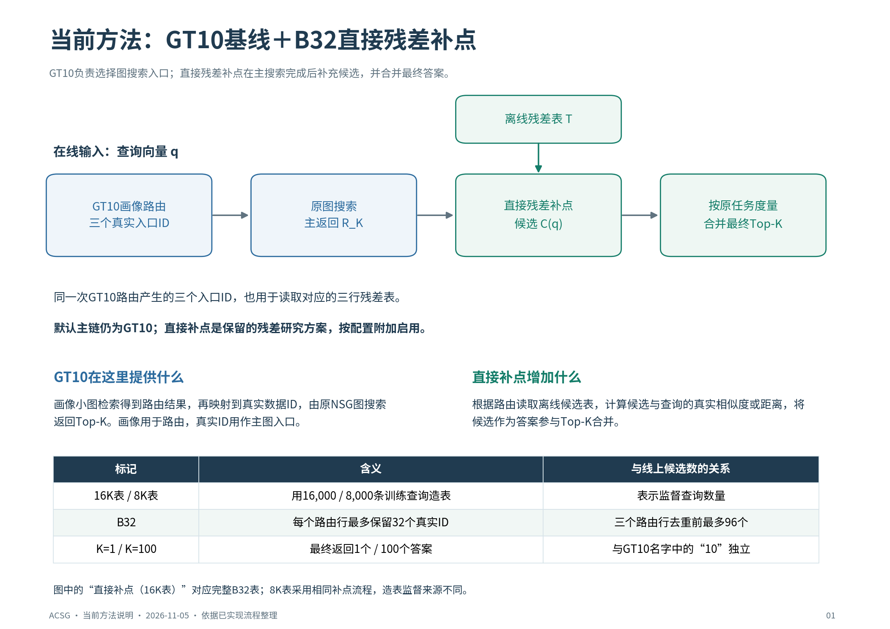
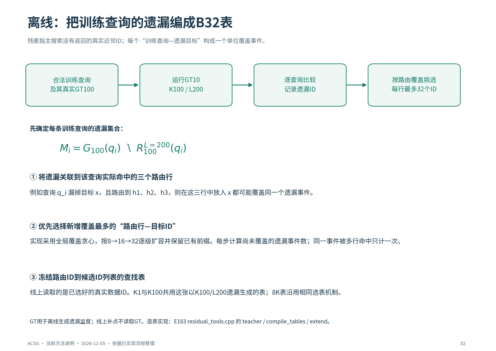
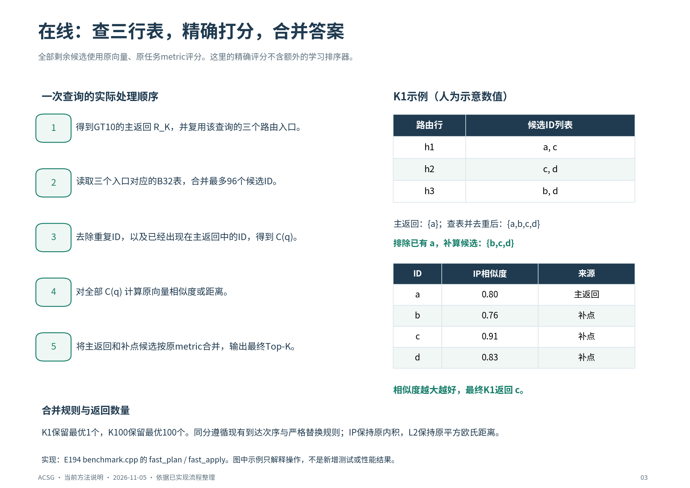

# 当前方法总结：GT10与直接残差补点

2026-11-05。按用户最新要求，仅总结当前保留方法，不展开效果问题、工程性评价或改进方案。[下载3页PDF](ACSG_当前方法总结_GT10与直接残差补点_20261105.pdf)。

当前默认主链为GT10；直接残差补点是保留的残差研究方案，按配置附加启用。双塔、学习精排导航和门控已经退出主线，不属于本说明的当前方法组成部分。本文不恢复这些分支，也没有新实验或默认变更。

## 1. 整体流程

GT10画像路由得到三个真实入口ID，原NSG图搜索从这些入口返回主结果。直接残差补点复用同一组三个路由入口，查离线表得到候选，按原向量、原任务度量评分，再与主返回合并成最终Top-K。

画像向量用于路由；映射后的真实数据ID用作主图入口。补点候选的角色是直接参与答案合并，不需要再学习一个导航入口选择器。

图中的“直接补点（16K表）”对应完整B32表。16K是16,000条造表训练查询；8K是8,000条造表训练查询；B32是每个路由行最多32个真实数据ID。三个路由行去重前最多96个候选。这些数字与最终返回K=1或K=100分别对应不同含义。

## 2. 离线残差表怎样构造

在合法训练查询上运行GT10，以K100/L200作为当前表的固定教师配置。对每条查询q_i，比较实际返回R与对应真实GT100，得到遗漏目标集合M_i = GT100(q_i) − R100(q_i)。每个“训练查询—遗漏目标ID”视为一个单位覆盖事件。

若q_i路由到h₁、h₂、h₃并遗漏目标x，则将x放入这三个路由行中的任意一行，都可能覆盖该遗漏事件。编表时以“路由行—目标ID”为可选项，采用全局覆盖贪心：每一步优先选择能覆盖最多尚未覆盖遗漏事件的选项，并遵守每行容量限制；同一遗漏事件被多个路由行命中只计一次。

实际实现按8→16→32逐级扩容，保留之前选中的有序前缀。最终导出路由入口ID到最多32个候选ID的固定查找表。K1与K100共用当前这张由K100/L200遗漏生成的表。8K表采用相同机制，监督查询来源与完整16K表不同。

GT只用于离线生成遗漏监督，或在搜索返回后做评测；线上补点不读取GT。

## 3. 在线怎样补点，有没有精排

一次查询复用GT10路由结果和主返回，执行以下操作：

1. 读取三个路由行，合并候选ID，去重前最多96个。
2. 去除重复ID，以及已经出现在当前主返回中的ID，得到C(q)。
3. 对C(q)的全部候选按原向量计算原任务相似度或距离。
4. 将候选与主返回按原metric合并，输出最终Top-K。

因此，这里有原向量精确评分，没有额外的学习排序模型。IP任务保持原内积，L2任务保持原平方欧氏距离。K1保留最优1个，K100保留最优100个；同分遵循现有到达次序与严格替换规则。生产优化版本用哈希去重和Top-K维护完成同一补点语义。

PDF中的K1例子采用人为示意数值：三个表行分别为{a,c}、{c,d}、{b,d}，主返回是{a}，则补算{b,c,d}。IP相似度a=0.80、b=0.76、c=0.91、d=0.83时，最终返回c。它只解释操作，不是新增实验结果。

## 实现依据与交付

- [当前spec](../../spec.md)：主链、metric、路由、残差补全与返回合同。
- [E183 residual_tools.cpp](../../entry_method_exploration/20261017_gt10_residual_comprehensive_v1/src/residual_tools.cpp)：teacher、compile_tables、extend，固定K100/L200教师与覆盖贪心。
- [E194 benchmark.cpp](../../entry_method_exploration/20261030_residual_optimization_stability_v1/src/benchmark.cpp)：fast_plan、fast_apply，候选去重、原metric全评分与严格Top-K合并。
- [E183卡片](../../experiment_history/183_gt10_residual_comprehensive_v1.md)：当前固定ID表的实验来源。
- [当前研究收敛记录](../20261104_residual_pruning_graphs_v2/README.md)：当前保留与归档状态。本说明不重述性能结论。

三张图同时提供PNG/SVG。来源与修改前根文档字节见[source_before/identity.json](source_before/identity.json)；新[交付收据](delivery_validation.json)单独记录实际PDF渲染、内容和来源核验。旧报告、源码、模型、raw、seal及manifest保持原件。本次只有方法说明文档交付，没有新的实验编号。
