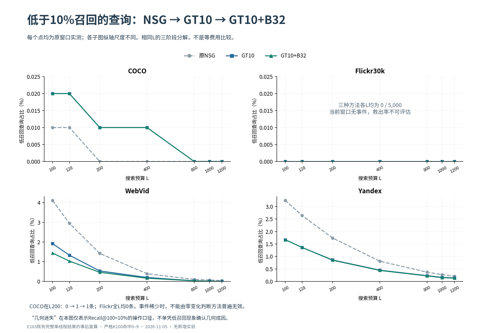
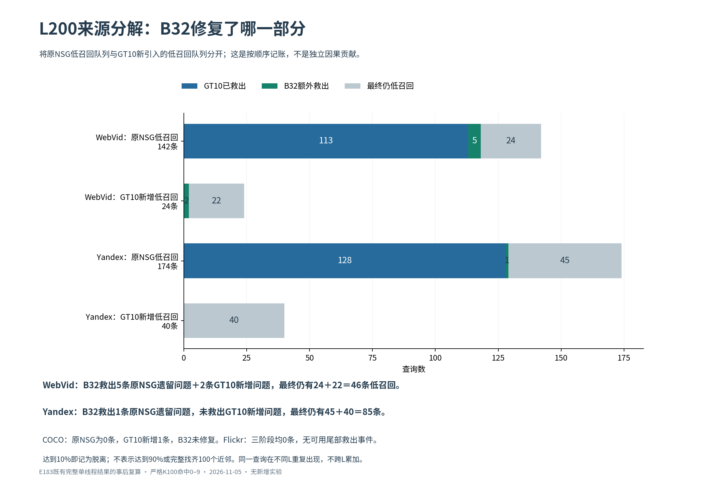
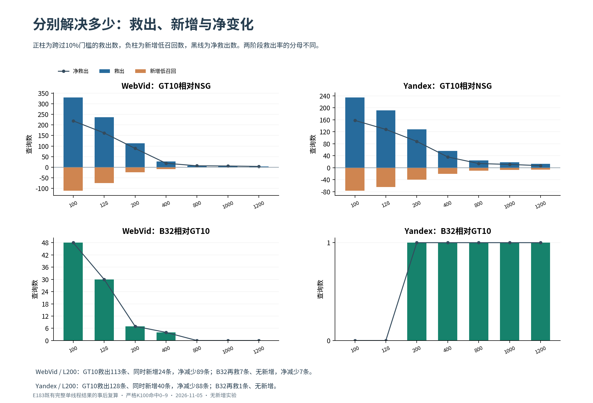
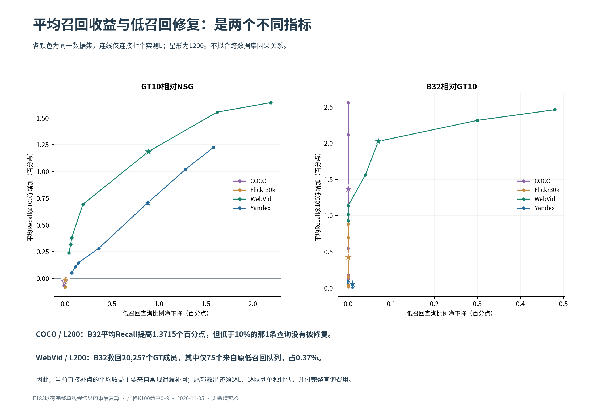

# GT10与B32分别解决了多少低于10%的查询

2026-11-05。按用户定义，“几何迷失率”在本报告中指**单条Recall@100严格低于10%的查询比例**。两阶段都能使部分查询脱离低召回：在当前四多模态数据中，GT10主要修复WebVid、Yandex的严重低召回；B32对WebVid的小预算有补充，对Yandex补充很少。COCO/Flickr的B32平均召回收益主要来自常规遗漏补回。

**本轮不做PDF。** 已有逐查询结果足够，无需补搜索实验。复用E183完整窗口（COCO/WebVid/Yandex各10,000条，Flickr5,000条），覆盖七个L；不是E199两个512条窗口的新确认。三阶段为原NSG→GT10→GT10+B32，B32为完整16K固定ID表，保留原任务metric、图与固定家族。旧与新绝对时间不混拼。

## 1. 口径及两阶段的分母

- 命中0–9个原GT100成员计为低召回，恰好10个排除。救出指从0–9升到至少10；不等于达到90%或找齐100个。
- GT10救出率的分母为原NSG低召回队列；B32救出率的分母为GT10之后的低召回队列。两个百分比不能当作同一任务难度下的独立模型比较。
- 同时统计救出与新增低召回。`后续低召回数 = 原低召回数 − 救出数 + 新增数`。净失败率下降以全部query为分母。
- 这里用“几何迷失”作用户指定的操作标签；统计本身不分辨路由、搜索预算、图结构等成因。顺序分解是记账，不是两个方法作用独立的因果贡献。

若F是原低召回比例、s是其中被救出的比例、新增低召回为u条、总查询为N，则`低召回比例净下降 = F × s − u/N`（比例使用0–1单位）。原迷失率高只提供更大潜在空间，实际下降还取决于能救出的比例及新增损伤。

## 2. L200：GT10完成大部分净下降，B32有条件追加

| 数据 | 查询总数 | NSG低召回 | GT10低召回 | GT10+B32低召回 | GT10救出 / 新增 | B32再救出 / 新增 |
| --- | --- | --- | --- | --- | --- | --- |
| COCO | 10000 | 0 / 0.00% | 1 / 0.01% | 1 / 0.01% | 0 / 1 | 0 / 0 |
| Flickr30k | 5000 | 0 / 0.00% | 0 / 0.00% | 0 / 0.00% | 0 / 0 | 0 / 0 |
| WebVid | 10000 | 142 / 1.42% | 53 / 0.53% | 46 / 0.46% | 113 / 24 | 7 / 0 |
| Yandex | 10000 | 174 / 1.74% | 86 / 0.86% | 85 / 0.85% | 128 / 40 | 1 / 0 |

WebVid：GT10救出113/142（79.58%），同时新增24条，净减少89条，失败率下降0.89个百分点；B32再救7/53（13.21%），无新增，失败率再下降0.07个百分点。净下降合计96条，按当前顺序记账GT10贡献89条、B32贡献7条。

Yandex：GT10救出128/174（73.56%），同时新增40条，净减少88条；B32再救1/86（1.16%），无新增，净减少1条。失败率依次为1.74%→0.86%→0.85%。

COCO：原NSG在此L没有低召回查询，GT10新增1条，B32未修复。Flickr三阶段均为0/5,000；零队列无法评估救出率，不能写成“0%有效”。

## 3. B32救回的是原NSG遗留，还是GT10新增问题

WebVid原NSG低召回142条，其中113条由GT10救出，剩29条；GT10另外新增24条，形成53条队列。B32从原NSG遗留中救出5条、从GT10新增中救出2条。最终仍有24条原NSG遗留与22条GT10新增，共46条。

Yandex原NSG174条中，GT10救出128条、遗留46条，再新增40条，形成86条。B32只修复其中1条原NSG遗留问题；最终45条遗留＋40条GT10新增＝85条。

本次全部七集七L中，未观察到B32新增低召回查询；这是现有返回的观测，不是数值实现永不损伤或搜索单调性的保证。GT10在多处会救出一些查询、同时使另一些查询落入低召回，不能只报救出数。

## 4. 不同预算：不能把L200结论推广到所有L

下表中每格为原窗口中的查询数，顺序固定为NSG→GT10→GT10+B32。

| 数据 | L100 | L128 | L200 | L400 | L800 | L1000 | L1200 |
| --- | --- | --- | --- | --- | --- | --- | --- |
| COCO | 1→2→2 | 1→2→2 | 0→1→1 | 0→1→1 | 0→0→0 | 0→0→0 | 0→0→0 |
| Flickr30k | 0→0→0 | 0→0→0 | 0→0→0 | 0→0→0 | 0→0→0 | 0→0→0 | 0→0→0 |
| WebVid | 411→192→144 | 295→133→103 | 142→53→46 | 39→20→16 | 10→3→3 | 7→1→1 | 4→0→0 |
| Yandex | 325→167→167 | 264→136→136 | 174→86→85 | 81→45→44 | 37→23→22 | 27→16→15 | 21→14→13 |

WebVid的B32额外救出数依次为48、30、7、4、0、0、0条；救出率分别为25.00%、22.56%、13.21%、20.00%、0%、0%、无定义。末项GT10原队列已为空，不能当作0%救出率。Yandex依次为0、0、1、1、1、1、1条。

COCO在L100/128有1→2→2条，在L200/400为0→1→1条，L800及以上均0；Flickr七个预算都没有低召回事件。这些稀疏尾部不足以支持数据集天然“适合/不适合”的普遍结论。相同query在多个L重复出现，不能把逐L救出数相加称为独立救出人数。

## 5. 与平均Recall收益有什么关系

低召回占比、低召回队列救出率、平均Recall是不同指标。平均Recall的变化可按本阶段之前的低召回队列与其他query精确相加：

`平均Recall净增益 = 原低召回群体贡献 + 其他查询贡献`。

以下均为L200，单位是Recall百分点；“原低召回”对GT10指原NSG队列，对B32指原GT10队列。

| 数据 | 阶段 | 原低召回群体贡献 | 其他query贡献 | 总平均Recall变化 |
| --- | --- | --- | --- | --- |
| COCO | GT10相对NSG | 0.0000 | -0.0303 | -0.0303 |
| COCO | B32相对GT10 | 0.0000 | 1.3715 | 1.3715 |
| Flickr30k | GT10相对NSG | 0.0000 | -0.0132 | -0.0132 |
| Flickr30k | B32相对GT10 | 0.0000 | 0.4280 | 0.4280 |
| WebVid | GT10相对NSG | 0.6905 | 0.4972 | 1.1877 |
| WebVid | B32相对GT10 | 0.0075 | 2.0182 | 2.0257 |
| Yandex | GT10相对NSG | 1.1077 | -0.4004 | 0.7073 |
| Yandex | B32相对GT10 | 0.0008 | 0.0562 | 0.0570 |

COCO的B32平均Recall增加1.3715个百分点，却没有救出那1条低召回query；全部13,715个新增命中来自原本Recall≥10%的query。Flickr没有低召回队列，仍有0.4280个百分点平均增益。

WebVid的B32救回20,257个GT成员，仅75个来自原低召回队列，占0.37%；Yandex为8/570（1.40%）。所以当前B32的平均收益主要来自常规遗漏补回，而不是严重低召回查询越过门槛。

对固定ID表而言，低召回本身不保证遗漏目标就在表中；当前训练源是否支持这些目标、三个路由是否取到、每行32个容量是否保留，决定了可补回的候选。它们与低召回率是不同环节。

GT10的收益结构不同：WebVid平均Recall净增1.1877个百分点，其中原NSG低召回群体贡献0.6905；Yandex原低召回群体贡献1.1077，但其他query净损失0.4004，合计只增加0.7073。尾部改善可以与其他query损伤同时出现，不能用平均数代替队列转移。

## 6. 完整成本与判断边界

同L只用于分开记账，不能当成等费用结论。下表引用E183原三轮完整单线程QPS的中位数及对应每query耗时差；没有重新计时。B32的“额外救出”还须支付候选评分/合并费用，不能仅按少量尾部救出来宣称前沿胜出。

| 数据 | NSG完整QPS | GT10完整QPS | GT10+B32完整QPS | B32额外µs/query | B32 QPS变化 |
| --- | --- | --- | --- | --- | --- |
| COCO | 2593.00 | 2690.89 | 2522.93 | 24.74 | -6.24% |
| Flickr30k | 2534.08 | 2569.23 | 2428.35 | 22.58 | -5.48% |
| WebVid | 1637.55 | 1756.55 | 1661.32 | 32.64 | -5.42% |
| Yandex | 1505.32 | 1632.56 | 1569.01 | 24.81 | -3.89% |

完整Recall–QPS是否值得采用仍需对照附近搜索预算；这里不由同L表推导等费用优势，也不把E183绝对QPS拼入E199新窗口。当前默认保持GT10，已停止双塔/门控分支没有恢复。

## 7. 来源、核验与可下载数据

本分析覆盖原七集147个K100点、49个三阶段组合、392个状态计数、98个阶段比较；四多模态为主表，非多模态仅保留已有数据附录。读取旧封存NPZ作向量化分析，再用独立stdlib集合实现从原GT和真实timed返回逐条复算全部147点、三阶段状态及平均收益分解，原163项输入SHA全部复核。独立指同执行者的不同实现与数据读取路径，不是独立人员或新盲样本。

- [四多模态全L阶段分解CSV](analysis/stage_attribution_four_multimodal.csv)
- [七集全L附录CSV](analysis/stage_attribution_all_datasets.csv)
- [救出、平均召回与完整成本CSV](analysis/stage_effects_and_costs.csv)
- [三阶段八种状态计数](analysis/three_stage_paths.csv)
- [低召回query索引与三阶段命中数](analysis/low_query_transitions.csv)
- [原三轮完整指标引用](analysis/original_point_metrics.csv)
- [分析收据](analysis/analysis_receipt.json) · [原GT/实际返回第二实现核验](reviews/raw_audit.json)
- [固定口径](protocol.md) · [来源与修改前根文档](source_before/identity.json) · [交付收据](delivery_validation.json)

没有新增ANN、GT、训练、模型、计时或PDF；必要补实验的授权本次未触发，因为旧保存结果已经完整覆盖所问比较。原E183/E184、旧报告/源码/模型/raw/seal/manifest均保持原件，根文档修改单独保留字节桥接。
