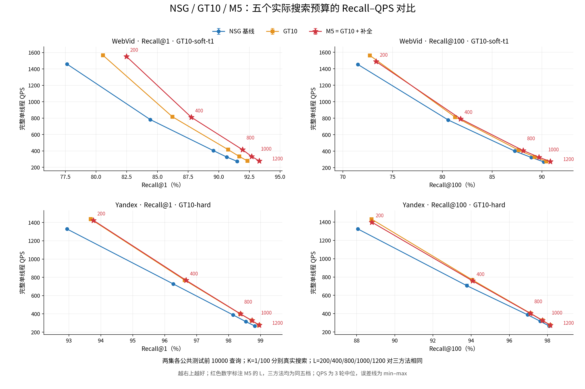

# GT10 与正在研究的 M5：方法和完整测试结果

**当前状态：M5 正在研究；E173 直接测试已完成，默认仍为 GT10。** WebVid 使用 GT10-soft-t1，Yandex 使用 GT10-hard。GT10 用真实近邻的 hub 归属监督训练查询侧画像，并通过小型 Micro-HNSW 路由到真实图入口。M5 复用该入口和原搜索结果，用训练时搜索遗漏构造的冻结小表补全输出；每行8个目标，在线3行合并最多24个候选，原度量重评分后返回TopK，不增加第二次图搜索。

## 最新测试结论

本轮已完成 **60 个实测点、180 批单线程正式计时**，每点全部 10000 条查询计算真实 Recall。**M5 正在研究**，结构为 GT10 入口路由与主搜索之后的冻结残差表补全。

相对 NSG，同 L 的 GT10 和 M5 在 20 个场景点的 Recall 与 QPS 中位数均更高。两者分别有 19/20 点的三轮配对速度均更高；GT 的 WebVid K100 L800、M5 的 WebVid K100 L1200 各有一轮速度低于 NSG，不能说每轮都提高。

相对 GT10，同 L 的 M5 在 20/20 点提高 Recall，真值近邻成员损伤为 0；配对 QPS 中位变化均为负，下降约 0.16%–4.85%。WebVid Recall@1 提高 0.97–1.92 个百分点，Recall@100 提高 0.4134–0.6308 个百分点；Yandex 分别提高 0.01–0.09、0.0042–0.0254 个百分点，增益很小。

WebVid Recall@1 有两个离散实测的综合优势：M5 L800 为 91.94%、414.37 QPS，GT L1000 为 91.66%、333.49 QPS；M5 L1000 为 92.68%、332.23 QPS，GT L1200 为 92.33%、278.59 QPS。按 QPS 中位数比，分别约快 24.25%、19.25%，三轮速度范围分离。其余三个数据集/K 场景没有这样的跨 L 实测优势；未据连线插值推导等 Recall 吞吐。

这次复测支持 M5 的 WebVid Recall@1 局部价值，尚未确立跨数据集、双 K 的稳定综合替代。继续保留 WebVid GT10-soft-t1、Yandex GT10-hard 默认；M5 标为正在研究。本轮没有新增训练、选择集筛选或按 test 调参。测试来自有历史曝光的公共窗口，不称新盲测。

## 图与阅读顺序

1. [简洁方法正文：GT10、M5与流程图](../../entry_method_exploration/20261009_nsg_gt_m5_test_v1/advisor_report/concise_v1/method_report.md)，[3页PDF](../../entry_method_exploration/20261009_nsg_gt_m5_test_v1/advisor_report/concise_v1/GT与M5方法说明.pdf)。
2. [完整实验报告与全部五档表](../../entry_method_exploration/20261009_nsg_gt_m5_test_v1/analysis_v2/report.md)。
3. [全部60点CSV](../../entry_method_exploration/20261009_nsg_gt_m5_test_v1/analysis_v2/metrics.csv)、[同L配对比较CSV](../../entry_method_exploration/20261009_nsg_gt_m5_test_v1/analysis_v2/comparisons.csv)、[完整JSON含三轮wall](../../entry_method_exploration/20261009_nsg_gt_m5_test_v1/analysis_v2/metrics.json)。
4. [按实际L查看Recall和QPS](../../entry_method_exploration/20261009_nsg_gt_m5_test_v1/figures_v2/recall_qps_vs_L_nsg_gt_m5.png)、[可打印曲线PDF](../../entry_method_exploration/20261009_nsg_gt_m5_test_v1/figures_v2/recall_qps_nsg_gt_m5.pdf)。
5. [测试协议](../../entry_method_exploration/20261009_nsg_gt_m5_test_v1/protocol_v2.md)、[M5冻结源码和范围](../../entry_method_exploration/20261009_nsg_gt_m5_test_v1/frozen_m5_source/README.md)、[实际在线测试调用](../../entry_method_exploration/20261009_nsg_gt_m5_test_v1/src/benchmark_v2.cpp)、[独立结果审查](../../entry_method_exploration/20261009_nsg_gt_m5_test_v1/final_result_review.json)。

## 测试范围与费用

两集各公共test前10000查询；Yandex为公共100K源的前10K。三个方法同原NSG图、raw-IP、scalar内核、CPU15单线程。K1/K100分别真实搜索，五档L200/400/800/1000/1200；60点各3轮，180批。QPS包括正常输出分配释放和入口、主搜索、M5全部补全成本；数据/模型加载、GT 真值评分和诊断计数在计时外。

全10K返回与Recall及M5独立线性合并核验完成，count/parity/NDC只覆盖事先固定均匀256查询。Native含加载和核验为WebVid44.90分钟、Yandex46.18分钟；本轮新增训练0。完整SHA预检160.77秒和弃用v1作业315.37秒单列，原历史完整训练超预算记录不回改。[本轮费用](../../entry_method_exploration/20261009_nsg_gt_m5_test_v1/delivery_costs.json)、[冻结输入身份](../../entry_method_exploration/20261009_nsg_gt_m5_test_v1/data_preflight.json)。

公开测试窗口有历史曝光，不能视为未见过的盲测。冻结FIT20K与本轮test字节重叠0；Web10K的9行重复按原窗口保留。没有候选筛选/选择集门，也没有在test上调参。曲线连线仅用于阅读；图上范围是三个完整timing轮的min–max，不是总体置信区间。

这是便于网页阅读的代码与聚合证据快照。大规模向量、图、冻结二进制模型和逐查询原始返回留本地；此公开快照不是独立可直接运行的全量实验包。[发布范围与身份](publication.md)、[逐文件清单](manifest.json)。此前[2026-10-06八方法快照](../20261006_results/README.md)保留历史身份。
